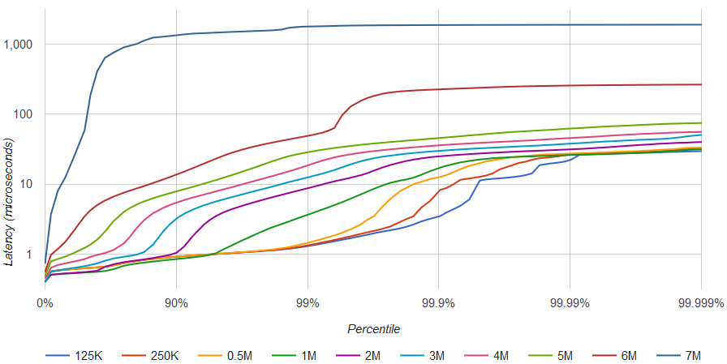

# exchange-core
[](https://www.javadoc.io/doc/exchange.core2/exchange-core)
[](https://github.com/exchange-core/exchange-core/actions/workflows/verify.yml)
[![][license img]][license]

Exchange-core is an **open source market exchange core** based on 
[LMAX Disruptor](https://github.com/LMAX-Exchange/disruptor), 
[Eclipse Collections](https://www.eclipse.org/collections/) (ex. Goldman Sachs GS Collections), 
[Real Logic Agrona](https://github.com/real-logic/agrona),
[OpenHFT Chronicle-Wire](https://github.com/OpenHFT/Chronicle-Wire),
[LZ4 Java](https://github.com/yawkat/lz4-java),
and [Adaptive Radix Trees](https://db.in.tum.de/~leis/papers/ART.pdf).

Exchange-core includes:
- orders matching engine
- risk control and accounting module
- disk journaling and snapshots module
- trading, admin and reports API

Applications embed exchange-core through its Java API and provide their own web UI if needed.

## Quick start

### Installation

**Published release (Java 8).** Add [exchange-core 0.5.3](https://central.sonatype.com/artifact/exchange.core2/exchange-core/0.5.3) to your application's `pom.xml`:

```xml
<dependency>
    <groupId>exchange.core2</groupId>
    <artifactId>exchange-core</artifactId>
    <version>0.5.3</version>
</dependency>
```

To run the [release example](https://github.com/exchange-core/exchange-core/blob/exchange-core-0.5.3/src/test/java/exchange/core2/tests/examples/ITCoreExample.java),
check out the `exchange-core-0.5.3` tag and run the command below using JDK 8.

**Development branch (Java 25 or newer).** Check out `master` and run the same command using JDK 25 or newer.
Both examples use Maven 3.6.3 or newer.

```sh
mvn -Pit "-Dtest=ITCoreExample#sampleTest" test
```

The example matches a sell order for 0.10 BTC at 154 LTC/BTC and prints `LTC fees collected: 26000` in
`target/surefire-reports/exchange.core2.tests.examples.ITCoreExample-output.txt`. To use `master` as a dependency, run
`mvn install` and set the dependency version to `0.5.4-SNAPSHOT`.

[Usage examples](#usage-examples) · [Snapshots and recovery](#snapshots-and-recovery) · [Contributing](CONTRIBUTING.md) · [Security](SECURITY.md)

## Performance

Designed for high scalability and pauseless 24/7 operation under high-load conditions and providing low-latency responses:
- 3M users having 10M accounts in total
- 100K order books (symbols) having 4M pending orders in total
- less than 1ms worst wire-to-wire target latency for 1M+ operations per second throughput
- 150ns per matching for large market orders

Single order book configuration is capable to process 5M operations per second on 10-years old hardware (Intel® Xeon® X5690) with moderate latency degradation:

|rate|50.0%|90.0%|95.0%|99.0%|99.9%|99.99%|worst|
|----|-----|-----|-----|-----|-----|------|-----|
|125K|0.6µs|0.9µs|1.0µs|1.4µs|4µs  |24µs  |41µs |
|250K|0.6µs|0.9µs|1.0µs|1.4µs|9µs  |27µs  |41µs |
|500K|0.6µs|0.9µs|1.0µs|1.6µs|14µs |29µs  |42µs |
|  1M|0.5µs|0.9µs|1.2µs|4µs  |22µs |31µs  |45µs |
|  2M|0.5µs|1.2µs|3.9µs|10µs |30µs |39µs  |60µs |
|  3M|0.7µs|3.6µs|6.2µs|15µs |36µs |45µs  |60µs |
|  4M|1.0µs|6.0µs|9µs  |25µs |45µs |55µs  |70µs |
|  5M|1.5µs|9.5µs|16µs |42µs |150µs|170µs |190µs|
|  6M|5µs  |30µs |45µs |300µs|500µs|520µs |540µs|
|  7M|60µs |1.3ms|1.5ms|1.8ms|1.9ms|1.9ms |1.9ms|



Benchmark configuration:
- Single symbol order book.
- 3,000,000 inbound messages are distributed as follows: 9% GTC orders, 3% IOC orders, 6% cancel commands, 82% move commands. About 6% of all messages are triggering one or more trades.
- 1,000 active user accounts.
- In average ~1,000 limit orders are active, placed in ~750 different price slots.
- Latency results are only for risk processing and orders matching. Other stuff like network interface latency, IPC, journaling is not included.
- Test data is not bursty, meaning constant interval between commands (0.2~8µs depending on target throughput).
- BBO prices are not changing significantly throughout the test. No avalanche orders.
- No coordinated omission effect for latency benchmark. Any processing delay affects measurements for next following messages.
- GC is triggered prior/after running every benchmark cycle (3,000,000 messages).
- RHEL 7.5, network-latency tuned-adm profile, dual X5690 6 cores 3.47GHz, one socket isolated and tickless, spectre/meltdown protection disabled.
- Java version 8u192, newer Java 8 versions can have a [performance bug](https://bugs.java.com/bugdatabase/view_bug.do?bug_id=JDK-8221355)

### Features
- HFT optimized. Priority is a limit-order-move operation mean latency (currently ~0.5µs). Cancel operation takes ~0.7µs, placing new order ~1.0µs;
- In-memory working state for accounting data and order books.
- Event-sourcing - disk journaling and journal replay support, state snapshots (serialization) and restore operations, LZ4 compression.
- Lock-free and contention-free orders matching and risk control algorithms.
- No floating-point arithmetic, no loss of significance is possible.
- Matching engine and risk control operations are atomic and deterministic.
- Pipelined multi-core processing (based on LMAX Disruptor): each CPU core is responsible for certain processing stage, user accounts shard, or symbol order books shard.
- Spot trading and futures margin trading.
- Maker/taker fees (defined in quote currency units).
- Two order books implementations: simple implementation ("Naive") and performance implementation ("Direct").
- Order types: Immediate-or-Cancel (`IOC`), Good-till-Cancel (`GTC`), Fill-or-Kill Budget (`FOK_BUDGET`).
- Testing - unit-tests, integration tests, stress tests, integrity/consistency tests.
- Low GC pressure, objects pooling, single ring-buffer.
- Thread affinity via `collections-affinity` on Linux and Windows. The latency and throughput presets pin processing threads in pipeline order using `-Daffinity.reserved=<hex mask>` or the Linux isolated CPU list. Enable native access with `--enable-native-access=ALL-UNNAMED`.
- User suspend/resume operation (reduces memory consumption).
- Core reports API (user balances, open interest).

## Usage examples

These examples use `master`. See [ITCoreExample.java](src/test/java/exchange/core2/tests/examples/ITCoreExample.java) for the complete test.

Create and start empty exchange core:
```java
// simple async events handler
SimpleEventsProcessor eventsProcessor = new SimpleEventsProcessor(new IEventsHandler() {
    @Override
    public void tradeEvent(TradeEvent tradeEvent) {
        System.out.println("Trade event: " + tradeEvent);
    }

    @Override
    public void reduceEvent(ReduceEvent reduceEvent) {
        System.out.println("Reduce event: " + reduceEvent);
    }

    @Override
    public void rejectEvent(RejectEvent rejectEvent) {
        System.out.println("Reject event: " + rejectEvent);
    }

    @Override
    public void commandResult(ApiCommandResult commandResult) {
        System.out.println("Command result: " + commandResult);
    }

    @Override
    public void orderBook(OrderBook orderBook) {
        System.out.println("OrderBook event: " + orderBook);
    }
});

// default exchange configuration
ExchangeConfiguration conf = ExchangeConfiguration.defaultBuilder().build();

// build exchange core
ExchangeCore exchangeCore = ExchangeCore.builder()
        .resultsConsumer(eventsProcessor)
        .exchangeConfiguration(conf)
        .build();

// start up disruptor threads
exchangeCore.startup();

// get exchange API for publishing commands
ExchangeApi api = exchangeCore.getApi();
```

By default, risk checks verify and reserve the required funds for spot orders and check available margin for futures orders.
`NO_RISK_PROCESSING` skips these checks on order placement after validating the user and symbol.
Keep a risk engine configured for user management and post-match accounting.

Create new symbol:
```java
// currency code constants
final int currencyCodeXbt = 11;
final int currencyCodeLtc = 15;

// symbol constants
final int symbolXbtLtc = 241;

// create symbol specification and publish it
CoreSymbolSpecification symbolSpecXbtLtc = CoreSymbolSpecification.builder()
        .symbolId(symbolXbtLtc)         // symbol id
        .type(SymbolType.CURRENCY_EXCHANGE_PAIR)
        .baseCurrency(currencyCodeXbt)    // base = satoshi (1E-8)
        .quoteCurrency(currencyCodeLtc)   // quote = litoshi (1E-8)
        .baseScaleK(1_000_000L) // 1 lot = 1M satoshi (0.01 BTC)
        .quoteScaleK(10_000L)   // 1 price step = 10K litoshi
        .takerFee(1900L)        // taker fee 1900 litoshi per 1 lot
        .makerFee(700L)         // maker fee 700 litoshi per 1 lot
        .build();

Future<CommandResultCode> future = api.submitBinaryDataAsync(new BatchAddSymbolsCommand(symbolSpecXbtLtc));
```

For spot symbols, `baseScaleK` is the lot size in base currency units. For `FUTURES_CONTRACT`, order size is a contract count,
and `marginBuy` and `marginSell` specify margin per contract in the contract currency (`quoteCurrency`).

Create new users. A user is identified by a `java.util.UUID`; any version works (random v4, time-ordered v7).
```java
UUID user1 = UUID.fromString("0f8fad5b-d9cb-469f-a165-70867728950e");
UUID user2 = UUID.fromString("7c9e6679-7425-40de-944b-e07fc1f90ae7");

// create first user
future = api.submitCommandAsync(ApiAddUser.builder()
        .uid(user1)
        .build());

// create second user
future = api.submitCommandAsync(ApiAddUser.builder()
        .uid(user2)
        .build());
```

Check the deposit result before reading the balance or using the funds.
```java
// first user deposits 20 LTC
future = api.submitCommandAsync(ApiAdjustUserBalance.builder()
        .uid(user1)
        .currency(currencyCodeLtc)
        .amount(2_000_000_000L)
        .transactionId(1L)
        .build());
CommandResultCode depositResult = future.get();
if (depositResult != CommandResultCode.SUCCESS) {
    throw new IllegalStateException("Deposit failed: " + depositResult);
}

// second user deposits 0.10 BTC
future = api.submitCommandAsync(ApiAdjustUserBalance.builder()
        .uid(user2)
        .currency(currencyCodeXbt)
        .amount(10_000_000L)
        .transactionId(2L)
        .build());
```

Both order books support three order types.

- `GTC` fills at the limit price or better and keeps any unfilled quantity on the book. Set `price` in price steps per lot.
- `IOC` fills immediately up to the available quantity at the limit price or better and cancels the remainder.
- `FOK_BUDGET` fills the entire quantity immediately or rejects it. Set `price` to the maximum total cost for a buy or
  the minimum total proceeds for a sell, before fees. The matcher compares this limit to the sum of `fillPrice * fillSize`.
  For spot buys, set `reservePrice` to the same limit.

```java
// the client picks order ids; any UUID works, a duplicate of a resting order is rejected
UUID order1 = UUID.randomUUID();
UUID order2 = UUID.randomUUID();

// first user places Good-till-Cancel Bid order
// he assumes BTCLTC exchange rate 154 LTC for 1 BTC
// bid price for 1 lot (0.01BTC) is 1.54 LTC => 1_5400_0000 litoshi => 10K * 15_400 (in price steps)
future = api.submitCommandAsync(ApiPlaceOrder.builder()
        .uid(user1)
        .orderId(order1)
        .price(15_400L)
        .reservePrice(15_600L) // can move bid order up to the 1.56 LTC, without replacing it
        .size(12L) // order size is 12 lots
        .action(OrderAction.BID)
        .orderType(OrderType.GTC) // Good-till-Cancel
        .symbol(symbolXbtLtc)
        .build());

// second user places Immediate-or-Cancel Ask (Sell) order
// he assumes worst rate to sell 152.5 LTC for 1 BTC
future = api.submitCommandAsync(ApiPlaceOrder.builder()
        .uid(user2)
        .orderId(order2)
        .price(15_250L)
        .size(10L) // order size is 10 lots
        .action(OrderAction.ASK)
        .orderType(OrderType.IOC) // Immediate-or-Cancel
        .symbol(symbolXbtLtc)
        .build());
```

Check the `CommandResultCode` returned by `submitCommandAsync` for command failures, and handle unfilled quantities reported through `IEventsHandler.rejectEvent`.
The core logs unhandled processing exceptions and initiates shutdown.

Request order book:
```java
Future<L2MarketData> orderBook = api.requestOrderBookAsync(symbolXbtLtc, 10);
```

GtC orders manipulations:
```java
// first user moves remaining order to price 1.53 LTC
future = api.submitCommandAsync(ApiMoveOrder.builder()
        .uid(user1)
        .orderId(order1)
        .newPrice(15_300L)
        .symbol(symbolXbtLtc)
        .build());
        
// first user cancel remaining order
future = api.submitCommandAsync(ApiCancelOrder.builder()
        .uid(user1)
        .orderId(order1)
        .symbol(symbolXbtLtc)
        .build());
```

Query user balances and open orders. After a successful report, read the account map by currency ID.
```java
SingleUserReportResult report = api.processReport(new SingleUserReportQuery(user1), 0).get();
if (report.getQueryExecutionStatus() == SingleUserReportResult.QueryExecutionStatus.OK) {
    long ltcBalance = report.getAccounts().get(currencyCodeLtc);
    System.out.println("Available LTC balance in litoshi: " + ltcBalance);
}
```

Check system balance:
```java
// check fees collected
Future<TotalCurrencyBalanceReportResult> totalsReport = api.processReport(new TotalCurrencyBalanceReportQuery(), 0);
System.out.println("LTC fees collected: " + totalsReport.get().getFees().get(currencyCodeLtc));
```

## Snapshots and recovery

With `SerializationConfiguration.DISK_JOURNALING`, schedule snapshots in your application.
Submit `ApiPersistState.builder().dumpId(snapshotId).build()` with a unique, nonzero ID and check for `CommandResultCode.SUCCESS`.

The journal writes batches to disk. A command result can arrive while the command is still in the journal buffer,
so an abrupt stop can lose buffered commands, including commands that returned `SUCCESS`. A normal
`ExchangeCore.shutdown()` flushes the pending journal buffer.

To recover, use the same exchange ID and storage directory. Set `initStateCfg` to
`InitialStateConfiguration.lastKnownStateFromJournal(exchangeId, snapshotId, baseSeq)` to restore that snapshot and replay its journal.
For `baseSeq`, add the previous run's configured base sequence (zero on a clean start) to `seq` from the `RE` entry for that snapshot
in `<exchangeId>.eca`.

Keep a complete snapshot and its journal partitions together. Replay stops at a missing partition, and
corrupted files can prevent startup. Verify balances and open orders before resuming trading, and test
recovery on a copy of the data before changing engine versions.

### Testing

When embedding `master`, use the test JVM options in [pom.xml](pom.xml) as a reference for native access and module flags.

- `mvn test` runs unit tests and Cucumber scenarios. Cucumber HTML reports are in `target/cucumber`.
- `mvn -Pit test` runs the integration suite. Dedicated stress tests and benchmarks run separately.
- Select a stress test or benchmark explicitly with `-Dtest`.
  - `mvn "-Dtest=ITExchangeCoreIntegrationStressBasic" test`
  - `mvn "-Dtest=PerfLatency#testLatencyMargin" test`
  - `mvn "-Dtest=PerfThroughput#testThroughputMargin" test`
  - `mvn "-Dtest=PerfHiccups#testHiccupMargin" test`
  - `mvn "-Dtest=PerfPersistence#testPersistenceMargin" test`

### TODOs
- market data feeds (full order log, L2 market data, BBO, trades)
- clearing and settlement
- reporting
- clustering
- FIX and REST API gateways
- cryptocurrency payment gateway
- more tests and benchmarks
- NUMA-aware and CPU layout custom configuration

### Contributing
See [CONTRIBUTING.md](CONTRIBUTING.md) for local checks and pull request guidance.

### Support
- [Discussion group in Telegram (t.me/exchangecoretalks)](https://t.me/exchangecoretalks)
- [News channel in Telegram (t.me/exchangecore)](https://t.me/exchangecore)

[license]:LICENSE.txt
[license img]:https://img.shields.io/badge/License-Apache%202-blue.svg
