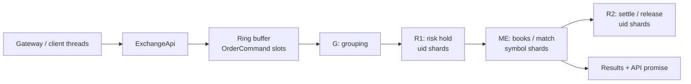

# How exchange-core works

A single narrative from first principles through the full command surface, with a code-level walkthrough of place → match → settle. This document is the long-form onboarding path. Start with [§2 In simple terms](#2-in-simple-terms) if you want the plain-language picture first; later sections add structure, then code. The detailed, flow-oriented references live under [`docs/java-flows/`](java-flows/README.md) (Java) and [`docs/zig-flows/`](zig-flows/README.md) (Zig port).

| Role | Document |
|---|---|
| **This file** | Simple explanation, mental model, end-to-end story, code-level place path, Zig map |
| [java-flows README](java-flows/README.md) | Index of Java flow guides and shortest mental model |
| [01 Architecture and lifecycle](java-flows/01-architecture-and-lifecycle.md) | Construction, Disruptor graph, sharding, groups, startup/shutdown |
| [02 Command processing](java-flows/02-command-processing.md) | API publication, routing matrix, admin commands, results |
| [03 Matching and risk](java-flows/03-matching-and-risk.md) | Order types, price-time match, R1 holds, R2 settlement, cancel/reduce/move |
| [04 Reports and persistence](java-flows/04-reports-and-persistence.md) | Reports, binary fan-out, snapshots, journal, recovery |
| [05 Source reading map](java-flows/05-source-reading-map.md) | File/package route and debugger walkthroughs |
| [zig-flows README](zig-flows/README.md) | Index of Zig flow guides (same chapter structure as java-flows) |
| [01 Architecture and lifecycle (Zig)](zig-flows/01-architecture-and-lifecycle.md) | Kernel, runtime, sharded pipeline, grouping, startup/shutdown |
| [02 Command processing (Zig)](zig-flows/02-command-processing.md) | API publication, routing matrix, binary frames, results |
| [03 Matching and risk (Zig)](zig-flows/03-matching-and-risk.md) | Order types, books, R1 holds, R2 prepare/commit, cancel/reduce/move |
| [04 Reports and persistence (Zig)](zig-flows/04-reports-and-persistence.md) | Reports, XCM2/XCJ3, journal, recovery, Java conversion |
| [05 Source reading map (Zig)](zig-flows/05-source-reading-map.md) | Module route, demos, and walkthroughs |
| [src/zig/README.md](../src/zig/README.md) | Zig port status, orchestration, parity evidence |
| [src/zig/USAGE_EXAMPLES.md](../src/zig/USAGE_EXAMPLES.md) | TCP demo and integration examples |

**Suggested reading order:**

1. [§2 In simple terms](#2-in-simple-terms) — plain-language picture  
2. [§3 Shortest mental model](#3-shortest-mental-model) — stage names for the same idea  
3. The rest of this document once end-to-end  
4. Each `java-flows/0N-*.md` or `zig-flows/0N-*.md` when you need depth on that implementation

---

## 1. What it is

**exchange-core** is an open-source **market exchange core**: in-memory matching, risk/accounting, optional disk journaling and snapshots, and a trading/admin/report API.

It is **not** a full exchange product. There is no FIX gateway, REST API, auth service, or market-data bus in the core. Production systems are expected to translate their protocols into the in-process API.

Design goals (from the project README):

- High throughput and low latency under multi-million ops/s style load
- Deterministic, atomic risk + matching
- Integer arithmetic only (no floating point in the core)
- Lock-free / contention-free pipeline via a single ring buffer and sharded processors
- Event-sourcing: journal + snapshots for recovery

There are two implementations of the same design:

| | Location | Notes |
|---|---|---|
| **Java (original)** | `src/main/java/exchange/core2/core/` | LMAX Disruptor pipeline; canonical flow docs describe this |
| **Zig (port)** | `src/zig/core/` | Same responsibilities and parity targets; native/sharded orchestration |

Unless noted, paths below refer to **Java**. Zig twins use snake_case names and live under `src/zig/core/`.

---

## 2. In simple terms

This section is the plain-language explanation. No stage codes required yet.

### One sentence

> Commands go into a single queue. They pass through **hold funds → match orders → settle trades**, then you get a result.

```text
Client  →  API  →  Queue  →  Hold money  →  Match book  →  Finalize money  →  Result
```

### What problem it solves

An exchange has two hard jobs that must stay consistent:

1. **Accounting** — users have balances; you must not spend money they do not have.
2. **Matching** — buy and sell orders meet on a book at a price, in a fair order.

If you match first and check money later, you can over-trade. If you check money while earlier matches are still settling, later orders can “see” stale balances.

exchange-core’s answer: a **fixed pipeline** with two risk steps around matching — reserve first, match second, settle third.

### Everyday analogy (conveyor belt)

Think of a **conveyor belt of trading tickets**:

1. **Ticket window (API)** accepts “buy / sell / cancel / deposit” tickets.
2. **Cashier (risk hold)** stamps “paid in advance” and sets money aside.
3. **Trading pit (matching)** finds counterparties and writes what happened.
4. **Back office (risk settle)** adjusts wallets to match the pit’s record.
5. **You** get the stamped ticket back as a result.

Everything is **deterministic**, **integer-math only**, and **in-memory** for speed. Gateways, auth, market-data distribution, and external databases sit **outside** this core.

### Key pieces (plain names)

| Piece | Role |
|---|---|
| **Public API** | In-process calls: place/cancel/move order, add user, adjust balance, reports |
| **Queue (ring buffer)** | One high-speed ordered log of commands. Everyone sees the same sequence |
| **Command object** | One reusable ticket that carries input *and* output as it moves along the belt |
| **Risk (users & money)** | Owns balances; sharded by user id |
| **Matching (books)** | Owns order books; sharded by symbol |
| **Batch boundary (event group)** | Small batch so settlement of earlier work finishes before later money checks for the same users |

### What happens when you place an order

Imagine Alice places a **buy** of 1 BTC at $50,000 (numbers are illustrative).

**1. Publish** — Your code calls “place order” on the API. That becomes a command on the queue.

**2. Batching** — Commands are grouped into small batches. Batches are the consistency boundary for accounting.

**3. Hold (risk before matching)** — Alice’s risk shard:

- checks she exists and the symbol is valid  
- calculates max possible cost (including fees)  
- **holds** that amount on her account  

If she cannot afford it → reject; the book never changes.  
If she can → mark the order valid for matching.

**4. Matching** — The book for that symbol:

- walks the best opposite side (best price first, then first-come within a price)  
- records **trades** when it hits resting orders  
- for leftover volume:  
  - **GTC** → rest the remainder on the book  
  - **IOC** → reject the remainder (do not rest)  
  - **FOK budget** → all-or-nothing within a total budget  

Matching uses **only integers** (no floating point). Price and size are scaled units defined per symbol.

**5. Settle (risk after matching)** — Risk reads the trade/reject/reduce record and **finalizes money**:

- transfer base/quote between buyers and sellers  
- charge maker/taker fees  
- release unused holds  

**6. Result** — Your callback or future completes with a result code and the event chain (trades, reduces, rejects).

**Subtlety worth remembering:** for normal orders, the async result can finish after **matching**, while final wallet settlement for that batch may still be catching up. For “what is my balance right now after that trade,” use a **report** that forces a batch boundary first.

### Order types in one glance

| Type | Behavior |
|---|---|
| **GTC** | Match now; rest what’s left |
| **IOC** | Match now; cancel/reject the rest |
| **FOK budget** | Fill full size only if total cost fits budget; else reject all |

Cancel / reduce / move are separate commands: matching removes or rematches the resting order; settlement returns or adjusts the hold.

### How it scales across cores (sharding)

- **Risk shards** partition by **user id** (who owns this wallet).  
- **Matching shards** partition by **symbol** (who owns this book).  

Every command is still seen by the pipeline (one shared ordered log), but only the **owner** mutates that user’s balances or that symbol’s book. That keeps things lock-free and deterministic.

Default config can be tiny (1 risk + 1 matching). Faster configs use more shards and a faster order-book implementation.

### How state survives restart (optional)

1. **Snapshots** — dump risk and matching state to disk  
2. **Journal** — append every command after batching  
3. **Replay** — load snapshot, then re-apply journal commands  

The core is **event-sourced**: the command log is the source of truth for recovery.

### Where things live (for later reading)

| Area | Path |
|---|---|
| Java original | `src/main/java/exchange/core2/core/` |
| Flow reference docs | `docs/java-flows/` |
| Zig port | `src/zig/core/` |
| TCP / browser demos | `src/zig/apps/` |

### Mental picture for newcomers

Same idea as the conveyor belt, one line:

**Ticket window → cashier holds cash → pit matches → back office settles → you get the result.**

When you are ready for stage names (`R1`, `ME`, `R2`) and file-level detail, continue with [§3](#3-shortest-mental-model) and the rest of this document.

---

## 3. Shortest mental model

Same story as §2, with the names used in code and in `java-flows/`.

```text
Client  →  ExchangeApi  →  Ring buffer (OrderCommand)  →  G → R1 → ME → R2
                                                              │
                                                              └→ Results (+ optional journal)
```

| Stage | Name | Job | Simple name (§2) |
|---|---|---|---|
| **API** | `ExchangeApi` | Translate public calls into ring slots; complete async callbacks by sequence | Ticket window |
| **G** | Grouping | Assign `eventsGroup` (accounting batch boundary); clear stale events | Batching |
| **R1** | Risk pre-process | Validate user/symbol; **hold** funds or pending margin (sharded by uid) | Cashier / hold |
| **ME** | Matching | Mutate order books; attach TRADE / REDUCE / REJECT events (sharded by symbol) | Trading pit |
| **R2** | Risk release | Consume matcher events; **settle** balances, fees, positions (sharded by uid) | Back office |
| **E** | Results | Invoke results consumer; complete API promises | Return the ticket |

Simplified diagram (full graph in [01 Architecture](java-flows/01-architecture-and-lifecycle.md#processor-graph)):



Important subtleties (do not skip these when reading code):

1. **Journaling (J)** runs beside R1 when enabled; results wait for matching **and** journal, not necessarily for R2.
2. **R2 is gated by event groups.** When R1 crosses into group *k+1*, it first drives R2 through group *k* for that risk shard so later holds see settled balances.
3. All shards **observe** every command; only the **owning** shard mutates partitioned state.

Canonical detail: [java-flows README](java-flows/README.md) and [01 Architecture](java-flows/01-architecture-and-lifecycle.md).

---

## 4. Vocabulary

| Term | Meaning |
|---|---|
| **Taker / active order** | Incoming or moved order that initiates matching |
| **Maker / matched order** | Resting GTC order consumed by the taker |
| **R1** | Pre-matching risk: validate + reserve |
| **ME** | Matching engine: book mutation + event chain |
| **R2** | Post-matching risk: settle from event chain |
| **Event group** | Bounded batch; R1 of group *k+1* waits for R2 of group *k* on that risk shard |
| **OrderCommand** | Reusable ring-slot object carrying input, intermediate state, and output |
| **MatcherTradeEvent** | Linked-list node: TRADE, REDUCE, REJECT, or BINARY_EVENT |
| **Binary command** | LZ4 multi-frame admin/report payload split across ring slots |
| **Reserve bid price** | Max quote price used to size a BID hold; also caps bid move |

Full glossary: [java-flows README — Important vocabulary](java-flows/README.md#important-vocabulary).

---

## 5. State ownership

| State | Owner | Partition |
|---|---|---|
| Ring slots + async promises | `ExchangeApi` | Disruptor sequence |
| `eventsGroup`, L2 service flags | `GroupingProcessor` | Global sequence |
| Users, accounts, positions, fees, adjustments | `RiskEngine` | `uid & (riskShards - 1)` |
| Symbol specs for risk | `SymbolSpecificationProvider` | Copied to every risk shard |
| Order books + open orders | `MatchingEngineRouter` → `IOrderBook` | `symbol & (matchingShards - 1)` |
| Binary reassembly | `BinaryCommandsProcessor` | Per risk and matching shard |
| Snapshots + journal | `ISerializationProcessor` | Per module type + shard |

Shard counts must be powers of two (mask instead of modulus).

Canonical table: [java-flows README — State ownership](java-flows/README.md#state-ownership).

---

## 6. Lifecycle: build, start, stop

**Composition root:** `ExchangeCore` builder takes a results consumer and `ExchangeConfiguration`. Construction creates the ring, `ExchangeApi`, every risk/matching shard, and the Disruptor dependency graph.

```text
build()
  → create Disruptor + ring
  → create serialization processor
  → load empty or snapshot state for each RE/ME shard
  → wire G, [J], R1…, ME…, R2…, E
  → pair each R1 master with its R2 slave

startup()
  → start Disruptor threads
  → optional journal replay through low-level ExchangeApi
  → enable live journaling

shutdown(timeout)
  → publish SHUTDOWN_SIGNAL
  → drain graph; journal flush if enabled
  → disruptor.shutdown
```

Default config is deliberately small: 1 risk + 1 matching, naive order book, blocking wait, no persistence. Latency/throughput configs switch to the direct book, busy-spin, affinity, and more shards.

Canonical detail: [01 Architecture and lifecycle](java-flows/01-architecture-and-lifecycle.md).

---

## 7. The OrderCommand object

Every operation is one `OrderCommand` in the ring (`common/cmd/OrderCommand.java`). Stages enrich it in place:

| Phase | Important fields |
|---|---|
| Publication | `command`, order/user/symbol fields, `price`/`size`/`action`/`orderType`, `timestamp`, `resultCode = NEW` |
| Grouping | `eventsGroup`, `serviceFlags`; clear old `matcherEvent` / `marketData` |
| R1 | Placement may become `VALID_FOR_MATCHING_ENGINE` or a risk error |
| Matching | Final matching code; linked `matcherEvent` chain; optional `marketData` |
| R2 | Interprets events into balances (normally does not rewrite command fields) |
| Results | Consumer + API promise see the enriched slot |

Place-specific inputs:

| Field | Role |
|---|---|
| `price` | Limit price (budget price for FOK_BUDGET) |
| `reserveBidPrice` | Max bid hold price; must be ≥ limit for normal BIDs |
| `size` | Lots |
| `action` | BID or ASK |
| `orderType` | GTC / IOC / FOK_BUDGET (others currently unsupported) |
| `matcherEvent` | Head of TRADE/REDUCE/REJECT chain after matching |

Canonical detail: [02 Command processing — One command object](java-flows/02-command-processing.md#one-command-object-carries-input-intermediate-state-and-output).

---

## 8. How a command enters the core

High-level API methods (e.g. `placeNewOrder`) claim a ring sequence, fill the slot, optionally store a `Consumer` in `promises[seq]`, and publish.

```text
Client → ExchangeApi.placeNewOrder(...)
       → ringBuffer.next() / get(seq) / publish(seq)
       → promises.put(seq, callback)
```

The Disruptor sequence is the correlation key. Fire-and-forget paths skip the promise map. Full-response helpers expose the mutable ring object — copy what you need before the slot wraps.

After matching (+ journal if enabled), the results stage:

```text
ResultsHandler.onEvent(cmd, seq)
ExchangeApi.processResult(seq, cmd)  → complete / remove promise
```

Async futures can complete **after matching** while R2 for that group is still pending. Commands that need a settled view force a group boundary (reports, binary final frames).

Canonical detail: [02 Command processing](java-flows/02-command-processing.md).

---

## 9. Event groups and why R1/R2 are paired

Without grouping, a later order for the same user can pass R1 before earlier trades have settled that user's balances.

```text
Group k:   R1 holds → ME matches → (later) R2 settles
Group k+1: R1 does not start until this risk shard's R2 finished group k
```

`TwoStepMasterProcessor` (R1) at a new group boundary:

1. Publishes R1 progress for the previous group (ME may process it)
2. Synchronously runs the paired `TwoStepSlaveProcessor` (R2) through the previous group
3. Then begins R1 for the new group

Groups close when:

- `msgsInGroupLimit` commands accumulate, or
- `maxGroupDurationNs` elapses while idle, or
- hard boundary (reset, matching snapshot, grouping control, final binary frame with `symbol == -1`)

Canonical detail: [01 Architecture — Why R1 and R2 are paired](java-flows/01-architecture-and-lifecycle.md#why-r1-and-r2-are-paired) and [How event groups are formed](java-flows/01-architecture-and-lifecycle.md#how-event-groups-are-formed).

---

## 10. Command routing matrix (who does what)

| Command | R1 | ME | R2 |
|---|---|---|---|
| `PLACE_ORDER` | Own user: validate + hold | Own symbol: match/rest if valid | Settle TRADE; release REJECT; margin updates |
| `MOVE_ORDER` | No new hold | Rematch at new price | Settle any trades |
| `CANCEL_ORDER` | No action | Remove order → REDUCE | Return hold/margin |
| `REDUCE_ORDER` | No action | Reduce size → REDUCE | Return released portion |
| `ORDER_BOOK_REQUEST` | No action | Attach L2 snapshot | May refresh last-price cache |
| `ADD_USER` | Create profile | Ignore | No action |
| `BALANCE_ADJUSTMENT` | Deposit/withdraw + tx id | Ignore | No action |
| `SUSPEND_USER` / `RESUME_USER` | Lifecycle | Ignore | No action |
| `BINARY_DATA_COMMAND` / `QUERY` | All risk shards reassemble/apply | All ME shards reassemble/apply | Binary events ignored by settlement |
| `PERSIST_STATE_MATCHING` / `RISK` | Force publish / store RE | Store ME | — |
| `RESET` | Clear risk state | Clear books | No matcher events |
| `NOP` | — | Shard 0 SUCCESS | — |
| `SHUTDOWN_SIGNAL` | Pass-through | Pass-through | Drain terminal sequence |

Full matrix and notes: [02 Command processing — Command routing matrix](java-flows/02-command-processing.md#command-routing-matrix).

---

## 11. Part 1 narrative: place → match → settle (with numbers)

Concrete story used throughout this doc and the Zig TCP demo:

| Item | Value |
|---|---|
| Symbol | `241` (currency exchange pair) |
| Base / quote currencies | `11` / `15` |
| Alice | uid `1001` (buyer) |
| Bob | uid `1002` (seller) |

### 10.1 Alice places BID GTC on empty book

1. API publishes `PLACE_ORDER` for Alice.
2. **R1:** hold max quote cost (including taker fee) from Alice’s free balance.
3. **ME:** no acceptable asks → rest order on bid book.
4. **R2:** no events → hold remains.
5. Result: `SUCCESS`, order live; money reserved, not spent.

### 10.2 Bob places ASK GTC that crosses Alice

1. API publishes `PLACE_ORDER` for Bob.
2. **R1:** hold base amount from Bob.
3. **ME:** match Alice’s bid at maker price; emit TRADE; both fully fill; nothing rests.
4. **R2:** both risk shards scan the chain; Alice’s shard credits base / adjusts quote hold; Bob’s shard credits quote proceeds − fees; fee counters update.
5. Result: `SUCCESS` + TRADE event(s).

Conceptual balance arc (fees/scales omitted for shape only):

| | Alice free quote | Alice base | Bob free base | Bob quote |
|---|---:|---:|---:|---:|
| After deposit | large | 0 | large | 0 |
| After Alice place | reduced + hold | 0 | large | 0 |
| After trade | reduced | +filled | reduced | +proceeds |

Arithmetic and fee detail: [03 Matching and risk](java-flows/03-matching-and-risk.md).

---

## 12. Code-level Part 1: place → match → settle

This section names the real Java methods. Executable parallel: [05 Source reading map — Walkthrough 2](java-flows/05-source-reading-map.md#walkthrough-2-one-gtc-order-crossing-the-book) and `ITCoreExample`.

### 11.1 Call stack (full fill)

```text
ExchangeApi.placeNewOrder
  └─ RingBuffer publish OrderCommand { PLACE_ORDER, NEW, ... }

GroupingProcessor
  └─ cmd.eventsGroup = k

TwoStepMasterProcessor → RiskEngine.preProcessCommand          // R1
  └─ placeOrderRiskCheck
       └─ placeOrder
            └─ placeExchangeOrder   // CURRENCY_EXCHANGE_PAIR
                 └─ accounts.addToValue(currency, -hold)
                 └─ resultCode = VALID_FOR_MATCHING_ENGINE

MatchingEngineRouter.processOrder                              // ME
  └─ processMatchingCommand
       └─ IOrderBook.processCommand
            └─ OrderBookNaiveImpl.newOrder   // or Direct
                 └─ newOrderPlaceGtc
                      └─ tryMatchInstantly
                           └─ OrdersBucketNaive.match
                                └─ OrderBookEventsHelper.sendTradeEvent
                      └─ maybe rest remainder
            └─ resultCode = SUCCESS

TwoStepSlaveProcessor → RiskEngine.handlerRiskRelease          // R2
  └─ handleMatcherEventsExchangeSell  // or Buy
       └─ taker + maker account updates, fees

ResultsHandler + ExchangeApi.processResult
  └─ callback.accept(cmd)
```

### 11.2 Stage 0 — Publish

**File:** `ExchangeApi.java`  
**Method:** `placeNewOrder(...)`

- `cmd.command = PLACE_ORDER`, `resultCode = NEW`
- Fills `price`, `reserveBidPrice`, `size`, `action`, `orderType`, `symbol`, `uid`
- High-level API often sets `orderId = seq`
- `promises.put(seq, callback)` then `publish(seq)`

Low-level overload restores `serviceFlags` / `eventsGroup` / explicit `orderId` for journal replay.

### 11.3 Stage 1 — R1 hold

**Wiring:** `ExchangeCore` attaches `TwoStepMasterProcessor` with `riskEngine::preProcessCommand`.

**Dispatch** (`RiskEngine.preProcessCommand`):

```text
case PLACE_ORDER:
  if (uidForThisHandler(cmd.uid))
    cmd.resultCode = placeOrderRiskCheck(cmd);
```

Ownership: `(uid & shardMask) == shardId`.

**`placeOrderRiskCheck`:**

1. Resolve `UserProfile` → else `AUTH_INVALID_USER`
2. Resolve `CoreSymbolSpecification` → else `INVALID_SYMBOL`
3. Optional skip if `cfgIgnoreRiskProcessing` → `VALID_FOR_MATCHING_ENGINE`
4. `placeOrder` → on failure many paths collapse to `RISK_NSF`

**`placeExchangeOrder` (spot):**

```text
currency = BID ? quoteCurrency : baseCurrency

BID:
  require reserveBidPrice >= price (or == for budget types)
  hold = calculateAmountBidTakerFee(size, reserveBidPrice, spec)
       = size * (reserveBidPrice * quoteScaleK + takerFee)

ASK:
  require price * quoteScaleK >= takerFee
  hold = calculateAmountAsk(size, spec)
       = size * baseScaleK

speculative: accounts.addToValue(currency, -hold)
if newBalance + freeFuturesMargin < 0 → revert → RISK_NSF
else VALID_FOR_MATCHING_ENGINE
```

Helpers: `utils/CoreArithmeticUtils.java`.

Futures path uses `canPlaceMarginOrder` + `position.pendingHold` instead of cash hold ([03 Matching and risk — Futures](java-flows/03-matching-and-risk.md#futuresmargin-flow)).

### 11.4 Stage 2 — Matching

**Wiring:** after all R1 masters → `MatchingEngineRouter::processOrder`.

**Filter:** only if `symbolForThisHandler(cmd.symbol)`.

**Gate** (`IOrderBook.processCommand`):

```text
PLACE_ORDER:
  if resultCode == VALID_FOR_MATCHING_ENGINE:
    orderBook.newOrder(cmd)
    return SUCCESS
  else:
    return resultCode   // preserve R1 rejection; no book mutation
```

**Naive book GTC** (`OrderBookNaiveImpl.newOrderPlaceGtc`):

1. `filled = tryMatchInstantly(cmd, subtreeForMatching(action, price), ...)`
2. If fully filled → return (nothing rests)
3. If duplicate `orderId` → `attachRejectEvent` for remainder
4. Else create `Order` with `reserveBidPrice`, put in price bucket, index in `idMap`

**Opposite-side window** (`subtreeForMatching`):

- ASK walks bid buckets with price ≥ limit (`headMap` on bid tree)
- BID walks ask buckets with price ≤ limit

**Bucket match** (`OrdersBucketNaive.match`): FIFO within price; for each fill:

```text
sendTradeEvent(maker, makerCompleted, takerCompleted, size, bidderHoldPrice)
  eventType = TRADE
  price = maker price
  matchedOrderId / matchedOrderUid = maker
  bidderHoldPrice = resting bid's reserve, or active bid's reserve if maker is ask
```

Events are linked onto `cmd.matcherEvent`.

**IOC:** match then `attachRejectEvent` for unfilled size (never rests).  
**FOK_BUDGET:** pre-scan budget; full match or full reject.

### 11.5 Stage 3 — R2 settlement

**Wiring:** after ME → `TwoStepSlaveProcessor` with `riskEngine::handlerRiskRelease`. Driven at group boundaries from R1 masters.

**`handlerRiskRelease`:**

- Skip if no useful events / only BINARY_EVENT
- Load symbol spec
- Resolve taker profile only if this shard owns `cmd.uid`
- Handle leading REJECT/REDUCE via `handleMatcherRejectReduceEventExchange`
- TRADE chain:
  - taker SELL → `handleMatcherEventsExchangeSell`
  - taker BUY → `handleMatcherEventsExchangeBuy`
- Every R2 shard scans the same chain; makers updated when `uidForThisHandler(matchedOrderUid)`

**Sell-taker settlement (Bob crosses Alice):**

```text
For each TRADE:
  taker aggregates size and size*price
  if this shard owns maker (Alice):
    release unused bid hold:
      priceDiff = bidderHoldPrice - tradePrice
      + calculateAmountBidReleaseCorrMaker (includes taker→maker fee correction)
    credit base = calculateAmountAsk(size, spec)

After loop:
  taker quote += sizePrice * quoteScaleK - takerFee * size
  fees[quote] += takerFee * takerSize + makerFee * makerSize
```

**Buy-taker settlement** refunds unspent portion of bid hold and credits base; makers receive quote − makerFee.

**Reject/reduce release:** credit back base (ask) or quote+fee hold (bid) for `ev.size`.

### 11.6 Stage 4 — Results

```text
ResultsHandler.onEvent
ExchangeApi.processResult(seq, cmd)
```

Not gated on R2 completion for ordinary places.

### 11.7 Rejection matrix for PLACE_ORDER

| Stage | Condition | Typical result | Book | Money |
|---|---|---|---|---|
| R1 | Unknown user | `AUTH_INVALID_USER` | no | no |
| R1 | Unknown symbol | `INVALID_SYMBOL` | no | no |
| R1 | NSF / bad reserve / fee | often `RISK_NSF` | no | hold reverted |
| ME | No book | `MATCHING_INVALID_ORDER_BOOK_ID` | no | hold may still exist |
| ME | R1 failed | preserves R1 code | no | — |
| ME | IOC leftover / FOK fail / dup id | `SUCCESS` + REJECT event | partial | R2 releases reject size |

Matching **SUCCESS can coexist with REJECT events** — always inspect the event chain.

### 11.8 What mutates where

| State | Mutator |
|---|---|
| Free balances (hold/settle) | R1 / R2 of risk owner |
| Order books + order id index | ME of symbol owner |
| `cmd.resultCode`, `cmd.matcherEvent` | R1 then ME |
| Fee counters | R2 |
| API promises | publish + results stage |

---

## 13. Order types

| Type | Match now | Rest remainder | Notes |
|---|---|---|---|
| **GTC** | yes | yes | Default resting |
| **IOC** | yes | no (REJECT) | Take what you can |
| **FOK_BUDGET** | only if full size fits budget | no | Pre-scan; all or nothing |
| FOK / IOC_BUDGET in enum | — | — | Currently unsupported → full reject |

Price-time priority: best price first; FIFO within a price level. Trades execute at the **maker’s** resting price.

Canonical detail: [03 Matching and risk — Supported order behavior](java-flows/03-matching-and-risk.md#supported-order-behavior).

---

## 14. Cancel, reduce, move

### Cancel

```text
API → CANCEL_ORDER
R1: no new hold
ME: verify orderId+uid, remove remaining size, emit REDUCE
R2: return held funds / pending margin for that size
```

### Reduce

Same as cancel but capped at requested size; partial reduce keeps remainder at same price/priority.

### Move

```text
API → MOVE_ORDER (new price)
R1: no new hold
ME: remove from old price → rematch as active → rest remainder at new price (new queue priority)
R2: settle any trades from the move
```

**Sharp edge:** in exchange mode a BID cannot move above its original `reserveBidPrice` because R1 does not re-hold for moves. That is why place carries a separate reserve price.

Canonical detail: [03 Matching and risk — Cancel, reduce, and move](java-flows/03-matching-and-risk.md#cancel-reduce-and-move).

---

## 15. Users and balances (admin)

| Command | Behavior |
|---|---|
| `ADD_USER` | Create empty active profile (accounts map, positions, adjustments counter) |
| `BALANCE_ADJUSTMENT` | Deposit/withdraw; `orderId` = tx id; `symbol` = currency; `price` = amount |
| `SUSPEND_USER` | Only if zero balances and empty positions |
| `RESUME_USER` | Activate suspended placeholder or create empty profile |

Balance adjustment tx rules:

- equal to last id → already applied  
- lower than last → stale  
- withdraw would go negative → NSF  
- else apply and bump counter  

Risk tracks opposite of adjustments/suspends for the global balance invariant used in reports.

Canonical detail: [02 Command processing — User and balance administration](java-flows/02-command-processing.md#user-and-balance-administration).

---

## 16. Integer units and symbol rules

All core math uses `long` and `CoreSymbolSpecification`:

| Field | Meaning |
|---|---|
| `baseScaleK` | Base units in one lot |
| `quoteScaleK` | Quote units per price step per lot |
| `price` | Integer price steps |
| `size` | Integer lots |
| `makerFee` / `takerFee` | Quote units per lot |
| `marginBuy` / `marginSell` | Futures margin per lot |

```text
base amount              = size * baseScaleK
quote amount             = size * price * quoteScaleK
bid hold with taker fee  = size * (reservePrice * quoteScaleK + takerFee)
budget bid hold          = budgetSteps * quoteScaleK + size * takerFee
```

Canonical detail: [03 Matching and risk — Integer units](java-flows/03-matching-and-risk.md#integer-units-and-symbol-rules).

---

## 17. Futures / margin mode

Two symbol types:

| Mode | Settlement model |
|---|---|
| `CURRENCY_EXCHANGE_PAIR` | Transfer base/quote between parties ([§11](#11-part-1-narrative-place--match--settle-with-numbers)–[§12](#12-code-level-part-1-place--match--settle)) |
| `FUTURES_CONTRACT` | No coin transfer; track position, pending size, margin, P&L |

Futures R1: margin check + `pendingHold`.  
Futures R2: update position from trades, realize P&L, charge open fees, release pending on reject/reduce.  
L2 snapshots refresh last-price cache for unrealized P&L estimates.

Canonical detail: [03 Matching and risk — Futures/margin flow](java-flows/03-matching-and-risk.md#futuresmargin-flow).

---

## 18. Reports (consistent reads)

Reports do not peek at mutable state from another thread. They ride the same ring:

```text
ExchangeApi.processReport(query, transferId)
  → serialize + LZ4 + multi-frame BINARY_DATA_QUERY
  → final frame (symbol == -1) forces new event group
    (prior trading R2 completes first)
  → every risk shard: query.process(RiskEngine) → section 0..N
  → every matching shard: query.process(MatchingEngineRouter) → section 1024..
  → BINARY_EVENT nodes CAS-appended on the command
  → API merges sections via query.createResult(...)
```

Standard reports:

| Report | Purpose |
|---|---|
| `SingleUserReportQuery` | One user’s accounts, positions, open orders |
| `TotalCurrencyBalanceReportQuery` | Global conservation (client + holds + fees − adjustments) |
| `StateHashReportQuery` | Deterministic fingerprint of all shards |

Canonical detail: [04 Reports and persistence](java-flows/04-reports-and-persistence.md).

---

## 19. Binary admin commands

Large admin payloads (batch add symbols/accounts) are not passed by object reference:

1. Serialize type + payload (Chronicle Bytes in Java)
2. LZ4 compress
3. Pack into five `long` words per ring frame
4. Final frame: `symbol == -1`
5. Frame size capped relative to ring

Every risk and matching shard owns a `BinaryCommandsProcessor` keyed by `transferId`. Final frame forces a group boundary so bulk admin sees settled prior state.

Canonical detail: [02 Command processing — Binary administrative commands](java-flows/02-command-processing.md#binary-administrative-commands).

---

## 20. Persistence: snapshots and journal

### Snapshots

`ApiPersistState` publishes two adjacent commands:

1. `PERSIST_STATE_MATCHING` — every ME shard writes its books  
2. `PERSIST_STATE_RISK` — every RE shard writes users/balances  

Grouping forces a boundary so prior trading is matched and settled first. Files (disk impl):

```text
<exchangeId>_snapshot_<snapshotId>_ME<shard>.ecs
<exchangeId>_snapshot_<snapshotId>_RE<shard>.ecs
```

### Journal

When enabled, after grouping, mutating commands append to journal (inputs + `eventsGroup` / `serviceFlags`, not derived matcher events). Replay recomputes risk, matching, and settlement deterministically.

```text
<exchangeId>_journal_<baseSnapshotId>_<partition>.ecj
```

### Recovery

```text
load ME/RE snapshots → start threads → replay journal via low-level API
  (grouping off so recorded groups survive) → enable live journaling
```

Initial-state factories: `cleanStart`, `cleanStartJournaling`, `fromSnapshotOnly`, `lastKnownStateFromJournal`.

Tests (`PersistenceTestsModule`, `JournalingTestsModule`) compare state hash and global balance invariant after restore.

Canonical detail: [04 Reports and persistence](java-flows/04-reports-and-persistence.md).

---

## 21. Order-book implementations

| Impl | Class | When |
|---|---|---|
| Naive | `OrderBookNaiveImpl` | Default / easiest to read; TreeMap buckets |
| Direct | `OrderBookDirectImpl` | Latency configs; ART + pools |

Both must produce the same external behavior and implementation-independent state hashes. Prefer Naive when learning; switch to Direct for performance reading.

Canonical detail: [03 Matching and risk — Order-book contract](java-flows/03-matching-and-risk.md#order-book-contract-and-implementations).

---

## 22. Configuration knobs that change the flow

| Config | Effect |
|---|---|
| `matchingEnginesNum` | Symbol partitions (power of two) |
| `riskEnginesNum` | User partitions + R1/R2 pairs (power of two) |
| `msgsInGroupLimit` / `maxGroupDurationNs` | Batching vs R2 catch-up latency |
| `sendL2ForEveryCmd` / `l2RefreshDepth` | Margin last-price refresh |
| `riskProcessingMode` | Can skip funds checks (pipeline still runs) |
| `marginTradingMode` | Futures registration and margin accounting |
| `orderBookFactory` | Naive vs Direct |
| `enableJournaling` | Adds J dependency on results path |

Canonical detail: [01 Architecture — Configuration choices](java-flows/01-architecture-and-lifecycle.md#configuration-choices-that-change-the-flow).

---

## 23. Scope boundaries

Inside this repository:

- Matching, risk, reports, snapshots/journal, in-process API
- Zig port with TCP demo and browser WASM targets

Outside this repository (you supply them):

- Network protocols, auth, market-data distribution, external DB, UI

Exceptions in the Disruptor path are treated as **core-fatal** (log, shutdown signal, stop), not as soft per-command errors.

---

## 24. Java ↔ Zig map

| Concern | Java | Zig |
|---|---|---|
| Composition / lifecycle | `ExchangeCore` | `exchange_core.zig`, orchestrator, sharded core |
| Public API | `ExchangeApi` | `exchange_api.zig`, `exchange_api_sharded.zig` |
| Command protocol | `OrderCommand`, result codes | `cmd.zig` |
| Risk R1/R2 | `RiskEngine` | `risk.zig` |
| Matching | `MatchingEngineRouter` + books | matching / order-book modules under `src/zig/core/` |
| Events | `MatcherTradeEvent` | `events.zig` |
| Grouping / pipeline | Disruptor + `GroupingProcessor` + two-step processors | sharded pipeline / grouped workers (default XCM2); optional `immediate` mode |
| Persistence | `ISerializationProcessor` / disk | typed serialization + journal stack in Zig core |
| Demos | JUnit examples | TCP server/client, browser WASM |

**Mental model:** same exchange brain, different chassis. Parity targets command codes, event shapes, hold/settle math, and persistence semantics where enabled. Orchestration and memory ownership differ.

Port status and evidence: [src/zig/README.md](../src/zig/README.md), [src/zig/MIGRATION_COVERAGE.md](../src/zig/MIGRATION_COVERAGE.md).

### Hands-on Zig TCP quickstart

```sh
zig build
./zig-out/bin/exchange-core-server   # 127.0.0.1:7379, symbol 241
```

```sh
C=./zig-out/bin/exchange-core-client
$C ping
$C add-user 1001
$C add-user 1002
$C deposit 1001 15 20000000 1
$C deposit 1002 11 1000000 2
$C place 9001 1001 241 10500 100 bid gtc
$C place 9002 1002 241 10500 100 ask gtc
$C balance 1001 15
$C balance 1002 11
$C book 241 20
$C shutdown
```

Protocol is a local demo line protocol, not FIX/REST. Result `code=100` is success; other codes are engine rejections still delivered as protocol OK. Full command set: [USAGE_EXAMPLES.md](../src/zig/USAGE_EXAMPLES.md).

---

## 25. Command cheat sheet

| You want… | Path |
|---|---|
| Create trader | `ADD_USER` → R1 |
| Deposit/withdraw | `BALANCE_ADJUSTMENT` → R1 |
| Buy/sell | `PLACE_ORDER` → R1 hold → ME → R2 |
| Change price | `MOVE_ORDER` → ME rematch → R2 |
| Cancel / partial cancel | `CANCEL_ORDER` / `REDUCE_ORDER` → ME REDUCE → R2 |
| Peek book | `ORDER_BOOK_REQUEST` → ME L2 |
| Consistent user view | `SingleUserReportQuery` |
| Prove accounting | `TotalCurrencyBalanceReportQuery` |
| Fingerprint state | `StateHashReportQuery` |
| Save state | persist ME then RE |
| Bulk symbols/users | binary multi-frame command |
| Recover | snapshot load + journal replay |
| Stop cleanly | `SHUTDOWN_SIGNAL` |

---

## 26. How to learn the code (guided)

Use [05 Source reading map](java-flows/05-source-reading-map.md) for package map and three executable walkthroughs:

1. **Bootstrap** — `ITCoreExample`: symbols → users → funds → place → L2 → move → cancel → reports  
2. **One GTC cross** — the place stack in [§12](#12-code-level-part-1-place--match--settle)  
3. **Report** — `processReport` through binary frames and section merge  

Debugger breakpoints for place path:

1. `RiskEngine.placeExchangeOrder` — watch hold debit  
2. `OrdersBucketNaive.match` / `sendTradeEvent` — watch TRADE fields  
3. `handleMatcherEventsExchangeSell` / `Buy` — watch credits  
4. Assert conservation with total-balance report after a group boundary  

---

## 27. Recommended mastery order

1. [§2 In simple terms](#2-in-simple-terms) — plain-language picture first  
2. [§3 Shortest mental model](#3-shortest-mental-model) + [§4 Vocabulary](#4-vocabulary)  
3. [§11 Narrative place path](#11-part-1-narrative-place--match--settle-with-numbers)  
4. [§12 Code-level place path](#12-code-level-part-1-place--match--settle) (Naive book only)  
5. [§9 Event groups](#9-event-groups-and-why-r1r2-are-paired) (the non-obvious correctness trick)  
6. [§14 Cancel / reduce / move](#14-cancel-reduce-move)  
7. [§18–20 Reports + persistence](#18-reports-consistent-reads)  
8. [§17 Futures](#17-futures--margin-mode) if needed  
9. [§21 Direct order book](#21-order-book-implementations)  
10. [§24 Zig](#24-java--zig-map) when working on the port  

Then read the matching `java-flows/0N-*.md` chapter for each area you touch in code.

---

## 28. Canonical doc index (deep dives)

| Topic | Canonical doc |
|---|---|
| Processor graph, sharding, groups, startup/shutdown | [01-architecture-and-lifecycle.md](java-flows/01-architecture-and-lifecycle.md) |
| API, routing matrix, binary admin, result delivery | [02-command-processing.md](java-flows/02-command-processing.md) |
| Matching, R1/R2 math, order types, cancel/move, futures | [03-matching-and-risk.md](java-flows/03-matching-and-risk.md) |
| Reports, snapshots, journal, recovery tests | [04-reports-and-persistence.md](java-flows/04-reports-and-persistence.md) |
| File map and walkthrough recipes | [05-source-reading-map.md](java-flows/05-source-reading-map.md) |
| Flow index + ownership + glossary | [java-flows/README.md](java-flows/README.md) |

---

## 29. Related repo entry points

| Path | Why |
|---|---|
| `README.md` (repo root) | Features, latency table, Maven install |
| `src/main/java/exchange/core2/core/ExchangeCore.java` | Composition root |
| `src/main/java/exchange/core2/core/ExchangeApi.java` | Public publisher |
| `src/main/java/exchange/core2/core/processors/RiskEngine.java` | R1 + R2 |
| `src/main/java/exchange/core2/core/processors/MatchingEngineRouter.java` | ME routing |
| `src/main/java/exchange/core2/core/orderbook/OrderBookNaiveImpl.java` | Readable matching |
| `src/test/java/exchange/core2/tests/examples/ITCoreExample.java` | Executable narrative |
| `src/zig/core/` | Zig production port |
| `src/zig/apps/` | TCP and browser demos |
| `AGENTS.md` | Build/test conventions for this checkout |

---

*This guide threads the onboarding narrative to the `docs/java-flows/` set. When behavior details conflict with age or brevity, prefer the flow docs and the current source they link to.*
