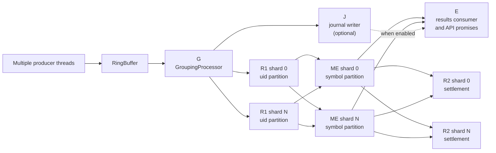
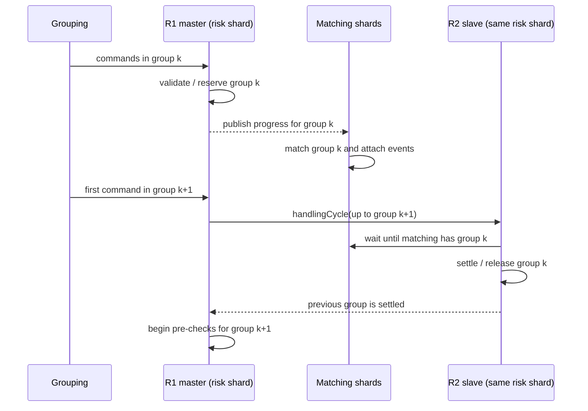
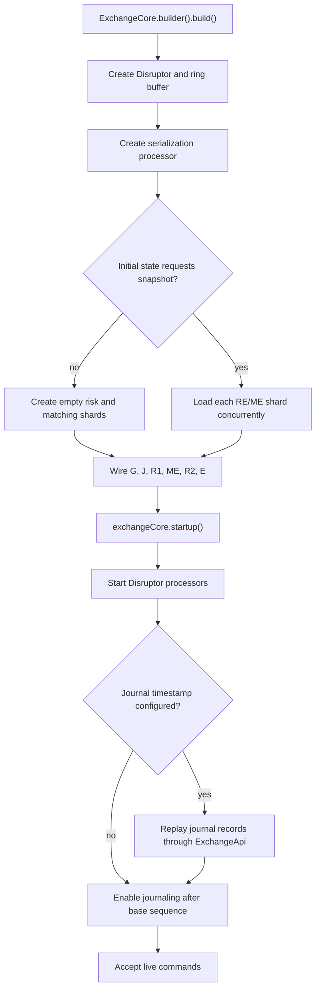
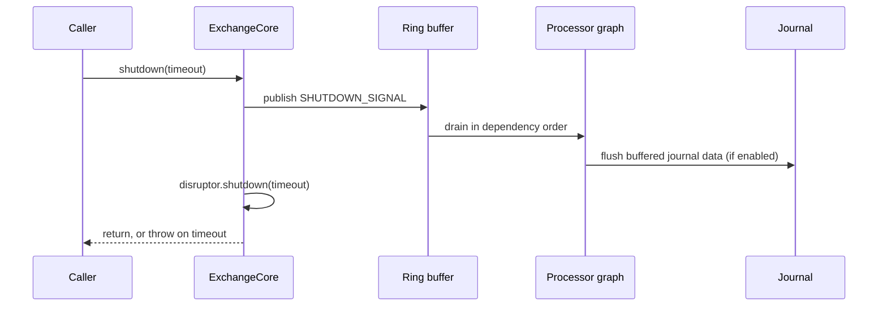

# Architecture and lifecycle

## Entry point

[`ExchangeCore`](../../src/main/java/exchange/core2/core/ExchangeCore.java) is both the composition root and lifecycle owner. Its builder requires:

- an `ObjLongConsumer<OrderCommand>` results consumer;
- an [`ExchangeConfiguration`](../../src/main/java/exchange/core2/core/common/config/ExchangeConfiguration.java), which nests performance, order-processing, initial-state, report, logging, and serialization settings.

Construction creates the ring buffer, the public [`ExchangeApi`](../../src/main/java/exchange/core2/core/ExchangeApi.java), every risk and matching shard, and the processor dependency graph. `startup()` starts the Disruptor and then performs journal replay. `shutdown()` publishes a sentinel command and waits for a graceful drain.

The default configuration is deliberately simple: one risk shard, one matching shard, a 16,384-slot ring buffer, blocking wait strategy, the naive order book, full per-currency risk, margin trading enabled, and no persistence. The latency and throughput builders switch to the direct order book, busy spinning, thread affinity, and larger/differently sharded pipelines; see [`PerformanceConfiguration`](../../src/main/java/exchange/core2/core/common/config/PerformanceConfiguration.java).

## Processor graph



The dependencies are built in [`ExchangeCore`](../../src/main/java/exchange/core2/core/ExchangeCore.java):

1. **G — grouping** is the first consumer of each ring slot.
2. **J — journaling** optionally consumes commands after G, in parallel with the risk/matching path.
3. **R1 — risk pre-processing** has one processor per risk shard. Every matching shard waits for every R1 shard.
4. **ME — matching** has one handler per matching shard. Each handler sees all commands but mutates only symbols it owns.
5. **R2 — risk release/settlement** has one processor per risk shard and waits for all matching shards.
6. **E — results** waits for all matching shards and, when enabled, J. It invokes the configured consumer and completes the sequence-indexed promise in `ExchangeApi`.

### Why R1 and R2 are paired

[`TwoStepMasterProcessor`](../../src/main/java/exchange/core2/core/processors/TwoStepMasterProcessor.java) runs R1. It groups commands by `eventsGroup`. When it encounters the first command in a new group, it:

1. publishes R1 progress through the end of the previous group, allowing matching to process it;
2. synchronously calls [`TwoStepSlaveProcessor.handlingCycle`](../../src/main/java/exchange/core2/core/processors/TwoStepSlaveProcessor.java), which waits for matching and runs R2 through the previous group;
3. only then starts R1 pre-processing for the new group.



This prevents a user's later order from passing its funds/margin check before earlier matcher events have updated that user's balances or positions. It also enables pipelining: matching group *k* can overlap R1 work until the next boundary requires settlement.

The result handler is not directly downstream of R2. A normal asynchronous command future can therefore complete after matching/journaling while R2 for its group is still pending. Commands that need a settled view—most importantly report and binary-query final frames—force an event-group boundary before they execute.

## How event groups are formed

[`GroupingProcessor`](../../src/main/java/exchange/core2/core/processors/GroupingProcessor.java) writes two fields into every command:

- `eventsGroup`: monotonically increasing group number;
- `serviceFlags`: currently bit `1` asks matching to attach an L2 snapshot for periodic margin-price refresh.

A group closes when one of these occurs:

- `msgsInGroupLimit` commands have accumulated;
- `maxGroupDurationNs` elapses while the pipeline is idle;
- a reset, matching snapshot, or grouping-control command needs a hard boundary;
- the final frame of a binary command/query arrives (`symbol == -1`).

It also clears `matcherEvent` and `marketData` left in reused ring slots. Event pooling exists but is disabled by `ExchangeCore.EVENTS_POOLING = false` in this checkout.

## Sharding and fan-out

Both module counts are validated as powers of two, allowing a mask instead of modulus:

```text
risk owner     = uid    & (riskEngineCount - 1)
matching owner = symbol & (matchingEngineCount - 1)
```

All risk processors receive every command because the Disruptor graph fans out. Only the owning risk shard changes a user profile, but every risk shard receives global binary commands and reports. Similarly, every matching router receives every command, but only the symbol-owning router touches a normal order book.

This distinction explains why query and administrative payloads can collect or update all shards without a separate message bus: the ring buffer itself is the deterministic broadcast log.

## State construction and startup



Snapshot loading occurs while `ExchangeCore` is being constructed. Matching and risk shard constructors call `ISerializationProcessor.canLoadFromSnapshot(...)`; if a required snapshot is present, each shard reconstructs its state from its own file. The loader uses a thread pool sized to the total number of risk and matching shards.

After processor threads start, [`replayJournalFullAndThenEnableJouraling`](../../src/main/java/exchange/core2/core/processors/journaling/ISerializationProcessor.java) republishes journal records through low-level `ExchangeApi` methods. Replay temporarily disables grouping so the stored `eventsGroup` and `serviceFlags` values survive. When replay finishes, journaling is enabled only after the recovered sequence and grouping is turned back on.

## Shutdown and failure behavior



The shutdown command is non-mutating and acts as a barrier through the processor graph. The journal handler explicitly flushes on it. `ExchangeCore` permits a single startup and a single shutdown; it does not currently close the API to new publications before the sentinel, as noted by its own TODO.

The default Disruptor exception handler logs the failing sequence, publishes a shutdown signal, and stops the Disruptor. Exceptions are therefore treated as core-fatal, not as isolated command rejections.

## Configuration choices that change the flow

| Configuration | Effect |
|---|---|
| `matchingEnginesNum` | Adds symbol partitions and matching handlers; must be a power of two. |
| `riskEnginesNum` | Adds user partitions and R1/R2 pairs; must be a power of two. |
| `msgsInGroupLimit`, `maxGroupDurationNs` | Trade off how quickly R2 catches up against batching throughput. |
| `sendL2ForEveryCmd`, `l2RefreshDepth` | Controls how often matching attaches book prices used by margin P&L estimates. |
| `riskProcessingMode` | `NO_RISK_PROCESSING` skips funds/margin checks for placement, but the rest of the pipeline remains. |
| `marginTradingMode` | Controls futures-symbol registration and margin-position accounting. |
| `orderBookFactory` | Chooses naive or direct book without changing the processor contract. |
| `enableJournaling` | Adds J as a result-handler dependency and enables replay/durable command logging. |

[Next: command processing](02-command-processing.md)
