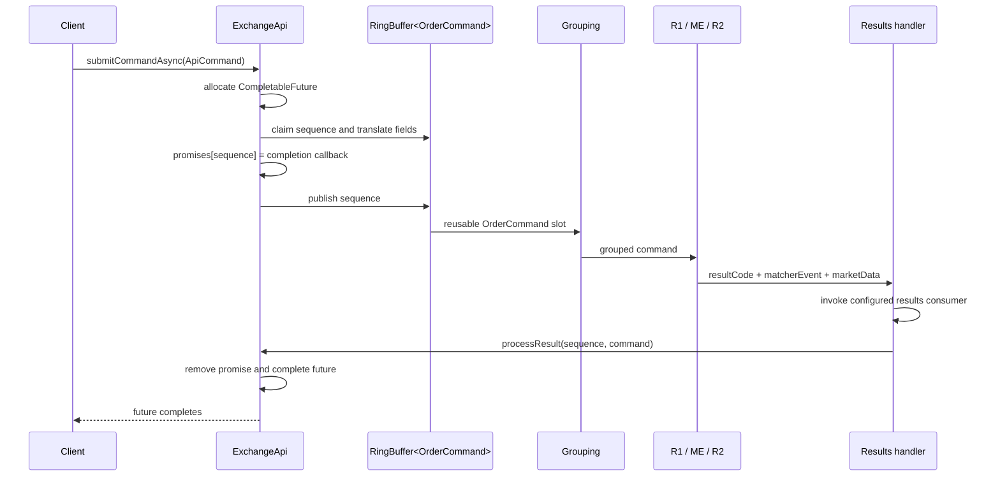
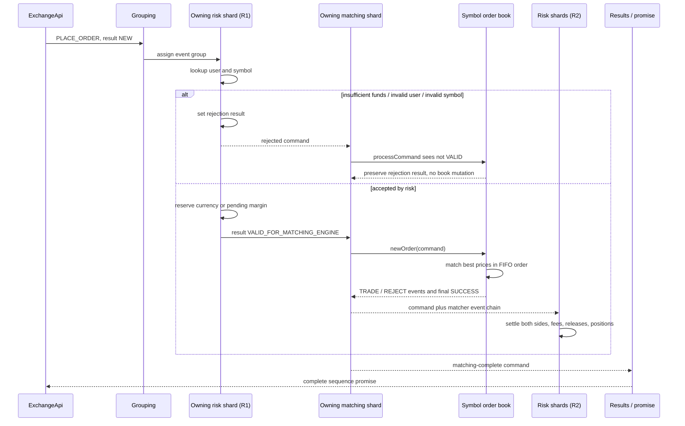

# Command processing

## From public API object to ring slot

[`ExchangeApi`](../../src/main/java/exchange/core2/core/ExchangeApi.java) is an in-process publisher, not a network endpoint. Its high-level methods accept immutable-ish API DTOs such as `ApiPlaceOrder`, `ApiCancelOrder`, or `ApiAdjustUserBalance` and translate them into fields on a reusable [`OrderCommand`](../../src/main/java/exchange/core2/core/common/cmd/OrderCommand.java) ring slot.

The Disruptor sequence is the correlation key for asynchronous calls. `ExchangeApi` stores a callback in a concurrent `promises` map while publishing; the final stage removes it by sequence. Fire-and-forget `submitCommand(...)` does not create a promise.

`submitCommandAsyncFullResponse(...)` exposes the mutable `OrderCommand` ring object. It is useful for immediate inspection in tests, but code that must retain a response should copy the required values before the ring wraps and reuses that slot.

## One command object carries input, intermediate state, and output

The same `OrderCommand` is enriched in place:

| Phase | Important fields |
|---|---|
| Publication | `command`, order/user/symbol fields, price/size/action/type, timestamp, `resultCode = NEW` |
| Grouping | `eventsGroup`, `serviceFlags`; old `matcherEvent` and `marketData` are cleared |
| R1 | Placement may become `VALID_FOR_MATCHING_ENGINE` or a risk error; user-management commands get their final result here |
| Matching | Order-book result replaces the intermediate result; a linked `matcherEvent` chain and optional `marketData` may be attached |
| R2 | Matcher events are interpreted into balances, positions, and fees; the command payload is normally not rewritten |
| Results | Consumer receives the enriched slot; an API promise is completed from it |

The internal `VALID_FOR_MATCHING_ENGINE` result is a gate: [`IOrderBook.processCommand`](../../src/main/java/exchange/core2/core/orderbook/IOrderBook.java) only calls `newOrder` when R1 assigned it. A rejected placement reaches matching, but the book returns the existing risk code without mutation.

## Command routing matrix

| Command | R1: risk pre-process | ME: matching router | R2: settlement | Result notes |
|---|---|---|---|---|
| `PLACE_ORDER` | Owning user shard validates user/symbol and holds funds or pending margin | Owning symbol shard matches and/or rests the order only if R1 marked it valid | Settles `TRADE`; releases unmatched `REJECT`; updates margin prices if L2 is attached | Matching success can coexist with a partial IOC reject event. |
| `MOVE_ORDER` | No new hold | Owning symbol shard verifies order/uid, enforces bid reserve ceiling, removes, rematches, and re-inserts remainder | Settles trades generated by the move | Existing hold follows the order; price cannot exceed its reserved bid price in exchange mode. |
| `CANCEL_ORDER` | No action | Owning symbol shard removes order and emits one `REDUCE` event for the unfilled size | Returns the reserved funds/pending margin | Unknown or wrong-owner order ID fails in matching. |
| `REDUCE_ORDER` | No action | Owning symbol shard reduces up to the remaining size and emits one `REDUCE` event | Returns the released portion | Non-positive reduce size fails. |
| `ORDER_BOOK_REQUEST` | No action | Owning symbol shard attaches an L2 snapshot | Can refresh the margin last-price cache | `size < 0` means full depth. |
| `ADD_USER` | Owning user shard creates the profile | Ignored | No action | Duplicate user fails in R1. |
| `BALANCE_ADJUSTMENT` | Owning user shard checks transaction monotonicity and available funds, then updates the account | Ignored | No action | `orderId` carries transaction ID; `symbol` carries currency; `price` carries amount. |
| `SUSPEND_USER` / `RESUME_USER` | Owning user shard mutates profile lifecycle | Ignored | No action | Suspend requires no non-zero balances or open/pending positions. |
| `BINARY_DATA_COMMAND` | Every risk shard reassembles and applies the payload | Every matching shard reassembles and applies the payload | Binary events are ignored by settlement | Only the final frame completes the high-level future. |
| `BINARY_DATA_QUERY` | Every risk shard reassembles and appends a report section | Every matching shard does the same | Binary events are ignored | Caller merges all serialized sections. |
| `PERSIST_STATE_MATCHING` | Marks command valid and forces early R1 publication | Every matching shard stores its snapshot | No action | First half of `ApiPersistState`; success is `ACCEPTED`. |
| `PERSIST_STATE_RISK` | Every risk shard stores its snapshot | Ignored | No action | Second half; combined future returns the first failure or `SUCCESS`. |
| `RESET` | Every risk shard clears state | Every matching shard clears books/reassembly | No matcher events | Grouping forces a boundary first. |
| `NOP` | No action | Matching shard 0 marks success | No action | Used as a publication barrier by synchronous bulk helpers. |
| `SHUTDOWN_SIGNAL` | Pass-through | Pass-through | R2 is driven to the terminal sequence | Journal flushes before Disruptor shutdown completes. |

## Placement sequence, including rejection

For a normal single-user command, only one risk shard changes `resultCode`. For operations executed by all shards, such as snapshot storage and report-section attachment, [`UnsafeUtils`](../../src/main/java/exchange/core2/core/utils/UnsafeUtils.java) uses compare-and-swap operations to combine concurrent result/event writes safely.

## User and balance administration

[`UserProfileService`](../../src/main/java/exchange/core2/core/processors/UserProfileService.java) owns user records inside a risk shard.

### Add and adjust

An `ADD_USER` creates an active profile containing:

- a currency-to-balance map;
- a symbol-to-margin-position map;
- a monotonically increasing `adjustmentsCounter`;
- active/suspended status.

`BALANCE_ADJUSTMENT` uses its transaction ID for duplicate/out-of-order protection:

- equal to the last ID → already applied same transaction;
- lower than the last ID → already passed by later transactions;
- a withdrawal that would make an account negative → insufficient funds;
- otherwise update the balance and counter.

Risk also tracks the opposite of each adjustment in a system-wide `adjustments` or `suspends` accumulator. The total-balance report later combines those counters with client funds, order holds, and fees to test the accounting invariant.

### Suspend and resume

Suspend removes an active user profile from the main map only when all accounts are zero and all positions (including pending sizes) are empty. A later settlement for a missing profile can recreate a suspended placeholder via `getUserProfileOrAddSuspended`; resume either activates that placeholder or creates a new active empty profile. This accommodates commands already in the pipeline while still allowing inactive profiles to be removed.

## Binary administrative commands

Large administrative objects are not placed in a ring slot by reference. The API:

1. serializes a type code plus payload with Chronicle Bytes;
2. LZ4-compresses the bytes;
3. packs the result into five `long` fields per ring message;
4. marks the final frame with `symbol == -1`;
5. publishes fragments no larger than one quarter of the ring.

Every risk and matching shard owns a [`BinaryCommandsProcessor`](../../src/main/java/exchange/core2/core/processors/BinaryCommandsProcessor.java) keyed by `transferId`. It accumulates the five-word frames, decompresses the final transfer, reflects the configured payload constructor, and applies it.

The standard configuration supports:

- `BatchAddSymbolsCommand`: installs symbol specifications in all risk shards and creates symbol order-book definitions in matching routers;
- `BatchAddAccountsCommand`: creates users/accounts in their owning risk shards; matching routers intentionally do nothing.

The final binary frame forces an event-group boundary. That makes prior trading settlement visible before the global administration/query payload runs.

## Result delivery and backpressure implications

[`ResultsHandler`](../../src/main/java/exchange/core2/core/processors/ResultsHandler.java) calls the configured results consumer first and `ExchangeApi.processResult(...)` second. Consequently:

- the consumer runs on the single final Disruptor stage, so blocking it delays ring-buffer reclamation and future completion;
- an uncaught consumer exception is a core-level processor failure and can prevent the corresponding future from completing;
- [`SimpleEventsProcessor`](../../src/main/java/exchange/core2/core/SimpleEventsProcessor.java) is a convenience adapter that catches handler exceptions and emits, in order, command result, trade/reduce/reject information, then optional order-book data.

For a low-latency integration, keep the final consumer small and hand immutable copies to another system if downstream work can block.

## What “synchronous” means in this API

`submitCommandsSync(List)` publishes all but the last command without promises, then joins the last. The stream overload publishes every command and joins a final NOP. This guarantees the final result stage has reached that sequence. It does not add a special R2 barrier beyond the normal event-group mechanism.

Use a report/binary query when the caller needs a consolidated, settled view of accounts and books; its final frame creates the required group boundary.

[Previous: architecture and lifecycle](01-architecture-and-lifecycle.md) · [Next: matching and risk](03-matching-and-risk.md)

