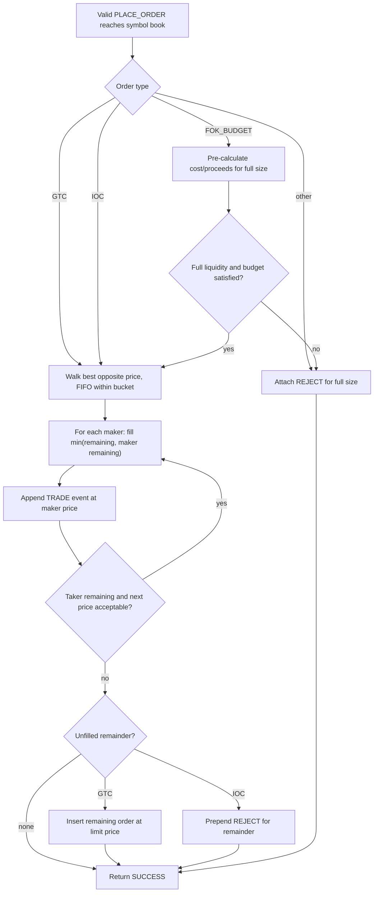
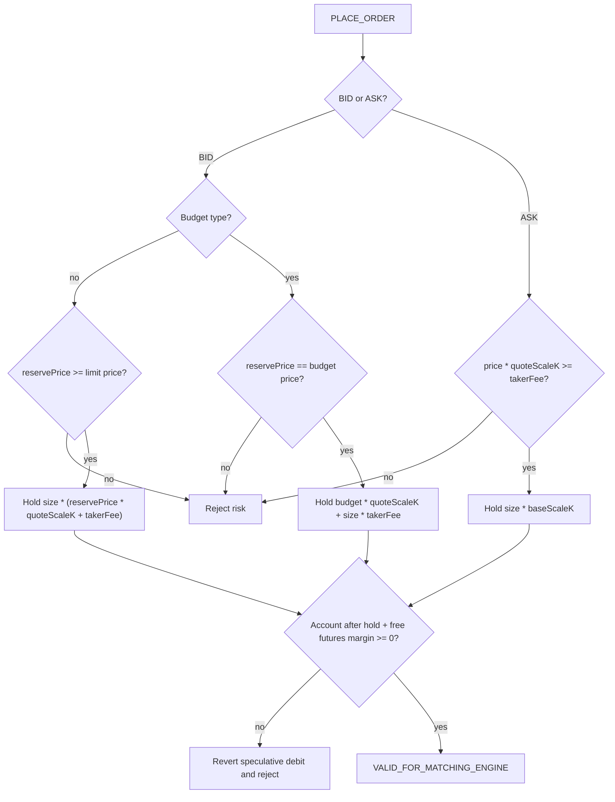
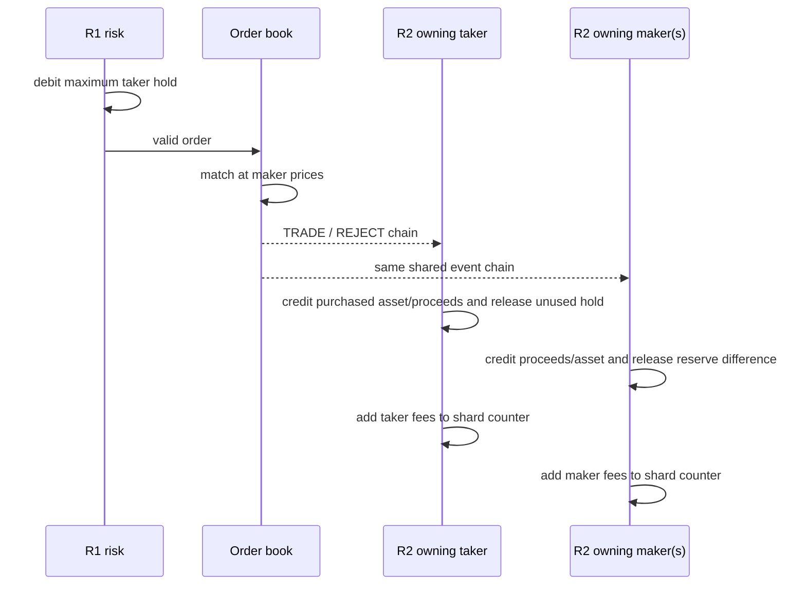

# Matching and risk

Matching and accounting are deliberately separated. R1 reserves the maximum exposure before an order reaches a book, the matching engine produces an immutable-in-practice event chain describing what happened, and R2 converts that chain into final account or position changes.

## Integer units and symbol rules

[`CoreSymbolSpecification`](../../src/main/java/exchange/core2/core/common/CoreSymbolSpecification.java) defines all arithmetic. No floating-point values enter the core.

| Field | Meaning |
|---|---|
| `baseScaleK` | Base-currency units in one order lot. |
| `quoteScaleK` | Quote-currency units in one price step per lot. |
| `price` | Integer number of quote price steps. |
| `size` | Integer number of lots. |
| `makerFee`, `takerFee` | Quote-currency units charged per lot. |
| `marginBuy`, `marginSell` | Quote-currency margin units per futures lot. |

The central arithmetic helpers are in [`CoreArithmeticUtils`](../../src/main/java/exchange/core2/core/utils/CoreArithmeticUtils.java):

```text
base amount                 = size * baseScaleK
quote amount                = size * price * quoteScaleK
bid hold with taker fee     = size * (reservePrice * quoteScaleK + takerFee)
budget-bid hold             = budgetSteps * quoteScaleK + size * takerFee
```

Callers are responsible for choosing scales that keep all intermediate `long` calculations within range.

## Order-book contract and implementations

[`IOrderBook`](../../src/main/java/exchange/core2/core/orderbook/IOrderBook.java) defines the behavior shared by both implementations:

- [`OrderBookNaiveImpl`](../../src/main/java/exchange/core2/core/orderbook/OrderBookNaiveImpl.java) uses Java `TreeMap` price buckets and per-bucket linked maps. It is the default and easiest implementation to read.
- [`OrderBookDirectImpl`](../../src/main/java/exchange/core2/core/orderbook/OrderBookDirectImpl.java) uses adaptive radix trees, intrusive order links, bucket/order indexes, and object pools. It is selected by the latency/throughput configurations.

Both are intended to produce implementation-independent state hashes and the same external behavior. They keep asks from lowest to highest price, bids from highest to lowest price, and FIFO order within a price level: price priority first, then insertion priority.

Symbol definitions are broadcast to every matching router by the binary command. Each router therefore has the symbol's order-book definition, but `MatchingEngineRouter.processOrder` sends ordinary order commands only to the router selected by the symbol mask. Resting orders for a symbol exist only in that active shard's copy.

## Supported order behavior

The enum contains five order types, but the current order-book switch implements three:

| Type | Current behavior |
|---|---|
| `GTC` | Match immediately at acceptable prices; if volume remains, rest it in the book. |
| `IOC` | Match immediately up to the limit; attach a `REJECT` event for any remainder; never rest. |
| `FOK_BUDGET` | Pre-scan available liquidity and aggregate price. Execute all only when full size is available within the total buy/sell budget; otherwise reject all. |
| `IOC_BUDGET` | Present in the enum but falls through to the unsupported path and receives a full reject event. |
| `FOK` | Present in the enum but falls through to the unsupported path and receives a full reject event. |

An unsupported or unfilled order can still finish with matching `SUCCESS`; the outcome is represented by the attached `REJECT` event. Integrations must consume both `resultCode` and matcher events.

## Price-time matching flow



Each trade executes at the resting maker's price. A fully filled maker is removed from the order-ID index and its price bucket is deleted when empty. A partially filled maker retains its position and priority.

For a duplicate GTC order ID, the implementation first allows any immediately marketable portion to trade, then rejects the remainder instead of placing a second resting order with that ID. This ordering is visible in both implementations.

## Matcher event chain

The matching engine communicates with risk and result consumers through a linked list of [`MatcherTradeEvent`](../../src/main/java/exchange/core2/core/common/MatcherTradeEvent.java) nodes attached to the command.

| Event | Meaning | Key fields |
|---|---|---|
| `TRADE` | Taker matched a resting maker | maker order/uid, maker price, size, maker/taker completion flags, bidder hold price |
| `REDUCE` | Cancel or reduce released resting volume | released size, original price and reserve, completion flag |
| `REJECT` | Incoming remainder did not enter the book | rejected size, command price/reserve |
| `BINARY_EVENT` | Serialized report section, not a trade | section number plus five payload words |

[`OrderBookEventsHelper`](../../src/main/java/exchange/core2/core/orderbook/OrderBookEventsHelper.java) constructs these nodes. R2 ignores binary events; [`SimpleEventsProcessor`](../../src/main/java/exchange/core2/core/SimpleEventsProcessor.java) converts trade/reduce/reject nodes into the friendlier `IEventsHandler` DTOs.

## Currency-exchange risk: R1 hold

For `CURRENCY_EXCHANGE_PAIR`, the owning risk shard looks up the user and symbol, calculates the maximum debit, and applies it speculatively:



If margin trading is enabled, unrealized futures P&L minus required futures margin in the same currency contributes to available funds. The placement code currently normalizes most detailed `placeOrder(...)` failures to `RISK_NSF` before returning to the caller; invalid user and invalid symbol retain their specific codes.

## Currency-exchange settlement: R2

R1 has already removed the maximum held amount, so R2 mostly transfers proceeds and returns unused hold.

### Incoming BID (taker buys base)

For every trade:

- the maker is an ASK and receives `trade quote amount - maker fee`;
- the taker accumulates bought base volume;
- the taker receives the difference between held reserve price and actual maker price;
- fees accumulate as taker fee plus maker fee per executed lot.

After the chain, the taker gains `executed size * baseScaleK`. A reject or reduce returns the quote amount held for the rejected size at its bidder hold price, including the taker-fee component.

### Incoming ASK (taker sells base)

For every trade:

- the maker is a BID and gains the bought base;
- the maker receives the unused difference between its reserved bid price and actual trade price, corrected from taker-fee hold to maker-fee charge;
- the taker accumulates actual quote proceeds.

After the chain, the taker receives `sum(size * makerPrice * quoteScaleK) - taker fees`. A reject or reduce returns the unexecuted base hold.



Every R2 shard scans the same event chain but updates only users selected by `uid & shardMask`. This lets one trade settle taker and makers that live on different risk shards without cross-shard locks.

## Futures/margin flow

For `FUTURES_CONTRACT`, account currency does not transfer between counterparties. Risk tracks exposure and realized/unrealized P&L in [`SymbolPositionRecord`](../../src/main/java/exchange/core2/core/common/SymbolPositionRecord.java).

R1:

1. finds or creates the user's per-symbol position record;
2. calculates current required margin from open position plus pending buy/sell sizes;
3. permits an exposure-reducing order without additional margin;
4. otherwise compares new margin against cash plus P&L/free margin across positions sharing the quote currency;
5. increments `pendingBuySize` or `pendingSellSize` when accepted.

R2 for each trade:

1. removes the executed size from pending exposure;
2. closes any opposite position and realizes P&L;
3. opens any remainder in the new direction;
4. charges maker/taker fee only on size that opens exposure;
5. removes an empty position and moves accumulated profit into the user's cash account.

Reject and reduce events only release pending exposure. Periodic or requested L2 snapshots update the risk shard's best ask/bid cache; that cache is used to estimate unrealized P&L for later margin checks.

## Cancel, reduce, and move

### Cancel

The book verifies that both order ID and uid match, removes the entire remaining order, copies the original action into the command, and attaches a single `REDUCE` event. R2 uses the action, remaining size, and reserve price to release currency hold or pending margin.

### Reduce

A positive requested reduction is capped at the order's remaining size. A full reduction removes the order; a partial reduction decreases the order and bucket volume in place. Either way one `REDUCE` event reports the effective amount.

### Move

Move removes the resting order from its old price, changes its price, and treats it as an active order against the opposite book. If it fully trades, it disappears; otherwise the remainder is inserted at the new price with new queue priority.

In currency-exchange mode, an existing BID cannot move above its original `reserveBidPrice`, because R1 does not reserve new funds for a move. This is the reason `ApiPlaceOrder` carries a separate reserve price even when the initial limit is lower.

## Accounting invariants exposed by reports

[`TotalCurrencyBalanceReportQuery`](../../src/main/java/exchange/core2/core/common/api/reports/TotalCurrencyBalanceReportQuery.java) independently totals:

- free balances and position P&L from risk shards;
- held balances in open exchange orders from matching shards;
- collected fees;
- external adjustments and suspends;
- futures long and short open interest.

Tests expect the signed global balance sum to be zero and aggregated long open interest to equal aggregated short open interest. This report is the most useful end-to-end check that R1 holds, matching events, and R2 settlement stayed consistent.

[Previous: command processing](02-command-processing.md) · [Next: reports and persistence](04-reports-and-persistence.md)
