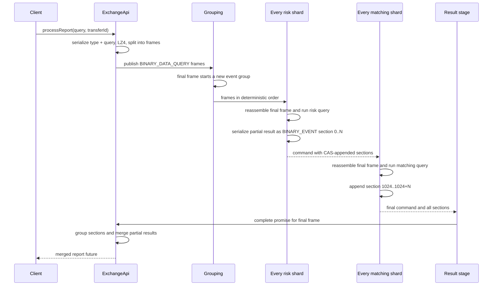
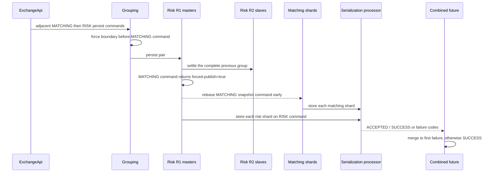
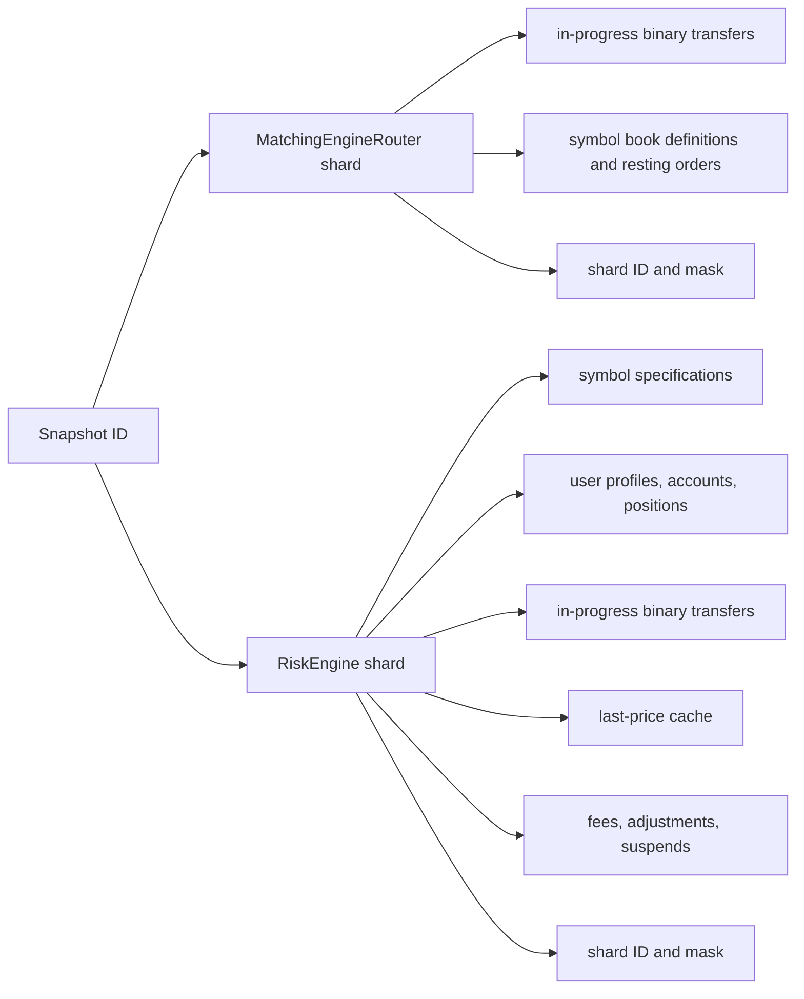
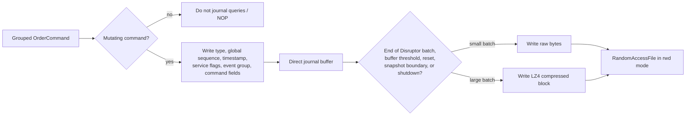
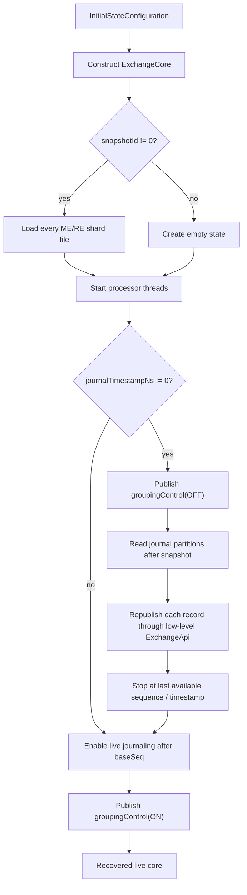

# Reports and persistence

Reports, bulk administration, snapshots, and journal replay all reuse the same command pipeline. There is no side channel that reads mutable state concurrently: each operation is serialized into ring-buffer commands and executed on the threads that own the state.

## Report map/reduce flow

The public entry point is `ExchangeApi.processReport(query, transferId)`. A [`ReportQuery`](../../src/main/java/exchange/core2/core/common/api/reports/ReportQuery.java) supplies four pieces of behavior:

- its stable integer type code;
- serialization of query parameters;
- `process(RiskEngine)` for one risk-shard partial result;
- `process(MatchingEngineRouter)` for one matching-shard partial result;
- `createResult(Stream<BytesIn>)` to merge all returned sections.



The final frame has `symbol == -1`. [`GroupingProcessor`](../../src/main/java/exchange/core2/core/processors/GroupingProcessor.java) advances the event group before assigning that frame, so every R1 shard first drives R2 through prior trading commands. The report therefore observes settled risk state and the corresponding matched order-book state.

Each [`BinaryCommandsProcessor`](../../src/main/java/exchange/core2/core/processors/BinaryCommandsProcessor.java) uses a unique section number:

```text
risk section     = risk shard ID                 (0, 1, ...)
matching section = matching shard ID + 1024      (1024, 1025, ...)
```

Partial results are serialized into `BINARY_EVENT` nodes. Multiple shard threads prepend their event chains with a compare-and-swap in [`UnsafeUtils.appendEventsVolatile`](../../src/main/java/exchange/core2/core/utils/UnsafeUtils.java). The API later groups nodes by section before asking the query to merge them, so concurrent append order does not define report semantics.

## Standard reports

[`ReportsQueriesConfiguration`](../../src/main/java/exchange/core2/core/common/config/ReportsQueriesConfiguration.java) registers three standard query types and permits additional report classes with unique integer codes and a public `BytesIn` constructor.

### Single user

[`SingleUserReportQuery`](../../src/main/java/exchange/core2/core/common/api/reports/SingleUserReportQuery.java):

- the owning risk shard returns status, currency accounts, and margin positions;
- each matching shard scans its books for that user's open orders;
- the merger selects the non-null risk data and combines symbol-to-order maps.

This is the normal way to get a consistent user view spanning risk and matching state.

### Total currency balance

[`TotalCurrencyBalanceReportQuery`](../../src/main/java/exchange/core2/core/common/api/reports/TotalCurrencyBalanceReportQuery.java):

- risk shards sum client accounts, position P&L, fees, external adjustments/suspends, and long/short open interest;
- matching shards value currency held by open exchange orders;
- the merger sums maps from all sections.

[`TotalCurrencyBalanceReportResult.isGlobalBalancesAllZero`](../../src/main/java/exchange/core2/core/common/api/reports/TotalCurrencyBalanceReportResult.java) checks the conservation equation used throughout integration, stress, persistence, and journaling tests.

### State hash

[`StateHashReportQuery`](../../src/main/java/exchange/core2/core/common/api/reports/StateHashReportQuery.java) hashes shard-owned submodules and returns a sorted module-key map. [`StateHashReportResult.getStateHash`](../../src/main/java/exchange/core2/core/common/api/reports/StateHashReportResult.java) folds that map into one deterministic value. Persistence tests compare this value before and after reconstruction.

## Snapshot creation

`ApiPersistState` does not publish one command. [`ExchangeApi.publishPersistCmd`](../../src/main/java/exchange/core2/core/ExchangeApi.java) claims two adjacent ring slots:

1. `PERSIST_STATE_MATCHING` for every matching shard;
2. `PERSIST_STATE_RISK` for every risk shard.



The boundary is the consistency mechanism: trading before the snapshot has passed matching and R2 before the snapshot commands start. `PERSIST_STATE_MATCHING` asks `TwoStepMasterProcessor` to publish its sequence immediately, allowing matching snapshots and risk snapshots to overlap safely because they serialize separate module state.

The `ISerializationProcessor.storeData(...)` contract is synchronous and thread-safe. The disk implementation creates one LZ4-framed Chronicle Wire file per module and shard:

```text
<exchangeId>_snapshot_<snapshotId>_ME<shard>.ecs
<exchangeId>_snapshot_<snapshotId>_RE<shard>.ecs
```

It uses `CREATE_NEW`; snapshot IDs must therefore be unique for a storage folder. The default folder is `./dumps`.

## What each snapshot contains



Shard IDs and masks are stored and validated on load, preventing a snapshot made with one partition layout from silently loading into an incompatible layout.

## Journaling path

Journaling is enabled by [`SerializationConfiguration.DISK_JOURNALING`](../../src/main/java/exchange/core2/core/common/config/SerializationConfiguration.java). `ExchangeCore` adds `serializationProcessor::writeToJournal` after grouping, in parallel with R1.



The journal stores original command inputs plus `eventsGroup` and `serviceFlags`, not derived matcher events. Replay recomputes deterministic risk, matching, and settlement state.

The result stage depends on the journal handler when journaling is enabled. Because the journal flushes at a Disruptor end-of-batch (and at its other explicit triggers), the visible result does not outrun the journal handler's processing of that sequence.

Journal files are partitioned and named relative to the current base snapshot:

```text
<exchangeId>_journal_<baseSnapshotId>_<partition>.ecj
```

Large journal batches are LZ4-compressed as blocks; individual or small batches remain raw. Snapshot completion registers a new base snapshot and forces the next journal partition to start under that base.

## Recovery: snapshot then replay



Low-level replay methods restore `serviceFlags`, `eventsGroup`, timestamp, and all command-specific fields. Grouping is disabled during replay so it does not overwrite the recorded group boundaries. No results promises are installed for replayed commands; clients normally issue a report after construction/startup to wait for and validate the recovered state.

Three initial-state factories express the common modes:

| Factory | Snapshot | Journal replay |
|---|---|---|
| `cleanStart(exchangeId)` | None | None |
| `cleanStartJournaling(exchangeId)` | None | Live journaling from sequence zero |
| `fromSnapshotOnly(exchangeId, snapshotId, baseSeq)` | Required | None |
| `lastKnownStateFromJournal(exchangeId, snapshotId, baseSeq)` | Required | Replay all available journal data, then continue journaling |

## Verification patterns in the tests

[`PersistenceTestsModule`](../../src/test/java/exchange/core2/tests/util/PersistenceTestsModule.java) creates populated state, stores a snapshot, records a state hash, starts a new core from the snapshot, and compares the restored hash and global balance invariant.

[`JournalingTestsModule`](../../src/test/java/exchange/core2/tests/util/JournalingTestsModule.java) adds a second phase of commands after the snapshot, records the final hash, then restores snapshot plus journal and compares the reconstructed final hash and accounting invariant.

These are stronger checks than “files exist”: they establish that independent module snapshots and deterministic command replay converge to the same logical state.

## Current implementation boundaries

- `replayJournalStep(...)` is declared but the disk implementation throws `UnsupportedOperationException`; recovery uses full replay.
- The persistence test notes that it does not cover position serialization as a focused case, although other state/hash paths exercise positions.
- Snapshot/journal discovery and history descriptors are incomplete and contain TODOs; callers provide snapshot ID and base sequence explicitly.
- Disk formats are implementation details in this version, not presented as a stable cross-version compatibility contract.
- Default serialization is `DummySerializationProcessor`; persistence must be opted into through configuration.

[Previous: matching and risk](03-matching-and-risk.md) · [Next: source reading map](05-source-reading-map.md)
