# Source reading map

This is a practical route through the Java code. Follow one vertical flow at a time instead of reading all 150 Java files alphabetically.

## Package map

| Area | Start here | What it owns |
|---|---|---|
| Composition and public API | [`ExchangeCore`](../../src/main/java/exchange/core2/core/ExchangeCore.java), [`ExchangeApi`](../../src/main/java/exchange/core2/core/ExchangeApi.java) | Ring creation, processor graph, publication, futures, lifecycle |
| Internal protocol | [`OrderCommand`](../../src/main/java/exchange/core2/core/common/cmd/OrderCommand.java), [`OrderCommandType`](../../src/main/java/exchange/core2/core/common/cmd/OrderCommandType.java), [`CommandResultCode`](../../src/main/java/exchange/core2/core/common/cmd/CommandResultCode.java) | Fields and state transitions carried by every ring slot |
| Pipeline mechanics | [`GroupingProcessor`](../../src/main/java/exchange/core2/core/processors/GroupingProcessor.java), [`TwoStepMasterProcessor`](../../src/main/java/exchange/core2/core/processors/TwoStepMasterProcessor.java), [`TwoStepSlaveProcessor`](../../src/main/java/exchange/core2/core/processors/TwoStepSlaveProcessor.java) | Group boundaries and R1/R2 coordination |
| Risk and users | [`RiskEngine`](../../src/main/java/exchange/core2/core/processors/RiskEngine.java), [`UserProfileService`](../../src/main/java/exchange/core2/core/processors/UserProfileService.java), [`SymbolPositionRecord`](../../src/main/java/exchange/core2/core/common/SymbolPositionRecord.java) | Holds, balances, fees, futures positions, settlement |
| Matching | [`MatchingEngineRouter`](../../src/main/java/exchange/core2/core/processors/MatchingEngineRouter.java), [`IOrderBook`](../../src/main/java/exchange/core2/core/orderbook/IOrderBook.java) | Symbol routing and the common book contract |
| Order-book algorithms | [`OrderBookNaiveImpl`](../../src/main/java/exchange/core2/core/orderbook/OrderBookNaiveImpl.java), [`OrderBookDirectImpl`](../../src/main/java/exchange/core2/core/orderbook/OrderBookDirectImpl.java) | Price-time matching and resting-order structures |
| Event output | [`MatcherTradeEvent`](../../src/main/java/exchange/core2/core/common/MatcherTradeEvent.java), [`OrderBookEventsHelper`](../../src/main/java/exchange/core2/core/orderbook/OrderBookEventsHelper.java), [`SimpleEventsProcessor`](../../src/main/java/exchange/core2/core/SimpleEventsProcessor.java) | Trade/reduce/reject chains and client-friendly callbacks |
| Binary/report fan-out | [`BinaryCommandsProcessor`](../../src/main/java/exchange/core2/core/processors/BinaryCommandsProcessor.java), [`ReportQuery`](../../src/main/java/exchange/core2/core/common/api/reports/ReportQuery.java) | Payload fragmentation/reassembly and report sections |
| Persistence | [`ISerializationProcessor`](../../src/main/java/exchange/core2/core/processors/journaling/ISerializationProcessor.java), [`DiskSerializationProcessor`](../../src/main/java/exchange/core2/core/processors/journaling/DiskSerializationProcessor.java) | Module snapshots, journal encoding, replay |
| Configuration | [`ExchangeConfiguration`](../../src/main/java/exchange/core2/core/common/config/ExchangeConfiguration.java), [`PerformanceConfiguration`](../../src/main/java/exchange/core2/core/common/config/PerformanceConfiguration.java), [`OrdersProcessingConfiguration`](../../src/main/java/exchange/core2/core/common/config/OrdersProcessingConfiguration.java) | Pipeline shape and behavior switches |

## Walkthrough 1: bootstrap a small exchange

Use [`ITCoreExample`](../../src/test/java/exchange/core2/tests/examples/ITCoreExample.java) as the executable top-level narrative:

```mermaid
flowchart LR
    Build["Build ExchangeCore"] --> Start["startup()"]
    Start --> Symbol["BatchAddSymbolsCommand"]
    Symbol --> Users["ApiAddUser"]
    Users --> Funds["ApiAdjustUserBalance"]
    Funds --> Maker["Place GTC bid"]
    Maker --> Taker["Place IOC ask"]
    Taker --> L2["Request L2 book"]
    L2 --> Move["Move remaining order"]
    Move --> Cancel["Cancel remaining order"]
    Cancel --> Reports["User and total-balance reports"]
```



While reading that test, jump into the implementation in this order:

1. `ExchangeApi.submitCommandAsync` — select translator and register the sequence promise.
2. `ExchangeCore` constructor — see the stage graph the translated command enters.
3. `RiskEngine.preProcessCommand` — see R1 dispatch.
4. `MatchingEngineRouter.processOrder` — see symbol routing.
5. `IOrderBook.processCommand` and the chosen book's `newOrder` — see matching.
6. `RiskEngine.handlerRiskRelease` — see R2 settlement.
7. `ResultsHandler` and `ExchangeApi.processResult` — see output/future completion.

## Walkthrough 2: one GTC order crossing the book

For the simplest full trade path, search/read these methods in order:

```text
ExchangeApi.NEW_ORDER_TRANSLATOR
  -> RiskEngine.preProcessCommand
  -> RiskEngine.placeOrderRiskCheck
  -> RiskEngine.placeExchangeOrder (or canPlaceMarginOrder)
  -> MatchingEngineRouter.processMatchingCommand
  -> IOrderBook.processCommand
  -> OrderBookNaiveImpl.newOrderPlaceGtc
     or OrderBookDirectImpl.newOrderPlaceGtc
  -> tryMatchInstantly
  -> OrderBookEventsHelper.sendTradeEvent
  -> RiskEngine.handlerRiskRelease
  -> handleMatcherEventsExchangeBuy / Sell
     or handleMatcherEventMargin
  -> ResultsHandler.onEvent
```

After that path is clear, cancel, reduce, and move are small variations centered in the order-book implementation and the `REDUCE` event settlement path.

## Walkthrough 3: a consistent cross-module report

```text
ExchangeApi.processReport
  -> ExchangeApi.publishQuery
  -> ExchangeApi.publishBinaryData
  -> GroupingProcessor (final-frame group boundary)
  -> RiskEngine.preProcessCommand
  -> BinaryCommandsProcessor.acceptBinaryFrame
  -> ReportQuery.process(RiskEngine)
  -> MatchingEngineRouter.processOrder
  -> BinaryCommandsProcessor.acceptBinaryFrame
  -> ReportQuery.process(MatchingEngineRouter)
  -> UnsafeUtils.appendEventsVolatile
  -> ExchangeApi.processResult
  -> OrderBookEventsHelper.deserializeEvents
  -> ReportQuery.createResult
```

Read `SingleUserReportQuery` first because its risk and matching halves are easy to distinguish. Read `TotalCurrencyBalanceReportQuery` next to understand the accounting invariant, then `StateHashReportQuery` for persistence validation.

## Walkthrough 4: snapshot and journal recovery

Start with the executable modules rather than the file format:

1. [`PersistenceTestsModule`](../../src/test/java/exchange/core2/tests/util/PersistenceTestsModule.java) — snapshot-only lifecycle.
2. [`JournalingTestsModule`](../../src/test/java/exchange/core2/tests/util/JournalingTestsModule.java) — snapshot plus later journal records.
3. `ExchangeApi.publishPersistCmd` — the two-command consistent snapshot barrier.
4. `MatchingEngineRouter.processOrder(PERSIST_STATE_MATCHING)` and `RiskEngine.preProcessCommand(PERSIST_STATE_RISK)` — per-module writes.
5. Matching/risk constructors — per-shard load.
6. `ExchangeCore.startup` and `DiskSerializationProcessor.replayJournalFull` — command replay.
7. `DiskSerializationProcessor.readCommands` — mapping persisted record types back to low-level API publications.

## Useful tests by concept

| Question | Test/source |
|---|---|
| Does the public example work end to end? | [`ITCoreExample`](../../src/test/java/exchange/core2/tests/examples/ITCoreExample.java) |
| Do naive and direct books follow the same contract? | [`ITOrderBookBase`](../../src/test/java/exchange/core2/tests/perf/modules/ITOrderBookBase.java) and the order-book unit tests under `src/test/java/exchange/core2/core/orderbook` |
| Are invalid users, symbols, funds, and order operations rejected? | Integration rejection tests under `src/test/java/exchange/core2/tests/integration` |
| Do maker/taker fees conserve balances? | `ITFeesExchange*` and `ITFeesMargin*` integration tests |
| Does state survive snapshots? | [`PersistenceTestsModule`](../../src/test/java/exchange/core2/tests/util/PersistenceTestsModule.java) |
| Does snapshot plus journal reproduce the final state? | [`JournalingTestsModule`](../../src/test/java/exchange/core2/tests/util/JournalingTestsModule.java) |
| How is production-shaped load generated? | [`TestOrdersGenerator`](../../src/test/java/exchange/core2/tests/util/TestOrdersGenerator.java) and the `Perf*` tests |

## Commands for local exploration

```bash
# Compile the Java project and its tests without running them
mvn -DskipTests test

# Run the small executable example
mvn -Dtest=exchange.core2.tests.examples.ITCoreExample test

# Run order-book unit tests
mvn -Dtest='exchange.core2.core.orderbook.*Test' test

# Find every dispatch point for one internal command
rg 'PERSIST_STATE_MATCHING' src/main/java src/test/java
```

The executable example constructs the disk serialization stack even when journaling is disabled. With Homebrew JDK 25, this checkout's OpenHFT dependency stack fails during startup while reflecting on the removed `FileChannelImpl.unmap0(long,long)` signature. That is a runtime/dependency compatibility boundary, not a matching assertion failure; use a project-compatible JDK for the end-to-end example. The focused naive and direct exchange order-book suites run independently of that hook.

Performance tests and persistence/journaling modules can be CPU-, time-, affinity-, and disk-intensive. Run their focused methods intentionally rather than using them as the first reading smoke test.

## Things that are easy to misread

- The repository has no Java `main` method. Tests and an embedding application construct `ExchangeCore` directly.
- The ring buffer is both transport and object pool. An `OrderCommand` is not a durable response object.
- Every shard observes global commands; shard masks decide who mutates partitioned user/order state.
- R2 is a second phase of the same risk shard, invoked through group boundaries, not a downstream database writer.
- A successful matching result does not mean “fully filled”; inspect `TRADE` and `REJECT` events.
- Symbol `price` and `size` are scaled integers, not currency decimals.
- Report data travels back in matcher-event nodes even though it is not trading data.
- The Java Maven build is the source of truth for these documents. The Zig files in this checkout are outside this Java flow guide.

[Back to the guide index](README.md)
