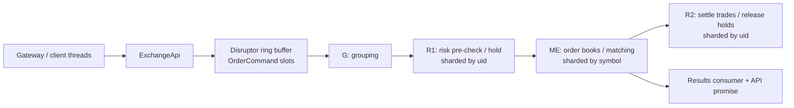

# exchange-core Java flow guide

This guide explains the Java implementation in this checkout (`0.5.4-SNAPSHOT`). It is organized around runtime flows rather than package names: how a command enters the core, which processor owns each state transition, how an order becomes trades and balance changes, and how the same state is queried or restored.

The Java core is an in-memory, event-sourced matching system built around one LMAX Disruptor ring buffer. Every inbound operation becomes a reusable [`OrderCommand`](../../src/main/java/exchange/core2/core/common/cmd/OrderCommand.java) slot and travels through a fixed processor graph.

The Zig twin of this guide is [`docs/zig-flows/`](../zig-flows/README.md) (same chapter layout, Zig owners and native boundaries).

## Start here

- **[How exchange-core works](../HOW_EXCHANGE_CORE_WORKS.md)** — full onboarding narrative. Starts with a plain-language “in simple terms” section (conveyor-belt mental model), then stage names, place→match→settle with numbers, code-level call stacks, cancel/reports/persistence, and Java↔Zig map. Cross-links into every chapter below.
- Then read the flow chapters in order for depth.
- For the native port, use **[zig-flows](../zig-flows/README.md)** instead of (or after) these Java chapters.

## Read in this order

1. [Architecture and lifecycle](01-architecture-and-lifecycle.md) — construction, processor topology, sharding, grouping, startup, and shutdown.
2. [Command processing](02-command-processing.md) — API publication, command routing, futures, administrative commands, and result delivery.
3. [Matching and risk](03-matching-and-risk.md) — order types, price-time matching, funds/margin holds, trade settlement, cancel, reduce, and move.
4. [Reports and persistence](04-reports-and-persistence.md) — binary fan-out, report map/reduce, snapshots, journaling, and recovery.
5. [Source reading map](05-source-reading-map.md) — a guided path through the implementation and its executable examples/tests.

## The shortest useful mental model

The diagram is intentionally simplified. Journaling runs beside R1, and result delivery waits for matching plus journaling, but it is not directly gated by R2. R2 catches up at event-group boundaries; R1 cannot begin a new group until that shard's R2 has settled the previous group. The exact dependency graph is in [Architecture and lifecycle](01-architecture-and-lifecycle.md#processor-graph).

## State ownership

| State | Owning component | Partition key | Purpose |
|---|---|---:|---|
| Ring slots and pending callbacks | [`ExchangeApi`](../../src/main/java/exchange/core2/core/ExchangeApi.java) | Disruptor sequence | Converts public API objects to internal commands and completes asynchronous calls. |
| `eventsGroup`, periodic L2 request flag, stale event cleanup | [`GroupingProcessor`](../../src/main/java/exchange/core2/core/processors/GroupingProcessor.java) | Global sequence | Defines the accounting consistency boundary used by the two-step risk pipeline. |
| Users, currency accounts, positions, fees, adjustments, last prices | [`RiskEngine`](../../src/main/java/exchange/core2/core/processors/RiskEngine.java) | `uid & (riskShards - 1)` | Validates/holds funds in R1 and settles/release funds in R2. |
| Symbol specifications used by risk | [`SymbolSpecificationProvider`](../../src/main/java/exchange/core2/core/processors/SymbolSpecificationProvider.java) | Copied to every risk shard | Supplies scale, fee, and margin rules for risk calculations. |
| Order books and open orders | [`MatchingEngineRouter`](../../src/main/java/exchange/core2/core/processors/MatchingEngineRouter.java) | `symbol & (matchingShards - 1)` | Routes symbol commands to an [`IOrderBook`](../../src/main/java/exchange/core2/core/orderbook/IOrderBook.java). |
| Per-transfer binary reassembly | [`BinaryCommandsProcessor`](../../src/main/java/exchange/core2/core/processors/BinaryCommandsProcessor.java) | One copy per risk/matching shard | Reassembles commands or queries and emits report sections. |
| Durable snapshots and journal files | [`ISerializationProcessor`](../../src/main/java/exchange/core2/core/processors/journaling/ISerializationProcessor.java) implementation | Module type and shard | Stores, loads, journals, and replays deterministic state. |

Both risk-shard and matching-shard counts must be powers of two. Risk shards divide user ownership; matching shards divide symbol ownership. All shards still observe every ring-buffer command, but only the owning shard mutates partitioned state.

## Important vocabulary

- **Taker / active order**: the incoming or moved order that initiates matching.
- **Maker / matched order**: an existing resting GTC order consumed by the taker.
- **R1**: pre-matching risk step. It validates a new order and reserves funds or pending margin.
- **ME**: matching-engine step. It mutates the order book and attaches a linked list of `TRADE`, `REDUCE`, or `REJECT` events.
- **R2**: post-matching risk step. It consumes matcher events to settle balances, fees, and positions.
- **Event group**: a bounded batch. Crossing into the next group makes R1 synchronously drive R2 through the previous group before doing more pre-checks.
- **Binary command**: an LZ4-compressed, multi-frame administrative payload, such as adding symbols or bulk accounts.
- **Report section**: one shard's serialized partial report, returned through `BINARY_EVENT` nodes and merged by the caller-side query object.

## Scope boundaries

These documents describe the current Java source, including its current limitations. They do not describe a network gateway, authentication service, market-data transport, or database because those are outside this repository's core. The public API is an in-process Java API; production adapters are expected to translate their protocols into it.

