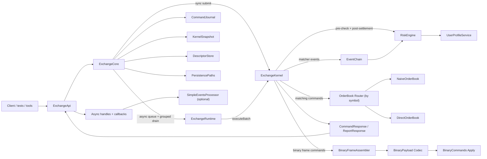
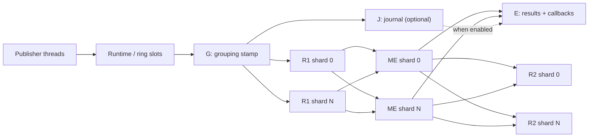
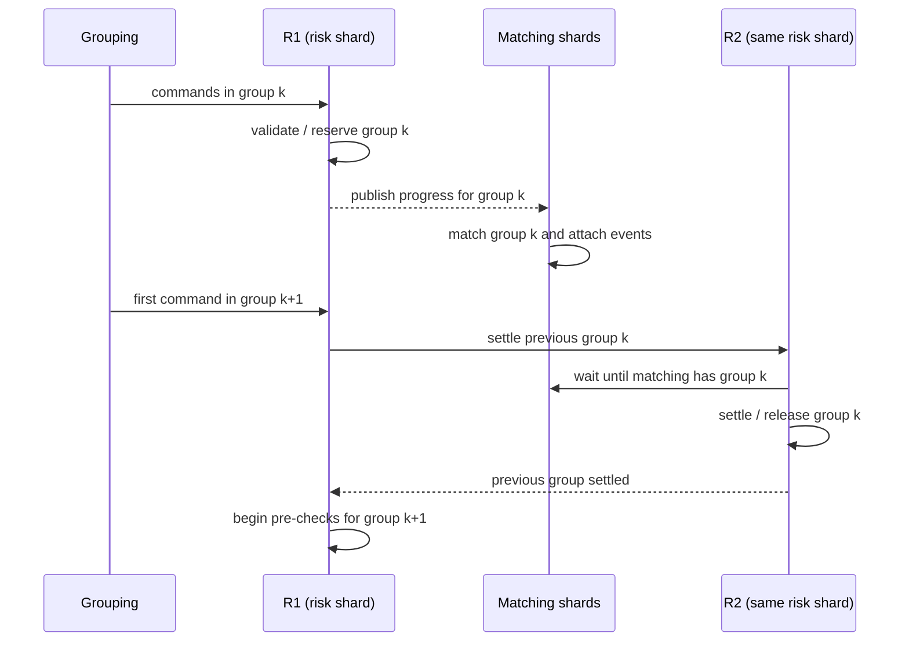
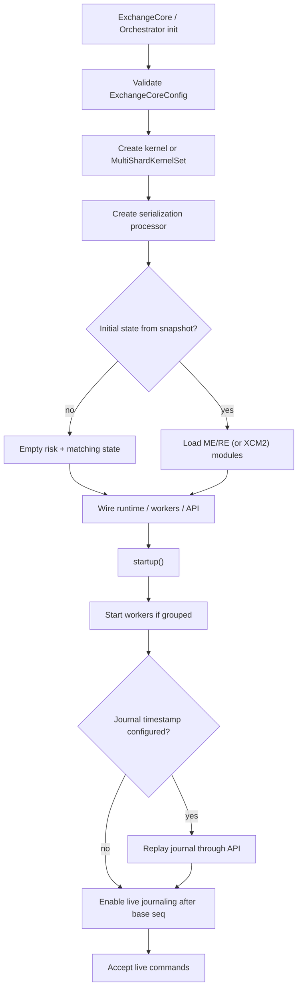
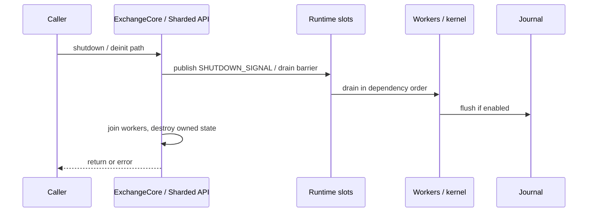

# Architecture and lifecycle

## Entry points

Zig has several composition roots, all rooted in the same domain model:

| Type | File | Role |
|---|---|---|
| [`ExchangeKernel`](../../src/zig/core/exchange_kernel.zig) | Core synchronous engine | Owns risk, books, binary assembler, reports. `execute` runs R1 → ME → R2 in one call. |
| [`ExchangeCore`](../../src/zig/core/exchange_core.zig) | Composition root | Wires kernel + optional runtime queue, journaling, snapshots, descriptors, lifecycle. |
| [`ExchangeApi`](../../src/zig/core/exchange_api.zig) | Public facade | Sync/async/batch/binary/report helpers over `ExchangeCore`. |
| [`ExchangeApiSharded`](../../src/zig/core/exchange_api_sharded.zig) | Multi-shard facade | Default production path for sharded topologies and Java-default orchestration. |
| [`ExchangeOrchestrator`](../../src/zig/core/exchange_orchestrator.zig) | Backend selector | Chooses single-core vs sharded backends and pipeline mode. |
| [`ExchangeRuntime`](../../src/zig/core/exchange_runtime.zig) | Async drain | Queues commands and drains them through the kernel (or sharded workers). |

Construction takes an allocator and an [`ExchangeCoreConfig`](../../src/zig/core/config.zig) (or `JavaExchangeConfig` mapped into it). Config nests matching, runtime, initial state, reports, logging, serialization, static capacity, and `sharded_pipeline_mode`.

Default configuration is deliberately simple and Java-aligned where practical: one risk shard, one matching shard, naive order book option, full risk, margin trading enabled, serialization off (`dummy`), and **persistent grouped** pipeline mode for sharded defaults. Latency/throughput presets switch books, wait strategies, shard counts, and static pools; see `PerformanceConfig` and `StaticCapacityConfig` in `config.zig`.

## High-level composition



## Execution topologies

### Single-threaded kernel (immediate path)

`ExchangeKernel.executeAtSequenceWithSettlement`:

1. Assign/validate publication sequence (monotonic).
2. **R1** — `RiskEngine.preProcessCommand`.
3. **Binary** — if frame command, assemble and apply payload or produce report.
4. **ME** — if matching command, route to the symbol book.
5. **R2** — prepare/commit exchange or margin release (or `handlerRiskRelease` fallback).
6. Return owned `CommandResponse` (result code, optional events, L2, reports).

This is the path used by WASM, many unit tests, and explicit `immediate` mode.

### Persistent grouped pipeline (production default for sharded)

Java’s Disruptor graph is not copied class-for-class. Zig implements the same **dependency graph**:

```text
grouping / journaling
        |
        v
R1 on every risk engine -> matching on every matching engine -> results
        ^                                               |
        |                                               v
        +------------- previous-group R2 ---------------+
```



Owned by [`sharded_pipeline.zig`](../../src/zig/core/sharded_pipeline.zig) and `ExchangeApiSharded`:

- one **paired R1/R2 worker per risk shard**;
- one **worker per matching shard**;
- Java-compatible **same-group R1 lookahead**;
- **cross-group R2 barriers** (R1 of group *k+1* waits until R2 finished group *k* for that shard);
- **journal-gated results** before delayed R2 (results do not wait for R2);
- global barriers for query/snapshot/reset/persistence/shutdown quiescence;
- fail-closed **poison** if matching fails mid-group after R1 mutations (terminal; no suffix result publication).

### Why R1 and R2 are paired



This prevents a user’s later order from passing funds/margin checks before earlier matcher events update that user’s balances. Matching of group *k* can overlap later R1 work until the next boundary requires settlement.

Result delivery is **not** directly downstream of R2. An ordinary async completion can return after matching/journaling while R2 for its group is still pending. Commands that need a settled view (report and binary-query final frames) force an event-group boundary first.

## How event groups are formed

[`grouping_processor.zig`](../../src/zig/core/grouping_processor.zig) is a deterministic state machine that stamps every live command with:

- `events_group`: monotonically increasing group number;
- `service_flags`: bit `1` asks matching to attach an L2 snapshot for periodic margin-price refresh.

A group closes when one of these occurs:

- `max_messages_in_group` commands have accumulated (with a persistence-pair exception so matching/risk persist slots stay co-grouped);
- `max_group_duration_ns` elapses while the pipeline is idle;
- a reset, matching snapshot, or grouping-control command needs a hard boundary;
- the final frame of a binary command/query arrives (`symbol == -1`).

When grouping is disabled (`GROUPING_CONTROL` with `order_id == 0`), stamps passthrough so journal replay can restore recorded group metadata.

## Sharding and fan-out

Both module counts are powers of two, allowing a mask instead of modulus:

```text
risk owner     = uid    & (risk_engine_count - 1)
matching owner = symbol & (matching_engine_count - 1)
```

All risk processors observe every command. Only the owning risk shard mutates a user profile, but every risk shard receives global binary commands and reports. Every matching router observes every command, but only the symbol-owning router mutates a normal order book.

The ring/queue is therefore the deterministic broadcast log: admin and query payloads collect or update all shards without a separate message bus.

## State construction and startup



Notes specific to Zig:

- Native live formats are **XCM2** (module/snapshot) and **XCJ3** (journal). Direct Chronicle/LZ4 startup is intentionally absent; offline conversion from Java `.ecs`/`.ecj` is supported.
- Grouped startup inventories XCM1/XCM2. If the newest committed snapshot is **legacy XCM1**, startup fails with `LegacyXcm1RequiresImmediateOrMigration` rather than silently starting empty. Pin `immediate` to restore for migration, or migrate to XCM2.
- Snapshot load with a non-empty custom report registry rejects incompatible legacy XCS/XME/XRE/XCM layouts fail-closed.
- Replay disables grouping so stored `events_group` and `service_flags` survive, then re-enables journaling and grouping after recovery.

## Shutdown and failure behavior



- Exceptions/errors are **fail-closed**. Persistent stages keep one immutable fatal record, wake waiters, and poison the runtime so neither the failing sequence nor its suffix can publish matching results after a mid-group matching fatal.
- Explicit error unions replace Java’s Disruptor exception handler; lifecycle methods return typed errors rather than swallowing failures.
- `ExchangeCore` / sharded API ownership of allocators, journals, and hooks is deterministic: tear down only after stop, and release borrowed settlement transport/registry only after the exchange and plugin stop.

## Configuration choices that change the flow

| Configuration | Effect |
|---|---|
| `matching.matching_engines_num` | Symbol partitions and ME workers; power of two. |
| `matching.risk_engines_num` | User partitions and R1/R2 pairs; power of two. |
| `runtime` group limits / wait strategy | How quickly R2 catches up vs batching throughput; blocking vs spin/yield. |
| `sharded_pipeline_mode` | `persistent_grouped` (default) vs `immediate` compatibility pin. |
| L2 refresh / service flags | How often matching attaches book tops for margin P&L estimates. |
| `orders_processing.risk_processing_mode` | `no_risk_processing` skips funds/margin placement checks. |
| `orders_processing.margin_trading_mode` | Futures registration and margin-position accounting. |
| `matching.order_book_kind` | Naive vs direct book without changing the processor contract. |
| `serialization` | Dummy vs disk journaling/snapshots; enables journal dependency on results. |
| `static_capacity` | Optional fixed matcher-event / order / user map pools for latency work. |
| `initial_state` | Clean start, snapshot-only, or snapshot + journal replay. |

## Related Zig-only extensions

These sit beside the Java-parity pipeline and are optional:

- **TigerBeetle settlement hooks** (`tigerbeetle_*.zig`): prepare fill chains at R2 boundary, durable outbox, destination registry. Not installed by default.
- **WASM browser target**: real kernel, no filesystem persistence or threaded sharded runtime.
- **Static allocation presets**: bounded pools for latency-sensitive deployments.

[Next: command processing](02-command-processing.md)
