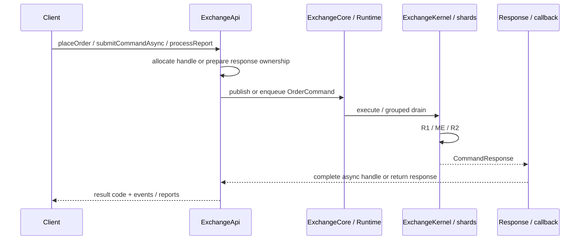
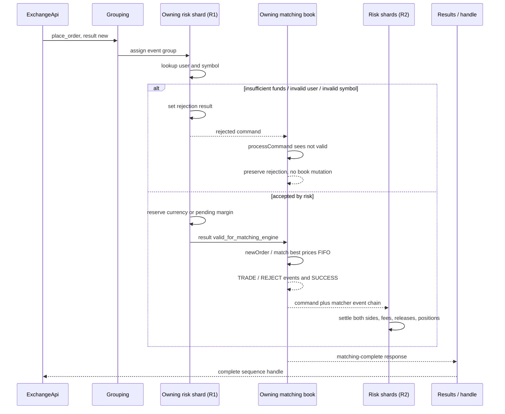

# Command processing

## From public API object to command

[`ExchangeApi`](../../src/zig/core/exchange_api.zig) (and [`ExchangeApiSharded`](../../src/zig/core/exchange_api_sharded.zig)) is an in-process publisher, not a network endpoint. High-level helpers accept structured inputs (or an [`ApiCommand`](../../src/zig/core/api_command.zig) tagged union) and translate them into fields on an [`OrderCommand`](../../src/zig/core/cmd.zig).

Publication sequence is the correlation key for asynchronous calls. Fire-and-forget paths do not install a completion handle; sync helpers own the returned `CommandResponse` and free matcher-event chains on `deinit`.

`processCommandFullResponse` / full-response async paths expose the enriched command view. Values that must outlive the response buffer or ring slot must be copied by the caller.

## One command object carries input, intermediate state, and output

The same `OrderCommand` is enriched in place:

| Phase | Important fields |
|---|---|
| Publication | `command`, order/user/symbol fields, price/size/action/type, timestamp, `result_code = .new` |
| Grouping | `events_group`, `service_flags`; leftover events/L2 from slot reuse are not trusted |
| R1 | Placement may become `.valid_for_matching_engine` or a risk error; user-management commands get their final result here |
| Matching | Order-book result replaces the intermediate result; a linked matcher-event chain and optional L2 may be attached |
| R2 | Matcher events become balances, positions, and fees; the command payload is normally not rewritten |
| Results | Consumer receives the response; async handle completes from sequence |

The internal `.valid_for_matching_engine` result is a gate: the book only mutates for placement when R1 assigned it. A rejected placement still reaches matching, but the book preserves the risk code without mutation.

## Command routing matrix

| Command | R1: risk pre-process | ME: matching | R2: settlement | Result notes |
|---|---|---|---|---|
| `place_order` | Owning user shard validates user/symbol and holds funds or pending margin | Owning symbol book matches and/or rests only if R1 marked valid | Settles `TRADE`; releases unmatched `REJECT`; may refresh margin prices from L2 | Matching success can coexist with a partial IOC reject event. |
| `move_order` | No new hold | Owning symbol verifies order/uid, enforces bid reserve ceiling, removes, rematches, re-inserts remainder | Settles trades from the move | Existing hold follows the order; price cannot exceed reserved bid price in exchange mode. |
| `cancel_order` | No action | Owning symbol removes order and emits one `REDUCE` for unfilled size | Returns reserved funds/pending margin | Unknown or wrong-owner order ID fails in matching. |
| `reduce_order` | No action | Owning symbol reduces up to remaining size and emits one `REDUCE` | Returns the released portion | Non-positive reduce size fails. |
| `order_book_request` | No action | Owning symbol attaches L2 snapshot | Can refresh margin last-price cache | `size < 0` means full depth. |
| `add_user` | Owning user shard creates profile | Ignored | No action | Duplicate user fails in R1. |
| `balance_adjustment` | Owning user shard checks transaction monotonicity and available funds | Ignored | No action | `order_id` = transaction ID; `symbol` = currency; `price` = amount. |
| `suspend_user` / `resume_user` | Owning user shard mutates profile lifecycle | Ignored | No action | Suspend requires zero balances and empty open/pending positions. |
| `binary_data_command` | Every risk shard reassembles and applies (sharded) | Every matching shard reassembles and applies | Binary events ignored by settlement | Only the final frame completes the high-level handle. |
| `binary_data_query` | Every risk shard reassembles and appends a report section | Every matching shard does the same | Binary events ignored | Caller merges all serialized sections / native report. |
| `persist_state_matching` | Marks valid / forces early R1 publish where required | Every matching shard stores snapshot | No action | First half of persist pair; success often `.accepted`. |
| `persist_state_risk` | Every risk shard stores snapshot | Ignored | No action | Second half; combined future returns first failure or success. |
| `reset` | Every risk shard clears state | Every matching shard clears books/reassembly | No matcher events | Grouping forces a boundary first. |
| `nop` | No action | Barrier / success on designated shard | No action | Publication barrier for sync bulk helpers. |
| `shutdown_signal` | Pass-through | Pass-through | R2 driven to terminal sequence | Journal flushes before shutdown completes. |
| `grouping_control` | Metadata only | Ignored | No action | Enables/disables group stamping for replay. |

## Placement sequence, including rejection

For a normal single-user command, only one risk shard changes `result_code`. For multi-shard operations (snapshots, report sections), shards combine results with Java-compatible merge rules (`CommandResultCode.mergeToFirstFailed`).

## User and balance administration

[`user_profile.zig`](../../src/zig/core/user_profile.zig) owns user records inside a risk shard.

### Add and adjust

`add_user` creates an active profile containing:

- a currency-to-balance map;
- a symbol-to-margin-position map;
- a monotonically increasing adjustments counter;
- active/suspended status.

Optional static pre-reserve maps can pre-size account/position maps per config.

`balance_adjustment` uses its transaction ID for duplicate/out-of-order protection:

- equal to the last ID → already applied same transaction;
- lower than the last ID → already passed by later transactions;
- a withdrawal that would make an account negative → NSF;
- otherwise update the balance and counter.

Risk tracks the opposite of each adjustment in system-wide adjustments/suspends accumulators. The total-balance report later combines those counters with client funds, order holds, and fees to test the accounting invariant.

### Suspend and resume

Suspend removes an active profile from the main map only when all accounts are zero and all positions (including pending sizes) are empty. Settlement for a missing profile can recreate a suspended placeholder; resume activates that placeholder or creates a new empty active profile. This accommodates in-flight commands while still allowing inactive profiles to be removed.

## Binary administrative commands

Large administrative objects are not placed by reference. The API:

1. serializes a type code plus payload (Java wire compatible via `compat/java/binary_wire.zig` / `binary_payload.zig`);
2. LZ4-compresses where the Java envelope expects it;
3. packs words into five `long` fields per ring message;
4. marks the final frame with `symbol == -1`;
5. publishes fragments bounded relative to queue capacity.

[`BinaryFrameAssembler`](../../src/zig/core/binary_frames.zig) accumulates frames by `transfer_id`, decompresses the final transfer, and dispatches to:

- `BatchAddSymbols` — installs symbol specs in risk and creates books in matching;
- `BatchAddAccounts` — creates users/accounts in owning risk shards (matching intentionally no-ops).

The final binary frame forces an event-group boundary so prior trading settlement is visible before global administration or queries run.

## Result delivery and backpressure implications

On the async/runtime path:

1. journal stage acknowledges the sequence when journaling is enabled;
2. a shared full-response observer publishes (Java-compatible grouping gate);
3. reduced runtime sinks and optional [`SimpleEventsProcessor`](../../src/zig/core/simple_events_processor.zig) run;
4. request-specific completion handles finish.

Consequently:

- a blocking results consumer delays reclamation and completion of later work;
- uncaught/failed callback policy is fail-closed on the core path (errors surface rather than silently dropping promises);
- `SimpleEventsProcessor` emits, in order: command result, trade/reduce/reject information, then optional order-book data, and ignores non-simple matcher-event kinds.

For low-latency integration, keep the final consumer small and hand immutable copies to another system if downstream work can block.

## What “synchronous” means in this API

`submitCommandsSync` / batch helpers publish a stream of commands and join a final barrier (often an explicit NOP or the last promised command). That guarantees the result stage has reached that sequence. It does not add a special R2 barrier beyond the normal event-group mechanism.

Use a report or binary query when the caller needs a consolidated, settled view of accounts and books; the final frame creates the required group boundary.

## Publication sequence

Zig assigns a global **publication sequence** ([`publication_sequence.zig`](../../src/zig/core/publication_sequence.zig)). Kernel `executeAtSequence` rejects non-monotonic identities before mutating engine state, so replay and concurrent publishers cannot regress or double-apply the same identity.

## Command and result codes

Wire-compatible enums live in [`cmd.zig`](../../src/zig/core/cmd.zig):

- `OrderCommandType` — same integer codes as Java (`place_order = 1`, …, `shutdown_signal = 127`).
- `CommandResultCode` — same integer codes (`success = 100`, `risk_nsf = -2001`, …). Zig adds a small number of native-only codes (for example `matching_engine_capacity` for static pool exhaustion).

[Previous: architecture and lifecycle](01-architecture-and-lifecycle.md) · [Next: matching and risk](03-matching-and-risk.md)
