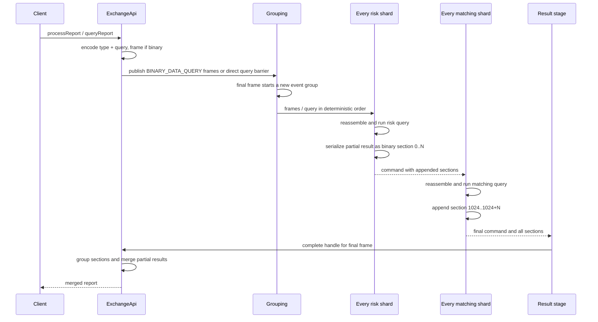
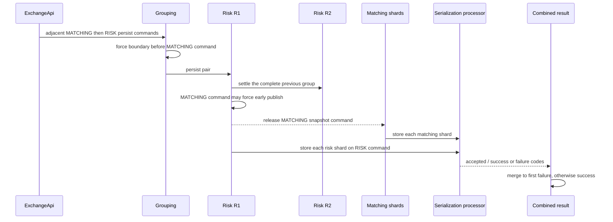
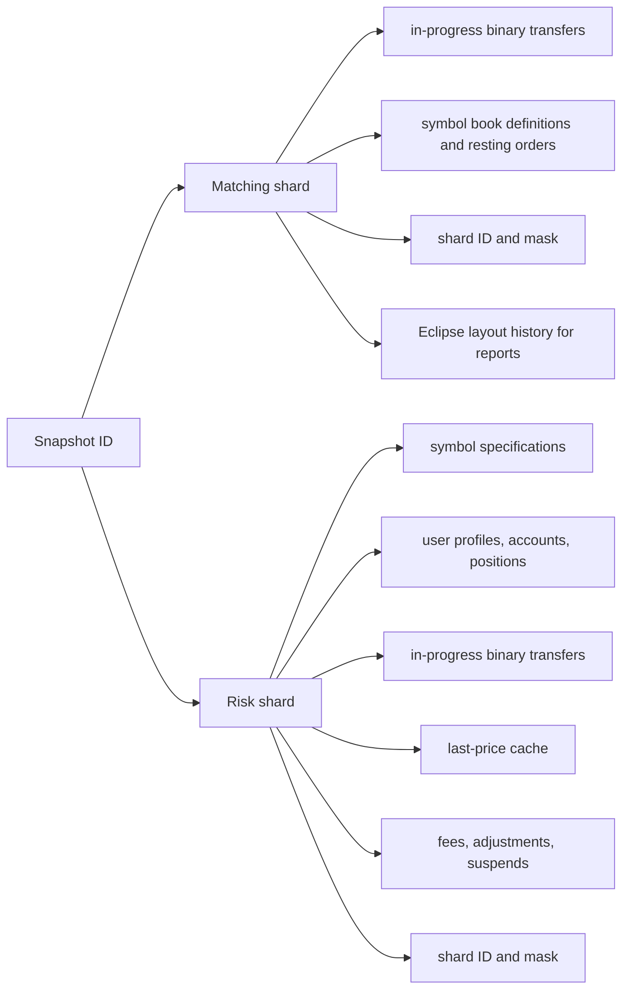
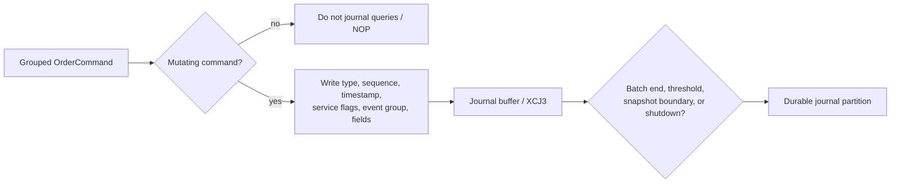
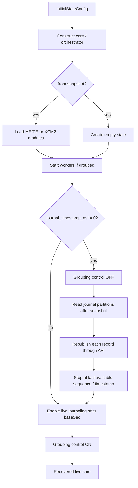

# Reports and persistence

Reports, bulk administration, snapshots, and journal replay all reuse the same command pipeline. There is no side channel that reads mutable state concurrently: each operation is serialized into commands and executed on the threads that own the state.

## Report map/reduce flow

Public entry points:

- `ExchangeApi.processReport` / `processTypedReport` / Java-wire variants;
- `ExchangeApi.queryReport` for native `ReportQuery` without multi-frame binary packaging;
- sharded and orchestrator twins of the same methods.

A report query supplies:

- a stable integer type code (Java wire) or a native `ReportQuery` union;
- serialization of query parameters (binary path);
- per risk-shard and per matching-shard partial processing;
- a merge step over returned sections or partials.



The final frame has `symbol == -1`. Grouping advances the event group before assigning that frame, so every R1 shard first drives R2 through prior trading commands. The report therefore observes settled risk state and the corresponding matched order-book state.

Section numbering matches Java:

```text
risk section     = risk shard ID                 (0, 1, ...)
matching section = matching shard ID + 1024      (1024, 1025, ...)
```

### Native vs exact-Java report lanes

Zig keeps two projections:

| Lane | Purpose | Owners |
|---|---|---|
| **Native** | Portable Zig `ReportResponse` unions for integrations | `exchange_kernel.queryReport`, `ReportQuery` |
| **Exact Java** | Byte/field-compatible report sections for parity | `java_report_producer.zig`, `java_report_wire.zig`, identity hash context |

`binary_report_projection` on the terminal query frame is process-local Zig metadata (not on the Java persistence wire). Unmarked queries retain exact-Java semantics. Exact Java state-hash requires a caller-supplied `JavaIdentityHashContext` because JVM identity hashes are process-local.

Custom report types register through [`report_registry.zig`](../../src/zig/core/report_registry.zig) and the custom report pipeline; XCM2 binds a configuration digest so snapshot restore fails closed on registry mismatch.

## Standard reports

### Single user

- owning risk shard returns status, currency accounts, and margin positions;
- each matching shard scans its books for that user’s open orders;
- merger selects non-null risk data and combines symbol-to-order maps.

This is the normal way to get a consistent user view spanning risk and matching state.

### Total currency balance

- risk shards sum client accounts, position P&L, fees, external adjustments/suspends, and long/short open interest;
- matching shards value currency held by open exchange orders;
- merger sums maps from all sections.

Global balance zero and long OI == short OI are the conservation checks used throughout integration, stress, persistence, and journaling tests.

### State hash

Hashes shard-owned submodules into a sorted module-key map, then folds into one deterministic value. Persistence tests compare this value before and after reconstruction. Exact-Java and native detailed hashes are separate lanes.

## Snapshot creation

Persist is a two-command barrier, not one command:

1. `persist_state_matching` for every matching shard;
2. `persist_state_risk` for every risk shard.



Trading before the snapshot has passed matching and R2 before the snapshot commands start. Matching and risk snapshots may overlap safely because they serialize separate module state.

API helpers: `persistState`, `persistStateWithDefaultMainLog`, `persistStateAsync`, and orchestrator twins.

### File naming (paths)

[`persistence_paths.zig`](../../src/zig/core/persistence_paths.zig):

```text
<exchangeId>_snapshot_<snapshotId>_ME<shard>.ecs
<exchangeId>_snapshot_<snapshotId>_RE<shard>.ecs
<exchangeId>_snapshot_<snapshotId>.ecm          # optional manifest
<exchangeId>_journal_<baseSnapshotId>_<partition>.ecj
```

Native live formats are **XCM2** / **XCJ3**. Java Chronicle artifacts use the same naming family; Zig does not load Chronicle/LZ4 frames directly at runtime—convert offline, then load native modules.

## What each snapshot contains



Shard IDs and masks are stored and validated on load, preventing a snapshot made with one partition layout from silently loading into an incompatible layout. Eclipse int/long map encounter order is preserved for report and hash parity (XMB4/XRB4-related history).

## Journaling path

Journaling is enabled through serialization config (`enable_journaling` + disk backend). The core writes after grouping, in parallel with the risk/matching path when workers are used.



The journal stores original command inputs plus `events_group` and `service_flags`, not derived matcher events. Replay recomputes deterministic risk, matching, and settlement state.

When journaling is enabled, the result stage depends on journal acknowledgement so visible results do not outrun durable publication of that sequence. XCJ3 covers crash-tail repair, sparse continuation, and retry-safe replay.

Snapshot completion registers a new base snapshot and forces the next journal partition to start under that base. Descriptor registration ([`persistence_descriptors.zig`](../../src/zig/core/persistence_descriptors.zig)) follows the durable commit boundary.

## Recovery: snapshot then replay



Low-level replay restores `service_flags`, `events_group`, timestamp, and command-specific fields. Grouping is disabled during replay so it does not overwrite recorded group boundaries. Clients normally issue a report after startup to wait for and validate recovered state.

Common initial-state modes (see `InitialStateConfig` in `config.zig`):

| Mode | Snapshot | Journal replay |
|---|---|---|
| Clean start | None | None |
| Clean start + journaling | None | Live journaling from sequence zero |
| From snapshot only | Required | None |
| Last known state from journal | Required | Replay all available journal data, then continue journaling |

Validation rejects snapshot load with dummy serialization and journal replay without journaling enabled.

## Java interop and conversion

- Authoritative Java-generated fixtures live under `src/zig/fixtures/java-persistence/`.
- Conversion tools and adapters (`java_journal_converter.zig`, `java_snapshot_*`, `legacy_persistence_adapter.zig`) transform Chronicle dumps into Zig-loadable state.
- Direct Chronicle startup remains intentionally out of scope; see `PERSISTENCE_INTEROP_DECISION.md` and `LEGACY_PERSISTENCE_ADAPTER_SPIKE.md` under `src/zig/`.

## Verification patterns

Zig tests and the repository gate prove:

- snapshot-only restore matches pre-snapshot state hashes and balance invariants;
- snapshot + later journal commands reconstruct the final hash and accounting invariant;
- Debug and ReleaseSafe both restore real Java-generated fixtures after conversion;
- crash-window and I/O-failure schedules keep adoption fail-closed.

These are stronger checks than “files exist”: independent module snapshots and deterministic command replay must converge to the same logical state.

## Current implementation boundaries

- Native live formats are XCM2/XCJ3; grouped mode rejects newest-committed XCM1 without an explicit immediate pin or migration.
- Custom serializer callbacks preserve end-of-batch markers but execute serially rather than with Java’s module-thread parallelism for custom processors.
- True journal persistence positions capture only the queue prefix present at the boundary; concurrent suffix work is excluded by design (covered in tests).
- Exact JVM identity remains a capability boundary: supply `JavaIdentityHashContext` or exact state-hash requests fail closed.
- Default serialization is dummy; persistence must be opted into through configuration.
- WASM deliberately excludes the filesystem persistence stack.

[Previous: matching and risk](03-matching-and-risk.md) · [Next: source reading map](05-source-reading-map.md)
