# Source reading map

This is a practical route through the Zig port. Follow one vertical flow at a time instead of reading every file under `src/zig/core` alphabetically.

## Module map

| Area | Start here | What it owns |
|---|---|---|
| Composition and public API | [`exchange_core.zig`](../../src/zig/core/exchange_core.zig), [`exchange_api.zig`](../../src/zig/core/exchange_api.zig), [`exchange_api_sharded.zig`](../../src/zig/core/exchange_api_sharded.zig), [`exchange_orchestrator.zig`](../../src/zig/core/exchange_orchestrator.zig) | Lifecycle, publication, async drain, sharding, shutdown |
| Synchronous kernel | [`exchange_kernel.zig`](../../src/zig/core/exchange_kernel.zig) | R1→ME→R2 in one call, books map, binary path, native reports |
| Internal protocol | [`cmd.zig`](../../src/zig/core/cmd.zig), [`api_command.zig`](../../src/zig/core/api_command.zig), [`common.zig`](../../src/zig/core/common.zig) | Command/result enums, `OrderCommand`, domain types |
| Pipeline mechanics | [`grouping_processor.zig`](../../src/zig/core/grouping_processor.zig), [`sharded_pipeline.zig`](../../src/zig/core/sharded_pipeline.zig), [`exchange_runtime.zig`](../../src/zig/core/exchange_runtime.zig), [`runtime_queue.zig`](../../src/zig/core/runtime_queue.zig) | Groups, workers, queues, wait strategies |
| Risk and users | [`risk.zig`](../../src/zig/core/risk.zig), [`user_profile.zig`](../../src/zig/core/user_profile.zig) | Holds, balances, fees, futures positions, prepare/commit release |
| Matching | [`orderbook_naive.zig`](../../src/zig/core/orderbook_naive.zig), [`orderbook_direct.zig`](../../src/zig/core/orderbook_direct.zig) | Price-time matching and resting-order structures |
| Event output | [`events.zig`](../../src/zig/core/events.zig), [`simple_events_processor.zig`](../../src/zig/core/simple_events_processor.zig) | Trade/reduce/reject chains and client-friendly callbacks |
| Binary/report fan-out | [`binary_frames.zig`](../../src/zig/core/binary_frames.zig), [`binary_payload.zig`](../../src/zig/core/binary_payload.zig), [`binary_commands.zig`](../../src/zig/core/binary_commands.zig), [`compat/java/binary_wire.zig`](../../src/zig/core/compat/java/binary_wire.zig), [`report_registry.zig`](../../src/zig/core/report_registry.zig) | Framing, codecs, admin apply, custom reports |
| Persistence | [`serialization_processor.zig`](../../src/zig/core/serialization_processor.zig), [`snapshot.zig`](../../src/zig/core/snapshot.zig), [`journal.zig`](../../src/zig/core/journal.zig), [`persistence_paths.zig`](../../src/zig/core/persistence_paths.zig), [`persistence_descriptors.zig`](../../src/zig/core/persistence_descriptors.zig), `sharded_snapshot*.zig` | Module snapshots, journal, paths, descriptors |
| Live Java compatibility | [`compat/java/root.zig`](../../src/zig/core/compat/java/root.zig), [`compat/java/report_producer.zig`](../../src/zig/core/compat/java/report_producer.zig), [`compat/java/report_wire.zig`](../../src/zig/core/compat/java/report_wire.zig), [`compat/java/hash32.zig`](../../src/zig/core/compat/java/hash32.zig) | Runtime binary/report wire parity and exact Java hashing |
| Offline Java persistence interop | [`interop/java_persistence/root.zig`](../../src/zig/interop/java_persistence/root.zig), [`interop/java_persistence/converter.zig`](../../src/zig/interop/java_persistence/converter.zig), [`interop/java_persistence/journal_converter.zig`](../../src/zig/interop/java_persistence/journal_converter.zig) | Opt-in `.ecs`/`.ecj` conversion to native XCM2/XCJ3 |
| Configuration | [`config.zig`](../../src/zig/core/config.zig) | Pipeline shape, performance presets, static capacity, initial state |
| Settlement opt-in | [`settlement_lifecycle.zig`](../../src/zig/core/settlement_lifecycle.zig), `tigerbeetle_*.zig` | External fill capture hooks and TigerBeetle outbox |
| Apps | [`apps/server.zig`](../../src/zig/apps/server.zig), [`apps/client.zig`](../../src/zig/apps/client.zig), [`apps/browser/`](../../src/zig/apps/browser/) | TCP demo and WASM surface |

Java production class → Zig owner map: [`JAVA_PRODUCTION_CLASS_MAP.md`](../zig/JAVA_PRODUCTION_CLASS_MAP.md).
Processor timing/ownership: [`PROCESSOR_PARITY_DECOMPOSITION.md`](../zig/PROCESSOR_PARITY_DECOMPOSITION.md).

## Walkthrough 1: bootstrap a small exchange

Use the TCP demo or an embedded `ExchangeApi` session as the executable top-level narrative:

```mermaid
flowchart LR
    Build["Init ExchangeCore / API"] --> Start["startup if required"]
    Start --> Symbol["BatchAddSymbols / addSymbol"]
    Symbol --> Users["add_user"]
    Users --> Funds["balance_adjustment"]
    Funds --> Maker["Place GTC bid"]
    Maker --> Taker["Place IOC/GTC ask"]
    Taker --> L2["order_book_request"]
    L2 --> Move["move_order"]
    Move --> Cancel["cancel_order"]
    Cancel --> Reports["Single-user and total-balance reports"]
```



Runnable paths:

```bash
# TCP two-terminal quickstart (see USAGE_EXAMPLES.md)
zig build
./zig-out/bin/exchange-core-server
./zig-out/bin/exchange-core-client -- ping
# add-user, deposit, place, balance, book, shutdown

# Browser WASM smoke
zig build -j1 wasm-smoke
```

While following that path in code:

1. `ExchangeApi.placeOrder` / `submitCommandAsync` — translate and publish.
2. `ExchangeCore` / runtime — stage graph the command enters.
3. `RiskEngine.preProcessCommand` — R1 dispatch.
4. Kernel book `processCommand` — matching.
5. `prepareExchangeRiskRelease` / `handlerRiskRelease` — R2 settlement.
6. Response ownership / async completion / optional `SimpleEventsProcessor`.

## Walkthrough 2: one GTC order crossing the book

For the simplest full trade path, search/read these methods in order:

```text
ExchangeApi.placeOrder
  -> OrderCommand construction (cmd.zig / api_command.zig)
  -> ExchangeKernel.executeAtSequenceWithSettlement   # or sharded workers
  -> RiskEngine.preProcessCommand
  -> RiskEngine.placeOrderRiskCheck
  -> RiskEngine.placeOrder
  -> RiskEngine.placeExchangeOrder   # or margin path
  -> Book.processCommand
  -> naive/direct newOrderPlaceGtc (or equivalent)
  -> tryMatch / bucket FIFO
  -> events.sendTrade (event chain)
  -> RiskEngine.prepareExchangeRiskRelease
  -> RiskEngine.commitPreparedExchangeRiskRelease
  -> CommandResponse returned / callback completed
```

After that path is clear, cancel, reduce, and move are small variations centered in the order-book implementation and the `REDUCE` event settlement path.

## Walkthrough 3: a consistent cross-module report

```text
ExchangeApi.processReport / queryReport
  -> encode + publish binary frames (if Java wire)
  -> GroupingProcessor (final-frame group boundary)
  -> RiskEngine.preProcessCommand (binary stage)
  -> BinaryFrameAssembler.acceptFrame
  -> report process on risk view
  -> matching binary stage / report process
  -> section merge / createResult
  -> ExchangeApi completes handle and returns ReportResponse
```

Read native `ReportQuery` handling in `exchange_kernel.zig` first. Then read `compat/java/report_producer.zig` for exact-Java sections, then `TotalCurrencyBalanceReport` for the accounting invariant, then state-hash for persistence validation.

## Walkthrough 4: snapshot and journal recovery

Start with config and tests rather than the file format:

1. `InitialStateConfig` factories in `config.zig` — clean / snapshot / journal modes.
2. `ExchangeApi.persistState*` — two-command consistent snapshot barrier.
3. Matching/risk persist command handling and `serialization_processor` store paths.
4. Snapshot load during init and journal replay after worker start.
5. `src/zig/fixtures/java-persistence/` — real Java-generated converted evidence.
6. Gate target `zig build -j1 gate` — full parity and persistence evidence.

## Useful tests and evidence by concept

| Question | Where to look |
|---|---|
| Does the TCP demo work end to end? | `zig build run-server` + `run-client`; `USAGE_EXAMPLES.md` |
| Does WASM matching work without FS? | `zig build -j1 wasm-smoke`; `docs/zig/BROWSER.md` |
| Do naive and direct books share behavior? | Tests co-located in `orderbook_*.zig`; gate suite |
| Are invalid users, symbols, funds rejected? | Focused tests in `risk.zig`, `exchange_kernel.zig`, `exchange_api*.zig` |
| Do fees conserve balances? | Total-balance report tests and migration coverage ledger |
| Does state survive snapshots? | Persistence tests in core modules; `MIGRATION_COVERAGE.md` |
| Does snapshot + journal reproduce final state? | Journaling tests; java-persistence fixtures |
| How is production-shaped load measured? | `src/zig/bench/`, orchestrator A/B reports under `src/zig/` |
| Java class → Zig file? | `JAVA_PRODUCTION_CLASS_MAP.md` |

## Commands for local exploration

```bash
# Format check
zig fmt --check build.zig src/zig

# Unit tests (Debug)
zig build test

# Unit tests (ReleaseSafe)
zig build test-release-safe

# Full serial gate (migration, parity, API audit, browser)
zig build -j1 gate --summary all

# TCP demo
zig build run-server
zig build run-client -- ping

# Find every dispatch point for one internal command
rg 'persist_state_matching' src/zig
```

Use Zig **0.16.0** as pinned by `build.zig.zon`. For Java fixture regeneration, use a project-compatible JDK (8 or 11); newer JDKs can fail OpenHFT reflection during Java persistence writers.

Performance benches and persistence modules can be CPU-, time-, and disk-intensive. Run focused targets intentionally rather than using them as the first reading smoke test.

## Things that are easy to misread

- There are multiple “API” types: kernel-local `ExchangeApi` inside `exchange_kernel.zig`, public `exchange_api.zig`, and `exchange_api_sharded.zig`. Prefer the public facades for integration.
- The single-threaded kernel runs R2 before returning; the persistent grouped pipeline publishes results **without** waiting for R2 (Java sibling timing).
- Every shard observes global commands; shard masks decide who mutates partitioned user/order state.
- R2 is a second phase of the same risk shard, invoked through group boundaries (or immediately in kernel mode), not a downstream database writer.
- A successful matching result does not mean “fully filled”; inspect `TRADE` and `REJECT` events.
- Symbol `price` and `size` are scaled integers, not currency decimals.
- Report data can travel back in matcher-event nodes even though it is not trading data.
- `immediate` mode is a compatibility pin, not the sharded production default.
- WASM is a real kernel path but excludes persistence and threaded sharding by design.
- The Zig port is the subject of this guide; Java flow detail remains in [`docs/java-flows/`](../java-flows/README.md).

[Back to the guide index](README.md)
