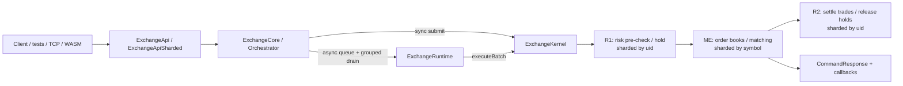

# exchange-core Zig flow guide

This guide explains the Zig port in this checkout (`src/zig`). It is organized around runtime flows rather than file names: how a command enters the core, which stage owns each state transition, how an order becomes trades and balance changes, and how the same state is queried or restored.

The Zig core is an in-memory, event-sourced matching system that preserves the Java pipeline semantics (R1 → matching → R2) while using native ownership, explicit error sets, and either a single-threaded kernel or a persistent per-shard worker graph. Every inbound operation becomes an [`OrderCommand`](../../src/zig/core/cmd.zig) and travels through a fixed processor sequence.

The Java twin of this guide is [`docs/java-flows/`](../java-flows/README.md). When behavior is shared, this guide states the Zig owners and notes intentional native boundaries.

## Start here

- **[How exchange-core works](../HOW_EXCHANGE_CORE_WORKS.md)** — full onboarding narrative. Plain-language conveyor-belt model, stage names, place→match→settle with numbers, and a Java↔Zig map.
- **[src/zig/README.md](../../src/zig/README.md)** — port status, parity evidence, TCP/WASM demos, and TigerBeetle settlement boundary.
- **[src/zig/USAGE_EXAMPLES.md](../../src/zig/USAGE_EXAMPLES.md)** — runnable TCP client, embedded integration, persistence, and orchestrator examples.
- Then read the flow chapters below in order for depth.

## Read in this order

1. [Architecture and lifecycle](01-architecture-and-lifecycle.md) — composition roots, kernel vs runtime vs sharded pipeline, grouping, startup, and shutdown.
2. [Command processing](02-command-processing.md) — API publication, command routing, binary frames, admin commands, and result delivery.
3. [Matching and risk](03-matching-and-risk.md) — order types, price-time matching, funds/margin holds, trade settlement, cancel, reduce, and move.
4. [Reports and persistence](04-reports-and-persistence.md) — binary fan-out, report map/reduce, snapshots, journaling, and recovery.
5. [Source reading map](05-source-reading-map.md) — a guided path through the Zig modules and executable demos/tests.

## The shortest useful mental model

On the single-threaded path, `ExchangeKernel.execute` runs R1, matching, and R2 in one call. On the default **persistent grouped** path, one paired R1/R2 worker runs per risk shard and one worker per matching shard; results publish after journal acknowledgement and before delayed R2, matching Java sibling timing. Explicit **immediate** mode remains available as a compatibility pin. The exact dependency graph is in [Architecture and lifecycle](01-architecture-and-lifecycle.md#execution-topologies).

## State ownership

| State | Owning component | Partition key | Purpose |
|---|---|---:|---|
| Publication sequence, async handles, callbacks | [`ExchangeApi`](../../src/zig/core/exchange_api.zig) / [`ExchangeApiSharded`](../../src/zig/core/exchange_api_sharded.zig) | Publication sequence | Translates `ApiCommand` to internal commands and completes asynchronous work. |
| `events_group`, L2 service flags, group boundaries | [`grouping_processor.zig`](../../src/zig/core/grouping_processor.zig) | Global sequence | Defines the accounting consistency boundary used by the two-step risk pipeline. |
| Users, currency accounts, positions, fees, adjustments, last prices | [`RiskEngine`](../../src/zig/core/risk.zig) | `uid & (risk_shards - 1)` | Validates/holds funds in R1 and settles/releases funds in R2. |
| Symbol specifications used by risk | `SymbolSpecificationProvider` inside risk | Copied / shared per risk shard | Supplies scale, fee, and margin rules. |
| Order books and open orders | Books in [`ExchangeKernel`](../../src/zig/core/exchange_kernel.zig) / sharded set | `symbol & (matching_shards - 1)` | Routes symbol commands to `NaiveOrderBook` or `DirectOrderBook`. |
| Binary transfer reassembly | [`BinaryFrameAssembler`](../../src/zig/core/binary_frames.zig) | One assembler (or per-shard in multi-shard) | Reassembles multi-frame commands/queries. |
| Durable snapshots and journal files | [`serialization_processor.zig`](../../src/zig/core/serialization_processor.zig), [`snapshot.zig`](../../src/zig/core/snapshot.zig), [`journal.zig`](../../src/zig/core/journal.zig) | Module type and shard | Stores, loads, journals, and replays deterministic state. |

Risk-shard and matching-shard counts must be powers of two. Risk shards divide user ownership; matching shards divide symbol ownership. All shards observe every command, but only the owning shard mutates partitioned state.

## Important vocabulary

- **Taker / active order**: the incoming or moved order that initiates matching.
- **Maker / matched order**: an existing resting GTC order consumed by the taker.
- **R1**: pre-matching risk step. Validates a new order and reserves funds or pending margin.
- **ME**: matching-engine step. Mutates the order book and attaches a linked list of `TRADE`, `REDUCE`, or `REJECT` events.
- **R2**: post-matching risk step. Consumes matcher events to settle balances, fees, and positions. Often prepare-then-commit for exchange/margin paths.
- **Event group**: a bounded batch. Crossing into the next group makes R1 wait for matching and R2 of the previous group before more pre-checks.
- **Binary command**: multi-frame administrative payload (LZ4-compatible wire with Java), such as adding symbols or bulk accounts.
- **Report section**: one shard's serialized partial report, returned through binary events and merged by the caller.
- **Immediate mode**: compatibility pin that executes stages without persistent worker pipelining; used for legacy snapshot migration and focused tests.
- **Persistent grouped mode**: production default for multi-shard and Java-default orchestration; one worker per ME, one paired R1/R2 worker per RE.

## Scope boundaries

These documents describe the Zig source under `src/zig`. They do not describe a full FIX gateway, authentication service, market-data bus, or external database as part of the matching core. Adapters live in:

- TCP demo: [`apps/server.zig`](../../src/zig/apps/server.zig) / [`apps/client.zig`](../../src/zig/apps/client.zig)
- Browser WASM: [`apps/browser/`](../../src/zig/apps/browser/)
- Optional TigerBeetle settlement hooks: `core/tigerbeetle_*.zig` (opt-in; not part of the ordinary pipeline)

Parity evidence, class maps, and migration ledgers stay in `src/zig/*.md`; this guide focuses on runtime flows.
