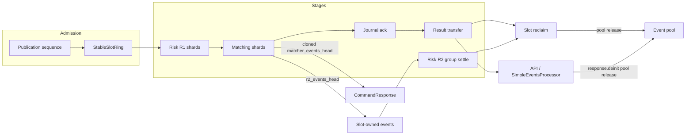
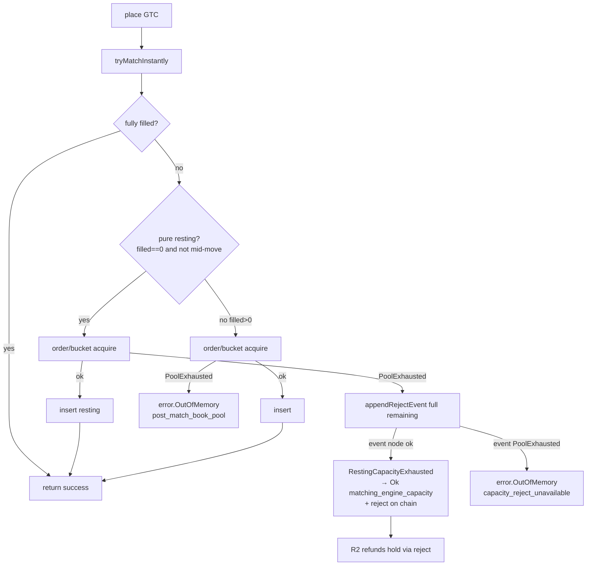
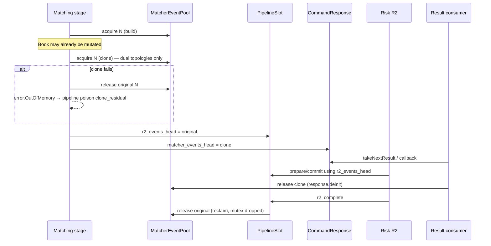
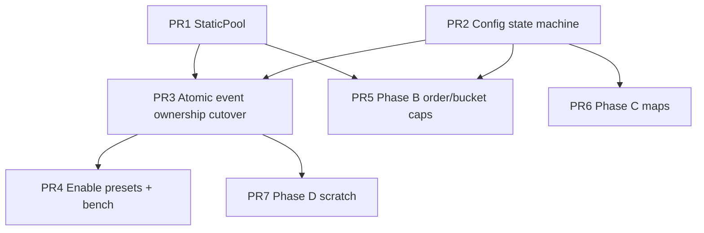

# Static Allocation for the Zig exchange-core Port

| Field | Value |
| --- | --- |
| **Author** | TBD |
| **Date** | 2026-08-01 |
| **Status** | Draft (rev 5 — product open questions partially resolved 2026-08-01: `-3060` final; latency-first enablement) |
| **Workspace** | `/Users/lock/ghq/github.com/exchange-core/exchange-core` |
| **Primary code** | `src/zig/core/` |
| **Zig** | 0.16.0 (pinned by `build.zig.zon`) |
| **Production topology** | `persistent_grouped` sharded pipeline |

---

## Overview

The Zig port of exchange-core2 already has several capacity-shaped structures (`StableSlotRing` / `PipelineSlot`, XCJ3 fixed encode buffers, freelist-shaped order/bucket pools), but the matching and result hot path still performs unbounded heap traffic: every `MatcherTradeEvent` node is `allocator.create`/`destroy`, the sharded matching stage **clones** the full event chain for dual ownership (R2 + `CommandResponse`), and `OrderPool` / `BucketPool` silently grow via `allocator.create` when their freelists are empty. Risk/user maps also call `ensureUnusedCapacity` on first use of keys.

This design defines **static allocation for this multi-stage, multi-shard engine**—not a TigerBeetle single-thread pure-static world—and proposes a phased migration: (A) bounded matcher-event pools with an explicit dual-ownership model and residual risk budget, (B) hard caps on direct order/bucket pools with **command-level** capacity failures (not pipeline poison), (C) optional pre-reservation of risk/user maps, and (D) slot/worker scratch for journal/L2/report buffers. Capacity is configured at bootstrap via an explicit enable machine (no overloaded `0` sentinels). Observable Java parity is retained for default policy paths; intentional static caps are an ops-configured extension with documented semantics.

---

## Background & Motivation

### Why now

Capacity evidence on same-host M4 (not a production claim) shows ~637k settled cmd/s (1×1) and ~190k (4×2) for `persistent_grouped`. Product evaluation of TigerBeetle-style techniques ranked:

| Technique | Verdict for XC2 Zig |
| --- | --- |
| Static allocation / object pools | **Highest ROI** on matching + risk hot path |
| io_uring / DIO | Only if journal fsync is proven bottleneck — **out of scope** |
| LSM | Wrong for live order books — **out of scope** |
| Fixed-size cells + bounds | Pairs with static pools; XCJ3 journal is already near-fixed |

Allocator traffic on the match path is pure overhead: event nodes are short-lived, high-churn, and already conceptual freelist candidates. Order/bucket pools already have freelist structure but not hard capacity. Closing those gaps improves tail latency, reduces allocator contention under `LockedAllocator` payload paths, and makes worst-case memory predictable for ops sizing.

### Current allocation reality (verified in tree)

#### Partially pooled (unbounded growth)

`src/zig/core/orderbook_direct.zig` defines `OrderPool` / `BucketPool` with `pool_next` freelists and reuse counters (`PoolStats`), but `acquire` falls back to `allocator.create` when empty:

```103:114:src/zig/core/orderbook_direct.zig
    fn acquire(self: *OrderPool) std.mem.Allocator.Error!*DirectOrder {
        if (self.head) |item| {
            self.head = item.pool_next;
            // ...
            return item;
        }
        const item = try self.allocator.create(DirectOrder);
        self.allocations += 1;
        return item;
    }
```

Live orders currently held in `order_id_index` are destroyed directly on book `deinit` (not returned through the freelist)—the freelist only holds released nodes. Caps must cover **live + free** concurrently. Book `deinit` must switch to “unlink live, free slab once.”

#### Hot-path heap today

| Site | Behavior |
| --- | --- |
| `events.EventChain.append` / `prepend` | `allocator.create(MatcherTradeEvent)` per node |
| `cloneMatcherEventChain` | Another full chain of `create` nodes |
| `orderbook_direct` / `orderbook_naive` | Append trades/rejects/reduces through `EventChain`; reserved reject via `chain.allocator.create` **before** match |
| `StageAdapter.runMatching` | `takeOwnedHead` for R2 + **`cloneMatcherEventChain` for response** (post book mutation) |
| `CommandResponse.deinit` / slot reclaim | `deinitMatcherEventChain` → `destroy` each node |
| Risk / user maps | `ensureUnusedCapacity` on first currency/position/user/fee key |
| Report producers | `java_report_producer`, `custom_report_pipeline`, kernel `produceCustomReportEvents` also build `EventChain`s |

Critical dual-ownership path (production sharded pipeline):

```4779:4791:src/zig/core/exchange_kernel.zig
            const r2_events_head = event_chain.takeOwnedHead();
            errdefer events.deinitMatcherEventChain(self.kernels.allocator, r2_events_head);
            response.matcher_events_head = try events.cloneMatcherEventChain(
                self.kernels.allocator,
                r2_events_head,
            );
            response.completeFromCommand(command);
            return .{
                .response = response,
                .r2_events_head = r2_events_head,
                // ...
            };
```

Clone is intentional: result publication can leave the slot (`takeNextResult`) while R2 still needs the chain until group settle + reclaim (`PipelineSlot.r2_events_head`, destroyed in `reclaimLocked` / `resetOwned`). **Important:** clone runs **after** book mutation; under a bounded pool this is the residual atomicity gap of the clone model (see Phase A — Clone residual).

#### Already capacity-shaped (extend these patterns)

- **`StableSlotRing` / `PipelineSlot`** (`sharded_pipeline.zig`): power-of-two ring, claim fails when slot not free; payload ownership reset on reclaim.
- **XCJ3 journal** (`journal.zig`): `XCJ3_MAX_ENTRY_BYTES = 90`, stack `encoded: [XCJ3_MAX_RECORD_BYTES]u8` encode path.
- **Prepare/commit risk release**: fallible prepare before mutation; commit infallible.
- **`PersistentGroupedRuntime.prepared`**: already preallocates per-risk-shard prepare slots at runtime create (`prepared: []?PreparedShardRiskRelease`) — Phase D aligns remaining hot allocs with this pattern.

### Architecture constraints



- Multi-stage: Grouping → R1 → ME → (journal ∥ result) → R2 → reclaim.
- Event chains **outlive** matching (callbacks, raw observers, pre-R2 result publication).
- Matching OOM today **poisons the pipeline** (`SerialGroupedPipeline` / `PersistentGroupedRuntime` / `GroupedTwoStepExecutor`). Static capacity must not turn ordinary “book full” into terminal poison (see Error mapping table).
- `reclaimLocked` **drops the runtime mutex** around event chain teardown — pool free is concurrent with other workers.
- Parity: representation may change; observable results/hashes must stay correct under default (unbounded-or-large) presets used by the gate.
- Gate: `zig build -j1 gate`; capacity via `bench-orchestrator-ab`.

---

## Goals & Non-Goals

### Goals

1. Define static allocation for **this** multi-shard, multi-stage engine (bounded pools + bootstrap capacity, not “zero allocator forever”).
2. Eliminate unbounded hot-path `create`/`destroy` for matcher events and direct order/bucket nodes.
3. Make matcher-event ownership explicit per topology (dual-clone vs single-chain), correct, and pool-backed.
4. **Fail closed before mutation** for capacity checks that are reachable *before* irreversible book/risk writes (reserved reject, resting place, map strict puts, first event node when no mutation yet). Document and budget the **clone residual** (post-mutation clone failure) honestly—do not claim full command atomicity for that site under the clone model.
5. Split **integrity/poison** errors from **capacity-policy** command results (order book full must not kill the engine).
6. Expose capacity configuration with an unambiguous enable/derive/fixed machine (no overloaded `0`).
7. Provide memory sizing estimates, tiered defaults (test / WASM / latency / throughput), and ops guidance.
8. Land via ordered PRs where ownership cutover is **atomic** across all create/destroy sites; gate on that cutover.

### Non-Goals

- io_uring / DIO / journal storage engine rewrite.
- LSM or replacing live order books with disk-oriented structures.
- Changing XCJ3 / snapshot wire formats or Java persistence interop contracts (except optional **additive** Zig `CommandResultCode` for capacity—see error table).
- Multi-node HA, cross-process shared memory, or NUMA-aware placement.
- Forcing `NaiveOrderBook` onto order/bucket object pools in phase B (naive remains correctness/parity reference; direct is production hot path). Naive **does** share the matcher event pool via `EventChain`.
- Removing the allocator parameter from the entire engine (cold paths, tests, snapshot import may still allocate).
- Online pool resize without restart.
- Refcounting event nodes as the **primary** v1 model (clone retained; refcount is Phase A.1 escape hatch if headroom policy fails in soak).

---

## What “static allocation” means here

**Definition (exchange-core Zig):**

> At process/engine bootstrap, reserve finite slabs for every object class that participates in the **command hot path** when static mode is enabled. Steady-state matching, risk pre/post, result publication, and slot reclaim **do not call the general-purpose heap for those classes**. Exhaustion is handled per the **error mapping table** (command result vs poison). Cold paths may still use the allocator under documented policy.

This is **not**:

- A single global arena wiped per command (event chains cross stages and threads).
- Guaranteed zero allocation for every API surface (binary report packing, custom reports, L2 snapshot arrays remain separate work unless Phase D covers a site).
- Implicit growth “until OOM of the machine” when static mode is on.
- A claim that progressive matching + post-match clone is fully transactional (see Clone residual).

| Object class | Static? | Owner | Lifetime |
| --- | --- | --- | --- |
| Pipeline slots | Already | Runtime / `StableSlotRing` | Ring residency |
| Matcher event nodes | Phase A | Kernel-set pool (mutex) or per-ME-shard pools | Build → R2 and/or response deinit |
| DirectOrder / Bucket | Phase B | Per `DirectOrderBook` slab | Resting book + freelist |
| Risk/user hash maps | Phase C (optional) | Per risk shard | Process life; pre-reserve |
| Journal encode buf | Already stack / Phase D scratch | Worker stack or slot scratch | Call scope |
| L2 / report scratch | Phase D | Worker / slot | Call or slot scope |
| R2 prepare arrays | Partially today + Phase D | Runtime `prepared` / kernel set | Runtime life |

---

## Implementation contract

This section is normative for implementers.

### Config state machine

```zig
/// How matcher event nodes are stored.
pub const MatcherEventStorage = union(enum) {
    /// Today's behavior: allocator.create/destroy per node (default until cutover enabled).
    unbounded_heap,
    /// Static pool; capacity derived: 2 * ring_buffer_size * events_per_command_sizing.
    derive,
    /// Static pool with explicit node capacity.
    fixed: usize,
};

pub const BookPoolCaps = struct {
    max_orders: usize,
    max_price_buckets: usize,
};

pub const StaticCapacityConfig = struct {
    matcher_events: MatcherEventStorage = .unbounded_heap,

    /// Sizing input for `.derive` only — NOT an enforcement cap (see events_per_command_limit).
    events_per_command_sizing: usize = 64,

    /// Optional hard max events per command. null = no enforcement (Java parity default).
    events_per_command_limit: ?usize = null,

    /// Order/bucket caps when static books enabled; ignored for unbounded heap books.
    order_pools: union(enum) {
        unbounded_heap,
        fixed: BookPoolCaps,
    } = .unbounded_heap,

    /// Map pre-reserve (Phase C). Zero means do not pre-reserve that dimension.
    pre_reserve_users_per_risk_shard: usize = 0,
    pre_reserve_accounts_per_user: usize = 0,
    pre_reserve_positions_per_user: usize = 0,
    /// If true, map growth mid-command returns capacity command result instead of allocate.
    strict_static_maps: bool = false,

    l2_scratch_depth: usize = 64,
    report_scratch_bytes: usize = 64 * 1024,

    /// Single source of truth for matcher event pool node capacity.
    /// - `unbounded_heap` → `null` (no pool).
    /// - `derive` → `ring * events_per_command_sizing * dual_factor` (default dual_factor=2).
    /// - `fixed` → the configured capacity (already final; dual_factor ignored).
    /// Overflow is a **validation error**, never silently treated as unbounded.
    pub fn resolvedMatcherEventCapacity(
        self: StaticCapacityConfig,
        ring_buffer_size: usize,
        dual_factor: usize = 2,
    ) error{Overflow, InvalidDualFactor}!?usize {
        if (dual_factor == 0) return error.InvalidDualFactor;
        return switch (self.matcher_events) {
            .unbounded_heap => null,
            .derive => blk: {
                const per_cmd = try std.math.mul(usize, ring_buffer_size, self.events_per_command_sizing);
                break :blk try std.math.mul(usize, per_cmd, dual_factor);
            },
            .fixed => |n| n,
        };
    }
};
```

**Rules:**

- Never use `0` as a sentinel meaning both “derive” and “disabled.”
- `.unbounded_heap` preserves today’s behavior (tests, gradual rollout).
- `.derive` / `.fixed` enable static mode and **require** pool init at kernel/runtime bootstrap.
- **`resolvedMatcherEventCapacity` always applies `dual_factor` (default 2)** for `.derive`. Callers (kernel init, preset docs, benches) must use this helper only—do not re-multiply. Single-chain topologies still use 2 as safe over-provision.
- Validation when static:
  - On config validate: `resolvedMatcherEventCapacity(ring, 2) catch return error.InvalidMatcherEventPoolCapacity`.
  - `fixed` capacity ≥ `2 * events_per_command_sizing` (one dual chain).
  - `events_per_command_limit` if set must be ≥ 1; does not alter derive formula unless ops sets them equal deliberately.
  - `BookPoolCaps` fields ≥ 1.

#### Preset tiers

| Preset | Matcher events | Order/bucket pools | Notes |
| --- | --- | --- | --- |
| Unit test helper | `.fixed` small (e.g. 256–4096) | `.fixed` 1k–16k orders, 256–2k buckets | CI-friendly RSS |
| WASM / browser | `.fixed` small or `.derive` with tiny ring | `.fixed` small | Must not inherit throughput slabs; CI check |
| `basePreset` | `.unbounded_heap` until a **post-soak follow-up** (not PR4) | `.unbounded_heap` then moderate fixed | Gate default; stays heap through PR4 |
| `latencyPreset` (ring 2k) | **PR4 enables `.derive`**, sizing 32 | `.fixed` e.g. 64k / 8k when Phase B on | ~10 MiB event pool order-of-magnitude |
| `throughputPreset` (ring 64k) | `.fixed` tuned after soak (start ~¼–½ full derive) | `.fixed` ops-chosen | Full derive ~640 MiB at 80 B × 2 × 64k × 64 — too large for default |

**Production multi-symbol RAM:** `symbols × (orders_slab + buckets_slab + index maps)`.

### Error mapping table

`ProcessError` includes `Allocator.Error` today; **any error returned from `runMatching` / matching stage poisons the pipeline**. Non-poison outcomes must therefore be returned as **successful stage completion** with `command.result_code` / `CommandResultCode` set—not as `error.*`.

| Failure class | When | How it leaves the book | Pipeline effect | Client effect | Notes |
| --- | --- | --- | --- | --- | --- |
| **Integrity / event OOM (pre- or mid-mutation)** | Event `reserveNode`/`append` fails (reserved reject before match, or mid-sweep) | `error.OutOfMemory` in `ProcessError` | **Poison** (status quo: any matching error poisons) | Engine terminal | **Not** converted to a command result in v1. FailingAllocator tests stay on `error.OutOfMemory`. Rare under event headroom. |
| **Progressive match OOM** | Mid-IOC/FOK after some fills | `error.OutOfMemory` | **Poison** | Engine terminal | Same residual as heap OOM today |
| **Clone residual** | Post-match clone fails; book mutated | `error.OutOfMemory` from `runMatching` | **Poison** + log `pool_exhausted=true clone_residual=true` | Engine terminal | Accepted residual; misconfig if headroom held |
| **Pure resting capacity** | GTC place needs order/bucket node; **no maker fills and not mid-move** (`taker.filled == 0`) | Book **appends/prepends a full-size `reject` event** for the unplaced size (same field shape as IOC unfilled reject via `rejectEvent` / `appendRejectEvent`), then returns **Ok** `CommandResultCode.matching_engine_capacity` | **No poison** | Client sees `-3060`; R2 refunds R1 hold via existing reject math | Phase B. **Must not** leave event chain empty (stranded holds). If event node cannot be acquired for that reject → **poison residual** (next row class), not capacity |
| **Post-match order/bucket residual** | GTC/move after `tryMatchInstantly` with `taker.filled > 0`, or move after `removeOrderFromChain`, then `order_pool`/`bucket_pool`/`insertOrder` fails | `error.OutOfMemory` (or `error.PostMatchBookPoolExhausted` aliased to OOM at kernel) | **Poison** + log `pool_exhausted=true post_match_book_pool=true` | Engine terminal | **Accepted residual** — same class as clone residual. **Never** return `matching_engine_capacity` here (would drop published fills / leave move order off ladder). |
| **Per-command event limit** (if enabled) | Over limit | poison or unused | default **off** | — | Parity |
| **Strict map capacity** | Phase C put needs growth in **prepare** before commit | Ok path / prepare error mapped to capacity code without commit | No poison if prepare fails closed | Capacity code | Default strict off |
| **True host OOM** | Allocator outside pools | `error.OutOfMemory` | Poison / fail as today | As today | No `pool_exhausted` |

**New result code (Zig-first, additive):**

```zig
// cmd.CommandResultCode — product-final (2026-08-01)
matching_engine_capacity = -3060, // pure resting capacity only; not in historical Java enum
```

- **Final code value: `-3060`.** Document for external/API clients in PR5 (`cmd.zig`, parity notes, `MIGRATION_COVERAGE.md` as needed). No alternate selection unless an **in-tree collision** is found during PR5 (then pick nearest free matching-range code and update this doc).
- Wire as ordinary `i32` result; unknown to old Java clients → treat as hard failure (acceptable).
- **Do not** reuse NSF/invalid-order-book codes (dishonest).
- Gate fixtures using tiny test pools must expect this code where they hit **pure** caps.

**Why pure capacity must emit a reject (R1 hold settlement):**  
R1 `placeExchangeOrder` / margin place **deducts hold / pendingHold** before matching (`risk.zig` ~690–747). Successful GTC rest with **no events** correctly **keeps** the hold (order is on the book). R2 `prepareExchangeRiskReleaseForSpec` refunds unfilled size only when it sees **reject/reduce** (and trades for fills) (~912–931); margin uses `pendingRelease` on reject/reduce (~1438). Empty head + no resting order does **not** unwind the hold (`handlerRiskRelease` / prepare no-ops). Therefore pure capacity **without** a reject would permanently strand R1 funds while reporting “engine full” — a correctness bug. **v1 reuses existing reject → R2 refund math** rather than a special R2 branch on `result_code`.

**Why post-match book pool exhaust is not a capacity command result:**  
`newOrderPlaceGtc` / `moveOrder` call `tryMatchInstantly` **before** `order_pool.acquire` / `insertOrder` (`orderbook_direct.zig` ~1070–1109, ~1207–1232). After fills, makers are mutated and trade events may already be on the chain. Returning only `matching_engine_capacity` (or inventing partial reject without publishing trades) is unsafe. Completing with “success + trades + reject remainder” after order-pool failure is a possible future enhancement; **v1 chooses poison residual + sizing** for post-match book pool exhaust.

**Headroom policy (clone + post-match book residual budget):**

1. Event pool: `resolvedMatcherEventCapacity(ring, dual_factor=2)`.
2. Order/bucket caps: size so high-water of resting orders stays below cap under expected depth; post-match residual after partial fill should be as rare as clone residual.
3. Alert when event or book pool `high_water_in_use > 0.5 * capacity` (warn) and `> 0.8 * capacity` (page).
4. Any `pool_exhausted=true` poison is a **severity** (under-provision).
5. If soak cannot keep high-water under 50% without huge RAM, escalate **Phase A.1 refcount** for events; for books, raise caps or reject at risk (pre-ME) in a future design.

### Place / move capacity control flow (normative for PR5)

GTC place today always `try`s into `error` on acquire failure, and `processCommandWithEvents` maps success to `.success`:

```261:268:src/zig/core/orderbook_direct.zig
            .place_order => blk: {
                // ...
                    try self.newOrder(command, event_chain);
                    break :blk .success;
```

**v1 algorithm — implementers must follow this exactly:**

```text
// Types (Phase B)
OrderPool.acquire() -> error{PoolExhausted}!*DirectOrder
BucketPool.acquire() -> error{PoolExhausted}!*Bucket

// Internal only (NOT added to public ProcessError / ExecuteError):
//   error{RestingCapacityExhausted}
// Used by newOrderPlaceGtc / insert helpers; processCommandWithEvents maps it to
// CommandResultCode.matching_engine_capacity BEFORE returning to the kernel.
// Therefore runMatching never sees RestingCapacityExhausted and never poisons on pure capacity.

// --- newOrderPlaceGtc (after tryMatchInstantly) ---
// if taker.filled == taker.size: return; // fully matched; no resting acquire
//
// order = order_pool.acquire() catch |e| switch (e) {
//   error.PoolExhausted => {
//     if (taker.filled > 0) {
//       log pool_exhausted=true post_match_book_pool=true
//       return error.OutOfMemory; // poison residual
//     }
//     // PURE CAPACITY — settlement-complete path:
//     // Emit full-size reject for remaining size so R2 unwinds R1 hold.
//     // Shape: same as appendRejectEvent / rejectEvent (IOC unfilled).
//     appendRejectEvent(event_chain, taker, taker.remaining(), .gtc, command.price)
//       catch |ev_err| {
//         // Cannot unwind hold without reject node — do NOT return capacity Ok.
//         log pool_exhausted=true capacity_reject_unavailable=true
//         return error.OutOfMemory; // poison
//       };
//     return error.RestingCapacityExhausted; // signal Ok capacity code at boundary
//   },
// };
// // insertOrder / bucket_pool same pure vs post-match split:
// // pure PoolExhausted: reject full remaining (as above) then RestingCapacityExhausted
// // post-match: OutOfMemory residual
//
// --- processCommandWithEvents place_order ---
// self.newOrder(...) catch |err| switch (err) {
//   error.RestingCapacityExhausted => break :blk .matching_engine_capacity,
//   else => |e| return e,
// };
// break :blk .success;
//
// Invariant after RestingCapacityExhausted: event_chain has exactly one reject
// (or reject chain equivalent) with size == original remaining, active_order_completed=true.
//
// --- moveOrder ---
// removeOrderFromChain already mutates book → any PoolExhausted on re-insert is
// ALWAYS residual poison (never matching_engine_capacity), even if filled==0.
//
// --- StageAdapter.runMatching ---
// result_code = try book.processCommandWithEvents(...)  // Ok path includes -3060
// command.result_code = result_code
// takeOwnedHead / clone may be NON-EMPTY (single reject) for pure capacity
// requires_risk_release = true (continue_to_risk_release) — R2 MUST run
// R2 prepareExchangeRiskRelease sees reject → refund hold (existing math)
// Pipeline: matching_complete; journal; takeNextResult delivers -3060 + reject events
// next command accepted — engine alive; balances restored after settle
```



**Kernel / pipeline contract for pure capacity:**

1. `processCommandWithEvents` returns **value** `.matching_engine_capacity` (not `error`).
2. Matching stage completes successfully; `command.result_code` / response code = `-3060`.
3. **Event chain is NOT empty:** one full-size **reject** for the unplaced remainder (fields via existing `rejectEvent`: `event_type=reject`, `size=remaining`, `price`/`bidder_hold_price` per GTC bid/ask rules, `active_order_completed=true`).
4. `requires_risk_release` / disposition **continue_to_risk_release** so R2 runs; existing `prepareExchangeRiskReleaseForSpec` / margin prepare refund from the reject (no special result_code branch).
5. Dual-topology clone includes that reject node (one extra event acquire for clone — headroom policy already dual_factor).
6. If reject cannot be allocated → `error.OutOfMemory` poison (`capacity_reject_unavailable`); **never** Ok capacity with empty chain.
7. Pipeline does **not** poison on pure capacity Ok; next command runs; after group settle, balances match pre-hold for the rejected size.
8. Required tests: see Test plan (exchange + margin balance restore; reject-unavailable poison).

### Topology ownership matrix

| Topology | Build path | Physical chains | Acquire count | Release sites | Clone? |
| --- | --- | --- | --- | --- | --- |
| `StageAdapter.runMatching` (serial + persistent grouped) | ME `EventChain` | R2 original + response clone | **2× N** | Slot reclaim (`r2_events_head`); `CommandResponse.deinit` (clone) | **Yes** |
| `ExchangeKernel.execute` | Single `EventChain` → `takeOwnedHead` on response | 1 | **N** | `CommandResponse.deinit` only | **No** |
| `GroupedTwoStepExecutor` | Single chain → pending owns; hook **aliases** `response.matcher_events_head` then nulls | 1 | **N** | Pending flush deinit (not response while aliased) | **No** |
| `java_report_producer` / custom reports | Local `EventChain` → `takeOwnedHead` on response or report handle | 1 | **N** | Response / report deinit | **No** |
| Unit tests / stack fixtures | Often stack nodes or test allocator | n/a | n/a | Test scope | n/a |

**Invariants:**

1. Never `allocator.destroy` a pool-backed node; never `pool.release` a heap node.
2. Hook aliasing (`GroupedTwoStepExecutor`): response must not deinit chain while pending owns (today nulls before transfer—preserve).
3. `CommandResponse` stores `events_owner: EventNodesOwner` (heap allocator **or** pool pointer). Kernel/runtime `deinit` waits until outstanding responses are drained (existing quiescence) before destroying the pool.
4. Do not double-clone on single-kernel paths.



### Public type signatures (target)

```zig
// events.zig
pub const EventNodesOwner = union(enum) {
    heap: std.mem.Allocator,
    pool: *MatcherEventPool,
};

pub const MatcherEventPool = struct {
    // wraps StaticPool(MatcherTradeEvent) + mutex for shared pool
    mutex: std.Thread.Mutex,
    inner: StaticPool(MatcherTradeEvent),
    pub fn acquire(self: *@This()) error{PoolExhausted}!*MatcherTradeEvent;
    pub fn release(self: *@This(), node: *MatcherTradeEvent) void;
};

pub const EventChain = struct {
    owner: EventNodesOwner,
    head: ?*MatcherTradeEvent = null,
    tail: ?*MatcherTradeEvent = null,
    len: usize = 0,

    pub fn initPool(pool: *MatcherEventPool) EventChain;
    pub fn initHeap(allocator: std.mem.Allocator) EventChain; // transitional / tests

    pub fn reserveNode(self: *EventChain) error{OutOfMemory}!*MatcherTradeEvent;
    pub fn releaseReserved(self: *EventChain, node: *MatcherTradeEvent) void;
    pub fn adoptReservedFront(self: *EventChain, node: *MatcherTradeEvent, filled: MatcherTradeEvent) void;
    pub fn append(self: *EventChain, event: MatcherTradeEvent) error{OutOfMemory}!*MatcherTradeEvent;
    pub fn prepend(self: *EventChain, event: MatcherTradeEvent) error{OutOfMemory}!*MatcherTradeEvent;
    pub fn takeOwnedHead(self: *EventChain) ?*MatcherTradeEvent;
    pub fn deinit(self: *EventChain) void;
};

pub fn deinitMatcherEventChain(owner: EventNodesOwner, head: ?*MatcherTradeEvent) void;
pub fn cloneMatcherEventChain(owner: EventNodesOwner, head: ?*const MatcherTradeEvent) error{OutOfMemory}!?*MatcherTradeEvent;

// exchange_kernel.zig
pub const CommandResponse = struct {
    // ... existing fields ...
    matcher_events_head: ?*events.MatcherTradeEvent = null,
    /// Set by every factory/constructor path. Default for tests: `.heap = testing.allocator`
    /// only when events were heap-allocated; production kernels set `.pool`.
    events_owner: events.EventNodesOwner,

    /// **Signature stays stable** for the entire API/app surface:
    ///   `pub fn deinit(self: *CommandResponse, allocator: std.mem.Allocator) void`
    /// - L2 / report / java_report resources: free with `allocator` (unchanged).
    /// - Matcher event nodes: free via `self.events_owner` only (heap destroy OR pool release).
    /// Do **not** introduce `deinit`/`deinitFull` split — minimizes churn across
    /// exchange_api*, apps/server, wasm, bench, tools.
    pub fn deinit(self: *CommandResponse, allocator: std.mem.Allocator) void;
};

/// Preferred construction so partial struct literals cannot omit owner:
pub fn CommandResponse.initEmpty(sequence: u64, command: cmd.OrderCommand, owner: EventNodesOwner) CommandResponse;
```

**Reserved reject (direct + naive)** — concrete API:

```zig
// orderbook_* newOrderPlaceGtc (both files; naive ~833, direct ~1062)
const reserved_reject = if (duplicate_before_matching)
    if (event_chain) |chain| try chain.reserveNode() else null
else
    null;
var reject_attached = false;
defer if (reserved_reject) |node| {
    if (!reject_attached) event_chain.?.releaseReserved(node);
};
// ... match / place ...
if (!placed) {
    const node = reserved_reject orelse unreachable;
    prependReservedRejectEvent(chain, node, ...); // writes fields, links; no second acquire
    reject_attached = true;
}
```

`reserveNode` maps `PoolExhausted` → `error.OutOfMemory` for drop-in with existing `ProcessError`.

### Thread safety and lock ordering

**Decision for v1:** one **kernel-set-wide** `MatcherEventPool` protected by an internal mutex (simplest correctness). Per-matching-shard pools are an optimization if bench shows mutex contention under 4×2.

**Lock rules:**

1. **Pool mutex is leaf-level.** Never acquire the runtime/`PersistentGroupedRuntime` mutex while holding the pool mutex.
2. `reclaimLocked` already drops the runtime mutex before chain teardown — reclaim then takes pool mutex, releases nodes, unlocks pool, re-locks runtime. Correct.
3. ME workers (all matching shards) may acquire concurrently → mutex covers acquire/acquire and acquire/release.
4. Result consumer `CommandResponse.deinit` may run on API thread → pool.release under pool mutex.
5. **Pool lifetime:** pool is owned by `MultiShardKernelSet` / `ExchangeKernel`. Destroy only after:
   - pipeline/runtime quiescence (no in-flight slots), and
   - no outstanding `CommandResponse` still holding event heads (API must deinit responses; document; debug assert `in_use == 0` on pool deinit).

**Tests:** concurrent stress under `payload_allocator_is_thread_safe = true`: matching continues while consumer deinits results; force high-water; inject tiny pool exhaust on clone and on resting place (capacity code).

### Call-site inventory (ownership cutover checklist)

#### A) Create / free matcher event **nodes** (must flip together)

| Area | File | Symbols / notes |
| --- | --- | --- |
| Core chain | `events.zig` | `append`, `prepend`, `deinitMatcherEventChain`, `cloneMatcherEventChain` |
| Direct book | `orderbook_direct.zig` | append helpers; reserved reject `chain.allocator.create` |
| Naive book | `orderbook_naive.zig` | same reserved reject pattern ~833 |
| Kernel execute | `exchange_kernel.zig` | `execute` EventChain; `CommandResponse.deinit`; `produceCustomReportEvents` |
| Grouped two-step | `exchange_kernel.zig` | `GroupedTwoStepExecutor` pending `matcher_events_head` deinit |
| StageAdapter | `exchange_kernel.zig` | `runMatching` clone + `MatchingOutput.deinit` |
| Multi-shard binary | `exchange_kernel.zig` | other `EventChain.init` (~3666, ~3980) |
| Pipeline | `sharded_pipeline.zig` | `PipelineSlot.resetOwned`; `reclaimLocked` deinit |
| Java reports | `compat/java/report_producer.zig` | EventChain build + deinit |
| Custom reports | `custom_report_pipeline.zig` | multiple EventChain.init |
| Tests | `orderbook_*.zig`, `events.zig`, kernel tests | convert FailingAllocator cases to tiny pool where testing static mode |

Stack-only `MatcherTradeEvent` locals (settlement tests, simple_events tests) need no pool.

#### B) `CommandResponse.deinit(allocator)` **consumers** (signature stable; free path internal)

These keep `response.deinit(allocator)`. PR3 must set `events_owner` on every constructed response (prefer `CommandResponse.initEmpty` / kernel factories). No mass signature rewrite.

| Area | Files (grep `CommandResponse` / `.deinit(`; non-exhaustive) |
| --- | --- |
| API | `exchange_api.zig`, `exchange_api_sharded.zig` |
| Core facades | `exchange_core.zig`, `exchange_core_sharded.zig`, `exchange_orchestrator.zig` |
| Pipeline/runtime | `sharded_pipeline.zig`, `exchange_runtime.zig` |
| Apps | `apps/server.zig`, `apps/browser/wasm.zig` |
| Bench / tools | `bench/orchestrator_ab.zig`, `tools/fixture_diff.zig`, journal replay helpers |
| Tests | widespread kernel/API tests |

**Cutover rule:** struct literals that omit `events_owner` are invalid once the field is required—use factory with explicit owner. Responses that never set `matcher_events_head` may still use `.heap = allocator` for a no-op deinit path.

---

## Proposed Design

### Phase overview



### Shared abstraction: `StaticPool(T)`

Add `src/zig/core/static_pool.zig` (exported from `core/root.zig`):

```zig
/// Fixed-capacity freelist over a single contiguous slab.
/// Not thread-safe; callers add synchronization (MatcherEventPool mutex) or use single-threaded owners (per-book pools).
pub fn StaticPool(comptime T: type) type {
    return struct {
        slab: []T,
        /// Next free index freelist head, or null.
        free_head: ?u32 = null,
        free_count: usize = 0,
        /// High-water of slab slots ever handed out (monotonic until full).
        watermark: usize = 0,
        in_use: usize = 0,
        capacity: usize,

        pub const Error = error{PoolExhausted};

        pub fn init(allocator: std.mem.Allocator, capacity: usize) !@This();
        pub fn deinit(self: *@This(), allocator: std.mem.Allocator) void; // free slab once

        pub fn acquire(self: *@This()) Error!*T;
        pub fn release(self: *@This(), item: *T) void;

        pub fn available(self: *const @This()) usize; // free_count + (capacity - watermark)
        pub fn stats(self: *const @This()) PoolStats;
    };
}
```

**Rules:** no silent `allocator.create` on empty freelist. Debug: full poison on release. ReleaseSafe: clear only structural link fields. ReleaseFast: freelist link only (see Security).

### Phase A — Matcher event pool (highest ROI)

#### Ownership model (chosen)

**Keep dual physical chains (clone) on StageAdapter topologies; both from bounded pool when static mode is on.**

Rationale:

1. Matches `StageAdapter.runMatching` dual lifetime (result vs R2).
2. Refcount is harder under reclaim mutex-drop + hook aliasing.
3. Clone residual is real — accepted under **headroom policy**, not denied.

#### Clone residual (normative)

Matching mutates the book while building the original chain. Clone needs another N nodes **after** mutation:

| Approach | Verdict |
| --- | --- |
| Pre-reserve 2N before first maker mutation | N unknown for variable IOC sweeps — insufficient alone |
| Transactional match rollback on clone fail | Not available today; huge project |
| Refcount single chain | Phase A.1 if headroom fails |
| **v1: size + alert so clone fail ≈ misconfig; poison + metrics if it happens** | **Chosen** |

**Required test:** force multi-maker successful fill, then fail clone (pool with capacity exactly N, not 2N) → expect pipeline poison, `clone_residual` log, original chain released, book **left mutated** (document as residual). Separate test: fail first `append` before any fill → book unchanged.

**Goals language:** “fail closed before mutation” applies to reserve/place/first-node paths; clone residual is explicitly **out of that guarantee**.

#### Per-command event limit vs sizing

- `events_per_command_sizing` (default 64): **derive input only**.
- `events_per_command_limit` default **`null`** (no enforcement) for Java parity — deep IOC sweeps may emit >64 trades.
- If a future latency-only preset sets a limit: progressive matching cannot fail-closed mid-sweep without rollback; limit is either (a) not enforced mid-sweep, or (b) poison — **do not enable limit on parity/gate presets.**

#### Fail-closed behavior (pre-mutation)

- Reserved reject `reserveNode` failure: no match yet → `error.OutOfMemory` → **pipeline poison** (status quo; not converted to command result in v1). Book unchanged.
- Pure resting `OrderPool`/`BucketPool` `PoolExhausted` with `taker.filled == 0` and not mid-move: emit **full-size reject** (R1 hold unwind), then **`matching_engine_capacity` Ok path**. Book unchanged (no resting order). If reject event cannot be allocated → poison (`capacity_reject_unavailable`).
- Post-match / mid-move book pool exhaust: **`error.OutOfMemory` poison residual** — not capacity code.
- Event append before any mutation that still returns `error.OutOfMemory`: poison if it reaches `runMatching` (status quo).

### Phase B — True static order/bucket pools

1. `DirectOrderBook.init(allocator, symbol_spec, caps: BookPoolCaps)` preallocates order and bucket slabs via `StaticPool`.
2. `acquire`: freelist or bump `watermark`; if none → `error.PoolExhausted` (pool API only).
3. **Map `PoolExhausted` only via the place/move control flow above:**
   - pure resting → `appendRejectEvent` (full remaining) then `RestingCapacityExhausted` → Ok `.matching_engine_capacity` (R2 refunds hold);
   - pure resting but event pool cannot supply reject → `error.OutOfMemory` poison;
   - post-match or move → `error.OutOfMemory` (poison residual).
4. **Book deinit:** iterate live orders only to unlink indexes; **do not** `allocator.destroy` each live node; `order_pool.deinit` / `bucket_pool.deinit` free slabs once.
5. **Map pre-size (decision):** production fixed presets call `order_id_index.ensureTotalCapacity(allocator, max_orders)` (and price indexes to `max_price_buckets`) at init so first put does not heap-grow under static books. Tests may skip if allocator is counting and caps are tiny.
6. Snapshot `restoreOrders`: if order count > cap → fail restore (closed), never silent grow.
7. Naive book: no order/bucket static pools.

**Defaults:** do **not** ship 1M orders/book as test/WASM default. Tiered caps only (see presets). Throughput multi-symbol must be costed: `symbols × slab`.

### Phase C — Pre-reserve risk/user maps (optional)

1. Config-driven `ensureUnusedCapacity` at risk engine init and on `add_user` / add-symbol admin paths.
2. `strict_static_maps`: mid-command growth → capacity command result (prepare path), not poison.
3. Default off for gate parity.

### Phase D — Slot-local / worker scratch

| Buffer | Today | Proposal |
| --- | --- | --- |
| XCJ3 encode | Stack `[XCJ3_MAX_RECORD_BYTES]` | Keep stack |
| L2 snapshot | Allocator-backed in book | Optional worker scratch `l2_scratch_depth` |
| Report packing | producer/wire alloc | Scratch where bounded |
| Risk release prepare | `prepareExchangeRiskReleaseStage` / `prepareMarginRiskReleaseStage` `allocator.alloc` of per-shard slices | Preallocate once on kernel set (mirror `PersistentGroupedRuntime.prepared` pattern) |

**PR10 target functions (exact):**

- `MultiShardKernelSet.prepareExchangeRiskReleaseStage`
- `MultiShardKernelSet.prepareMarginRiskReleaseStage`
- Align naming with existing `PersistentGroupedRuntime.prepared` / `RiskReleaseScratchState`

---

## API / Interface Changes

- Config: `MatcherEventStorage` / `order_pools` unions (see Implementation contract).
- `events.zig`: owner-tagged chain; `reserveNode` / `adoptReservedFront`; clone/deinit take `EventNodesOwner`.
- `CommandResponse`: carries `events_owner`; **`deinit(self, allocator)` signature unchanged** — events free via owner, other resources via allocator.
- Books: caps at init; pure resting → reject event + Ok `-3060`; post-match residual poison (control flow section).
- `cmd.CommandResultCode.matching_engine_capacity = -3060` (additive); internal `RestingCapacityExhausted` never escapes the book as pipeline error; reject uses existing `rejectEvent`/`appendRejectEvent` shapes.
- Pipeline reclaim: `deinitMatcherEventChain(owner, head)` with owner from adapter/kernel.

---

## Data Model Changes

- No journal/snapshot format changes.
- Semantic fields of `MatcherTradeEvent` unchanged for risk/reports.
- Optional internal freelist index side table (prefer side table / separate free list over bloating event struct for wire confusion — events are not pointer-persisted).
- If generation header added for Debug UAF, it is **not** part of semantic event layout; measure `@sizeOf` including any header wrapper type.

---

## Memory sizing estimates

**Implementation must print `@sizeOf(MatcherTradeEvent)` (and any pool node wrapper) and refresh tables.** Field layout on 64-bit is likely **72 B** without extra header; design tables use **80 B** as a conservative default including optional debug/generation padding. Order ~96 B, bucket ~40 B remain estimates until measured.

\[
\text{event pool bytes} \approx \text{capacity} \times @sizeOf(Node)
\]

Derive capacity (dual topologies): `2 × ring × events_per_command_sizing`.

| Profile | Ring | sizing | Capacity (2×ring×s) | Pool RAM @80 B |
| --- | --- | --- | --- | --- |
| Test | n/a | fixed 1024 | 1024 | ~80 KiB |
| WASM | small ring | fixed 4k–16k | 4k–16k | ~0.3–1.2 MiB |
| Latency | 2 048 | 32 | 131 072 | ~10 MiB |
| Base derive | 16 384 | 64 | 2 097 152 | ~160 MiB |
| Throughput full derive | 65 536 | 64 | 8 388 608 | ~640 MiB |
| Throughput tuned fixed | 65 536 | — | e.g. 1M–2M | ~80–160 MiB |

| Cap orders | Cap buckets | Orders RAM | Buckets RAM |
| --- | --- | --- | --- |
| 1k (test) | 256 | ~96 KiB | ~10 KiB |
| 64k | 8k | ~6 MiB | ~0.3 MiB |
| 1M | 128k | ~96 MiB | ~5 MiB |

**Do not** embed max event arrays in every ring slot (ring 64k × 64 × 80 × 2 ≈ 640 MiB **plus** pool — wasteful duplication).

---

## Alternatives Considered

### 1) Refcounted single event chain

- **Pros:** Eliminates clone residual and half of node traffic.
- **Cons:** Last-drop across API thread, R2, reclaim-without-runtime-mutex; hook aliasing footguns.
- **Verdict:** Not v1 primary. **Phase A.1** if headroom policy cannot keep clone residual at misconfig rarity.

### 2) Flat fixed arrays in every `PipelineSlot` + response

- Rejected for throughput rings (memory). Optional micro-opt only for latency ring 2k.

### 3) Arena per command

- Rejected: dual ownership and early result transfer prevent wipe-at-match-end.

### 4) Unbounded freelist status quo

- Rejected as end state.

### 5) Process-level malloc cache only

- Complementary, not a substitute for fail-closed engine caps.

---

## Security & Privacy Considerations

| Topic | Assessment |
| --- | --- |
| Availability | Capacity exhaustion: command-level for books; poison only for integrity/clone residual/progressive OOM |
| Stale data in freelist | Wipe policy by build mode (below) |
| Multi-tenant | Single-tenant process assumed |

**Wipe-on-release:**

| Build | Behavior |
| --- | --- |
| Debug | Full poison pattern on node/order bytes |
| ReleaseSafe | Clear `next_event` (events) / `pool_next` (orders); zero critical id fields optional |
| ReleaseFast | Freelist link only (hot path) |

---

## Observability

1. Counters: `acquire`, `release`, `exhausted`, `in_use`, `capacity`, `high_water`, `clone_residual_total`.
2. Logs: on pool exhaust set `pool_exhausted=true`; on clone residual also `clone_residual=true` (distinct from host OOM).
3. **Resize: restart-only.** No online grow/shrink of slabs.
4. Bench harness (PR enablement): dump high-water at shutdown.
5. Alerts: `exhausted_total > 0` page; high-water > 50% / 80% capacity.

---

## Rollout Plan

1. Land `StaticPool` + config unions with default **`.unbounded_heap`** (behavior unchanged).
2. **Atomic ownership cutover PR** (all production create/destroy sites) behind still-default heap mode if dual backend, or direct switch with full test + **gate** on that PR.
3. PR4: enable `.derive` on **latencyPreset only**; soak. Leave **basePreset on heap** until a post-soak follow-up. Throughput uses tuned `.fixed` when enabled.
4. Phase B with tiered caps; capacity result code; gate.
5. Phase C/D opt-in.
6. Rollback: set storage back to `.unbounded_heap` and redeploy (restart); no disk rollback.

---

## Risks

| Risk | Severity | Mitigation |
| --- | --- | --- |
| Clone residual poison after mutation | **High** | Headroom 2× sizing + 50% high-water alert; test; Phase A.1 refcount escape |
| Mixed pool/heap destroy during migration | **High** | Atomic cutover PR; inventory checklist; full `zig build test` + gate |
| Pure capacity mis-raised as `error` → false poison | **High** | Ok-path `matching_engine_capacity`; control-flow tests |
| Post-match capacity code drops fills | **High** | Forbidden; residual poison only after fills/move |
| Derive helper forgets dual_factor | **High** | `resolvedMatcherEventCapacity` multiplies by 2 internally |
| Mutex contention 4 ME | **Medium** | Leaf mutex; bench; optional per-shard pools later |
| Multi-symbol / WASM RSS blow-up | **High** | Tiered defaults; CI guard on WASM preset |
| Deep IOC > sizing advisory | **Medium** | No hard limit by default; sizing is advisory |
| Double-free / UAF | **High** | Owner tag; Debug generations; dual-free tests |
| Pool destroyed with live responses | **High** | Quiescence + `in_use==0` assert on pool deinit |

---

## Key Decisions

1. **Dual-chain clone retained on StageAdapter topologies; single-chain elsewhere** — Matrix is normative. Clone residual accepted under headroom policy, not claimed as pre-mutation atomic.
2. **Error split (refined):** integrity/progressive/clone/**post-match book pool**/capacity-reject-unavailable → `error.OutOfMemory` **poison**; **pure resting** order/bucket exhaust → **full-size reject event** + Ok `matching_engine_capacity` (-3060). Never capacity-code after maker fills or mid-move; never Ok capacity with empty chain (strands R1 holds).
3. **Non-poison capacity is an Ok `CommandResultCode` from `processCommandWithEvents`, not a `ProcessError`** — so `runMatching` does not poison. Settlement uses existing R2 reject refund path (`prepareExchangeRiskReleaseForSpec` / margin `pendingRelease`).
4. **Event OOM remains poison (status quo)** — no v1 conversion of pre-mutation event OOM to command result.
5. **Config is a tagged union (`unbounded_heap` / `derive` / `fixed`), never overloaded `0`.**
6. **`resolvedMatcherEventCapacity` includes `dual_factor` (default 2); overflow is validation error.**
7. **`events_per_command_sizing` is advisory for derive only; `events_per_command_limit` defaults null (parity).**
8. **No silent heap growth in static pools.**
9. **`StaticPool(T)` explicit API; no fake general `Allocator` façade for events.**
10. **v1 matcher pool: kernel-set-wide + leaf mutex; lock order documented.**
11. **`CommandResponse.deinit(allocator)` signature stable; events freed via `events_owner` internally.**
12. **Ownership cutover is one atomic PR3 with dual-backend safety.**
13. **Phase B pre-sizes `order_id_index` (and price indexes) to caps on production fixed presets.**
14. **Tiered caps for test/WASM/latency/throughput; restart-only resize.**
15. **Wipe-on-release cost tiers by build mode.**
16. **No persistence format changes.**
17. **`matching_engine_capacity = -3060` is product-final** (2026-08-01). Document for external clients; change only if PR5 finds an in-tree code collision.
18. **Preset enablement (product-final 2026-08-01):** PR3 keeps **heap default** everywhere. PR4 enables `.derive` on **`latencyPreset` only**. **`basePreset` stays heap** until a separate post-soak follow-up. Ops may set `.derive` / `.fixed` via explicit config anytime.

---

## Open Questions

1. **Exact numeric code for `matching_engine_capacity`:** **Resolved (product 2026-08-01).** Use `-3060`. Document for external clients. No alternate selection unless an in-tree collision is found during PR5.
2. **Throughput default fixed capacity after soak:** start at ¼–½ of full derive; finalize with orchestrator_ab high-water. *(Engineering measurement, not product.)*
3. **Per-shard event pools:** promote from optimization to default if 4×2 mutex shows up in profiles. *(Deferred to measurement.)*
4. **Phase A.1 refcount trigger:** define soak criterion (e.g. cannot keep p99 high-water < 50% under target RSS). *(Engineering.)*
5. **`basePreset` / gate default enable timing:** **Resolved (product 2026-08-01).** PR3 = heap default. PR4 = `.derive` on **`latencyPreset` only**. **`basePreset` remains heap** until a follow-up after soak. Explicit config may enable derive/fixed for any deployment without waiting for presets.

---

## Test & Verification Plan

| Layer | What |
| --- | --- |
| Unit | `StaticPool` acquire/release/exhaust/watermark; EventChain reserve/adopt/append/clone/deinit |
| Book atomicity | Existing reserved-reject FailingAllocator tests → tiny pool; **new** clone-residual after multi-maker fill (poison + mutated book) |
| Pure capacity settlement | Full order pool, place GTC with no match → `.matching_engine_capacity` + **single full-size reject** on chain; book unchanged; pipeline alive; **after R2/group settle, exchange quote/base balance restored** (hold unwound); margin pending hold cleared |
| Pure capacity reject unavailable | Order pool empty **and** event pool cannot allocate reject → poison + `capacity_reject_unavailable`; no Ok capacity with empty chain |
| Pure capacity pipeline | After pure capacity, next command still runs |
| Post-match book residual | Multi-maker partial fill then order/bucket pool empty → `error.OutOfMemory` / poison + `post_match_book_pool`; never capacity code |
| Move residual | `moveOrder` after `removeOrderFromChain` then insert/bucket exhaust → always poison residual |
| Kernel topologies | Single `execute` (1× free); StageAdapter dual free; GroupedTwoStep alias invariants |
| Pipeline | Concurrent reclaim vs match under thread-safe payload allocator; result before R2 and reverse |
| Reports | `java_report_producer` / custom report chains under pool owner |
| Parity | Gate fixtures with default heap or large caps — hashes unchanged |
| Bench | orchestrator A/B; RSS; high-water dump |
| Gate | **Required on ownership cutover PR and Phase B PR**, not only epic merge |

Named regression anchors (update as needed):

- `orderbook_direct.zig`: failing allocator on event append; duplicate reject reserve; FOK budget atomicity tests
- `orderbook_naive.zig`: same family ~1531+
- Pipeline tests using `payload_allocator_is_thread_safe = true` in `sharded_pipeline.zig`

---

## References

- `src/zig/core/events.zig`, `orderbook_direct.zig`, `orderbook_naive.zig`
- `src/zig/core/exchange_kernel.zig` — `CommandResponse`, `StageAdapter.runMatching`, `GroupedTwoStepExecutor`, prepare risk release stages
- `src/zig/core/sharded_pipeline.zig` — slots, reclaim mutex drop, `prepared` scratch
- `src/zig/core/risk.zig`, `user_profile.zig`, `journal.zig`, `config.zig`, `cmd.zig`
- `docs/zig/TIGER_STYLE_CHECKLIST.md`, `MIGRATION_COVERAGE.md`, orchestrator A/B reports

---

## PR Plan

Independently mergeable **where ownership safety allows**. Event ownership is deliberately **not** split across unsafe intermediate states.

### PR1 — `StaticPool` abstraction + unit tests

- **Title:** `feat(zig): add StaticPool freelist primitive`
- **Files:** `src/zig/core/static_pool.zig`, `src/zig/core/root.zig`
- **Dependencies:** none
- **Description:** Slab + freelist, watermark, stats, Debug poison. No production call sites.

### PR2 — Config state machine

- **Title:** `feat(zig): StaticCapacityConfig with explicit storage unions`
- **Files:** `src/zig/core/config.zig`, config tests, preset tables (defaults remain `.unbounded_heap`)
- **Dependencies:** none (∥ PR1)
- **Description:** `MatcherEventStorage` / `order_pools` unions; validation; derive helper with dual factor; tier comments for test/WASM/latency/throughput. **No `0` sentinel.**

### PR3 — Atomic matcher-event ownership cutover

- **Title:** `feat(zig): pool-backed matcher events with dual-backend owner tag`
- **Files:** `events.zig`; `orderbook_direct.zig`; `orderbook_naive.zig`; `exchange_kernel.zig` (execute, StageAdapter, GroupedTwoStep, custom reports); `sharded_pipeline.zig`; `compat/java/report_producer.zig`; `custom_report_pipeline.zig`; all teardown/init sites in inventory; tests converting FailingAllocator where static mode exercised
- **Dependencies:** PR1, PR2
- **Description:** Introduce `EventNodesOwner`, `reserveNode`/`adoptReservedFront`, clone/deinit via owner. Kernel constructs pool when config ≠ heap. **Default remains `.unbounded_heap`** so behavior is identical until enablement—but **all** code paths understand both backends so heap and pool never cross-free. Include topology tests + clone-residual test. **Require `zig build test` and `zig build -j1 gate` on this PR.**

### PR4 — Enable static matcher pools on latency only + bench

- **Title:** `feat(zig): enable derived matcher event pools on latency preset`
- **Files:** `config.zig` presets; bench report under `src/zig/`; capacity evidence note
- **Dependencies:** PR3
- **Description:** Set **`latencyPreset` only** to `.derive`. **Do not** flip `basePreset` (stays `.unbounded_heap` until a post-soak follow-up). Run orchestrator A/B; dump high-water; confirm `clone_residual=0`. WASM/test presets stay small fixed or heap. Document that ops can still select derive/fixed via explicit config.

### PR5 — Phase B true-cap order/bucket pools

- **Title:** `feat(zig): hard-cap DirectOrderBook pools with capacity result code`
- **Files:** `orderbook_direct.zig`; book init sites; `cmd.zig` (`matching_engine_capacity = -3060`); kernel mapping; restore/snapshot tests; config fixed book caps per tier; client-facing note for result code `-3060`
- **Dependencies:** PR1, PR2 (PR4 optional)
- **Description:** Preallocate slabs; remove create fallback; book deinit frees slab once; pre-size indexes on fixed presets; implement **place/move control flow** (pure → full-size reject + **`-3060`** Ok + R2 refund; reject-unavailable → poison; post-match/move → OOM poison residual). Balance restore tests for exchange and margin. Confirm no in-tree `CommandResultCode` collision on `-3060`. **Gate required.**

### PR6 — Phase C map pre-reserve

- **Title:** `feat(zig): optional risk/user map pre-reserve and strict mode`
- **Files:** `risk.zig`, `user_profile.zig`, config, tests
- **Dependencies:** PR2
- **Description:** Bootstrap/add_user ensure capacity; strict mode optional.

### PR7 — Phase D scratch

- **Title:** `feat(zig): preallocate risk-release and worker scratch buffers`
- **Files:** `exchange_kernel.zig` (`prepareExchangeRiskReleaseStage`, `prepareMarginRiskReleaseStage`); align with `PersistentGroupedRuntime.prepared`; optional L2 scratch
- **Dependencies:** PR3 recommended
- **Description:** Remove hot-path per-command alloc of fixed shard-count arrays.

### PR8 — Cleanup

- **Title:** `chore(zig): drop unused heap-only event paths if safe; ops docs for static capacity`
- **Files:** dead transitional code; README/usage if operator-facing; WASM CI guard
- **Dependencies:** PR4–PR7 soak
- **Description:** Only remove heap backend if all presets static and tests migrated; otherwise keep heap for tests forever is acceptable.

---

## Appendix: Dual-backend safety

During PR3, every node is created and destroyed through `EventNodesOwner`. Heap mode uses `allocator.create`/`destroy`. Pool mode uses acquire/release. **Forbidden:** storing pool nodes but destroying with allocator (or reverse). Debug builds may stamp a tag in padding or a side map keyed by pointer for assert on free path.

---

## Revision Summary (design doc)

- **Rev 2:** clone residual honesty; capacity vs poison table; config unions; atomic ownership PR; locks; topology matrix; sizing vs limit; tiered presets; reserve API; order deinit; observability; wipe tiers; Implementation contract; collapsed PR plan.
- **Rev 3:** split pure resting vs post-match/move book pool failures; normative place/move control flow + diagram so capacity is Ok `CommandResultCode` not `ProcessError`; event OOM stays poison status quo; `resolvedMatcherEventCapacity` bakes in dual_factor=2 with overflow error; stable `CommandResponse.deinit(allocator)` + consumer inventory; required tests for pure/post-match/move.
- **Rev 4:** pure capacity is settlement-complete: emit full-size **reject** so R2 unwinds R1 hold (verified against `prepareExchangeRiskReleaseForSpec` reject refund / margin `pendingRelease`); empty-chain capacity forbidden; event-pool failure on that reject → poison `capacity_reject_unavailable`; balance restore tests for exchange + margin.
- **Rev 5 (product 2026-08-01):** `matching_engine_capacity = -3060` final (document for external clients; change only on in-tree collision in PR5). Preset enablement: PR3 heap default; PR4 `.derive` on **latencyPreset only**; **basePreset stays heap** until post-soak follow-up; ops may override via explicit config anytime.
